<div style="page-break-before: always; break-before: page;"></div>

# Capítulo IV: Product Implementation & Validation

En este capítulo se describe la implementación y la validación de Guardian+: la configuración del entorno de desarrollo, la gestión del código fuente y del despliegue, la ejecución del Sprint 1 con sus evidencias y las entrevistas de validación realizadas con usuarios.

## 4.1. Software Configuration Management

En esta sección se describe cómo el equipo gestiona la configuración del software de Guardian+: las herramientas del entorno de desarrollo, la gestión del código fuente con GitFlow, las convenciones de código y la configuración del despliegue de cada producto.

### 4.1.1. Software Development Environment Configuration

En esta sección se especifican los productos de software que utilizan los integrantes del equipo para colaborar durante el ciclo de vida de Guardian+. Para cada producto se indica su propósito dentro del proyecto, su tipo de uso y la ruta de referencia, en el caso de servicios SaaS, o la ruta de descarga, en el caso de herramientas que se instalan en el computador de cada integrante. Las herramientas se agrupan según la actividad del ciclo de vida en la que se utilizan.

#### Project Management

La Tabla 4.1 presenta las herramientas utilizadas para Project Management.

<a id="tabla-4-1"></a>**Tabla 4.1.** Herramientas de Project Management

| Product | Purpose | Type | Reference / Download URL |
|---|---|---|---|
| **ClickUp** | Gestión del Product Backlog, planificación de Sprints, estimación con Story Points, asignación de tareas y seguimiento de su estado. | SaaS | [Tablero de Guardian+](https://sharing.clickup.com/9013201240/b/h/6-1400350000000524-2/1612e210bce4708) |
| **WhatsApp** | Comunicación diaria del equipo y coordinación rápida de avances y bloqueos. | SaaS / Mobile | [whatsapp.com](https://www.whatsapp.com/download) |
| **Discord** | Reuniones sincrónicas del equipo, revisiones de avance y sesiones de trabajo colaborativo. | SaaS / Desktop | [discord.com](https://discord.com/download) |

#### Requirements Management

La Tabla 4.2 presenta las herramientas utilizadas para Requirements Management.

<a id="tabla-4-2"></a>**Tabla 4.2.** Herramientas de Requirements Management

| Product | Purpose | Type | Reference / Download URL |
|---|---|---|---|
| **ClickUp** | Registro y priorización de User Stories, Technical Stories y Epics dentro del Product Backlog. | SaaS | [clickup.com](https://clickup.com) |
| **UXPressia** | Elaboración de User Personas, Empathy Maps, User Journey Maps e Impact Maps. | SaaS | [uxpressia.com](https://uxpressia.com) |
| **Miro** | Sesiones de EventStorming, Big Picture EventStorming y descubrimiento de Bounded Contexts candidatos. | SaaS | [miro.com](https://miro.com) |

#### Product UX/UI Design

La Tabla 4.3 presenta las herramientas utilizadas para Product UX/UI Design.

<a id="tabla-4-3"></a>**Tabla 4.3.** Herramientas de Product UX/UI Design

| Product | Purpose | Type | Reference / Download URL |
|---|---|---|---|
| **Figma** | Diseño de Style Guidelines, wireframes, mock-ups y prototipos del Landing Page y de la aplicación móvil. | SaaS | [figma.com](https://www.figma.com) |

#### Software Architecture & Modeling

La Tabla 4.4 presenta las herramientas utilizadas para Software Architecture & Modeling.

<a id="tabla-4-4"></a>**Tabla 4.4.** Herramientas de Software Architecture & Modeling

| Product | Purpose | Type | Reference / Download URL |
|---|---|---|---|
| **Structurizr** | Elaboración de los diagramas de arquitectura bajo el C4 Model. | SaaS | [structurizr.com](https://structurizr.com) |
| **Mermaid** | Diagramas como código para diagramas de clases, componentes, Domain Message Flows y mapas de navegación, versionados junto al informe. | Library / SaaS | [mermaid.js.org](https://mermaid.js.org) |
| **Graphviz** | Generación de los diagramas de base de datos a partir de archivos `.dot` versionados en el repositorio del informe. | Desktop | [graphviz.org/download](https://graphviz.org/download/) |

#### Software Development

La Tabla 4.5 presenta las herramientas utilizadas para Software Development.

<a id="tabla-4-5"></a>**Tabla 4.5.** Herramientas de Software Development

| Product | Purpose | Type | Reference / Download URL |
|---|---|---|---|
| **Git** | Control de versiones distribuido para todos los repositorios del proyecto. | Desktop | [git-scm.com/downloads](https://git-scm.com/downloads) |
| **GitHub** | Alojamiento de repositorios, revisión de cambios mediante Pull Requests e integración de ramas bajo GitFlow. | SaaS | [Organización Healthify](https://github.com/upc-pre-202620-1asi0238-13980-Healthify) |
| **Visual Studio Code** | Editor de código para el desarrollo del Landing Page y la edición del informe en Markdown. | Desktop | [code.visualstudio.com/download](https://code.visualstudio.com/download) |
| **Node.js y npm** | Entorno de ejecución y gestor de paquetes para instalar dependencias, ejecutar y compilar el Landing Page. | Desktop | [nodejs.org/en/download](https://nodejs.org/en/download) |
| **IntelliJ IDEA** | IDE para el desarrollo de los RESTful Web Services en Java con Spring Boot. | Desktop | [jetbrains.com/idea/download](https://www.jetbrains.com/idea/download/) |
| **Java Development Kit (JDK)** | Compilación y ejecución de los Web Services. | Desktop | [oracle.com/java/technologies/downloads](https://www.oracle.com/java/technologies/downloads/) |
| **Apache Maven** | Gestión de dependencias y construcción del proyecto de Web Services mediante Maven Wrapper. | Desktop | [maven.apache.org/download.cgi](https://maven.apache.org/download.cgi) |
| **PostgreSQL** | Base de datos relacional utilizada por los Web Services durante el desarrollo local. | Desktop | [postgresql.org/download](https://www.postgresql.org/download/) |
| **Docker Desktop** | Construcción y ejecución local de la imagen de contenedor de los Web Services antes de su despliegue. | Desktop | [docker.com/products/docker-desktop](https://www.docker.com/products/docker-desktop/) |
| **Android Studio** | IDE para el desarrollo de la aplicación móvil nativa en Kotlin, incluyendo Android SDK y Android Emulator. | Desktop | [developer.android.com/studio](https://developer.android.com/studio) |
| **Python** | Lenguaje de implementación y ejecución del IoT Simulator. | Desktop | [python.org/downloads](https://www.python.org/downloads/) |
| **Google Cloud (Compute Engine)** | Despliegue del IoT Simulator y del broker MQTT en una máquina virtual con IP pública fija. | SaaS | [cloud.google.com/compute](https://cloud.google.com/compute) |
| **Terraform** | Infraestructura como código: aprovisiona la máquina virtual, la IP fija, el firewall y la cuenta de servicio del IoT Simulator. | CLI | [developer.hashicorp.com/terraform/install](https://developer.hashicorp.com/terraform/install) |
| **Google Cloud Shell** | Terminal en el navegador desde la que se ejecuta Terraform sin instalar herramientas locales. | SaaS | [cloud.google.com/shell](https://cloud.google.com/shell) |
| **Eclipse Mosquitto** | Broker MQTT al que el IoT Simulator publica la telemetría y al que se suscribe el backend. | Library | [mosquitto.org](https://mosquitto.org) |

#### Software Testing

La Tabla 4.6 presenta las herramientas utilizadas para Software Testing.

<a id="tabla-4-6"></a>**Tabla 4.6.** Herramientas de Software Testing

| Product | Purpose | Type | Reference / Download URL |
|---|---|---|---|
| **JUnit 5 y Mockito** | Pruebas unitarias y de integración de los Web Services, incluidas en los starters de prueba de Spring Boot. | Library | [junit.org/junit5](https://junit.org/junit5/) |
| **Cucumber** | Ejecución de los escenarios de aceptación escritos en Gherkin a partir de los criterios de aceptación de las User Stories. | Library | [cucumber.io](https://cucumber.io) |
| **Swagger UI** | Prueba manual de los endpoints expuestos por los Web Services a partir de su especificación OpenAPI. | Library | [swagger.io/tools/swagger-ui](https://swagger.io/tools/swagger-ui/) |
| **JUnit, Espresso y Compose UI Test** | Pruebas unitarias e instrumentadas de la aplicación móvil. | Library | [developer.android.com/training/testing](https://developer.android.com/training/testing) |
| **Jest y React Testing Library** | Pruebas de los componentes del Landing Page. | Library | [jestjs.io](https://jestjs.io) |
| **Lighthouse** | Evaluación de accesibilidad, rendimiento y buenas prácticas SEO del Landing Page. | Browser tool | [developer.chrome.com/docs/lighthouse](https://developer.chrome.com/docs/lighthouse/overview/) |

#### Software Deployment

La Tabla 4.7 presenta las herramientas utilizadas para Software Deployment.

<a id="tabla-4-7"></a>**Tabla 4.7.** Herramientas de Software Deployment

| Product | Purpose | Type | Reference / Download URL |
|---|---|---|---|
| **Cloudflare Pages** | Publicación del Landing Page con despliegue automático desde la rama `main` de su repositorio. | SaaS | [pages.cloudflare.com](https://pages.cloudflare.com) |
| **Microsoft Azure** | Máquina virtual que ejecuta los Web Services como contenedor Docker y servicio gestionado Azure Database for PostgreSQL para su base de datos. | Cloud provider | [azure.microsoft.com](https://azure.microsoft.com) |
| **GitHub Actions** | Integración continua de los Web Services y despliegue automático en la máquina virtual de Azure ante cada integración en `develop`. | SaaS | [github.com/features/actions](https://github.com/features/actions) |
| **GitHub Container Registry** | Almacenamiento de las imágenes Docker de los Web Services que se despliegan en Azure. | SaaS | [ghcr.io](https://github.com/features/packages) |
| **Caddy** | Proxy inverso que publica los Web Services por HTTPS y gestiona automáticamente su certificado TLS. | Server | [caddyserver.com](https://caddyserver.com) |
| **Firebase App Distribution** | Distribución de las versiones de prueba de la aplicación móvil a los testers y usuarios de validación. | SaaS | [firebase.google.com/products/app-distribution](https://firebase.google.com/products/app-distribution) |

#### Software Documentation

La Tabla 4.8 presenta las herramientas utilizadas para Software Documentation.

<a id="tabla-4-8"></a>**Tabla 4.8.** Herramientas de Software Documentation

| Product | Purpose | Type | Reference / Download URL |
|---|---|---|---|
| **GitHub y Markdown** | Elaboración colaborativa y versionamiento del informe del proyecto. | SaaS | [guardian-plus-report](https://github.com/upc-pre-202620-1asi0238-13980-Healthify/guardian-plus-report) |
| **OpenAPI Specification vía Swagger** | Documentación de los endpoints de los Web Services, generada con springdoc-openapi. | Library | [springdoc.org](https://springdoc.org) |

#### Technology Stack

Las versiones de lenguajes y frameworks corresponden a las configuradas actualmente en los repositorios de cada producto. La Tabla 4.9 presenta el stack tecnológico de cada producto.

<a id="tabla-4-9"></a>**Tabla 4.9.** Technology Stack de Guardian+

| Product | Technology | Version |
|---|---|---|
| **Landing Page** | React | 19.3 |
| | React Scripts | 5.0.1 |
| **Web Services** | Java | 27 |
| | Spring Boot | 4.1.1 |
| | springdoc-openapi | 3.1.0 |
| | PostgreSQL | Driver JDBC gestionado por Spring Boot |
| **Mobile Application** | Kotlin | 2.2.10 |
| | Android Gradle Plugin | 9.4.1 |
| | Jetpack Compose BOM | 2026.02.01 |
| | Material Design 3 | Gestionado por Compose BOM |
| | Android SDK | `compileSdk` y `targetSdk` 37, `minSdk` 24 |
| **IoT Simulator** | Python | 3.14 (imagen Docker); Python 3 de Debian 12 en la VM |
| | Flask | 3.1.0 |
| | paho-mqtt | 2.1.0 |
| | requests | 2.32.3 |
| | Eclipse Mosquitto | Paquete de Debian 12 |

### 4.1.2. Source Code Management

El equipo utiliza Git como sistema de control de versiones distribuido y GitHub como plataforma para almacenar y administrar los repositorios de los productos que conforman Guardian+. Esta organización permite mantener trazabilidad sobre los cambios realizados, separar el trabajo de cada integrante y revisar las modificaciones mediante Pull Requests antes de integrarlas a las ramas principales.

Los repositorios utilizados por Guardian+ se presentan en la Tabla 4.10:

<a id="tabla-4-10"></a>**Tabla 4.10.** Repositorios de Guardian+

| Product / Artifact | Repository | Purpose |
|---|---|---|
| Project Report | [guardian-plus-report](https://github.com/upc-pre-202620-1asi0238-13980-Healthify/guardian-plus-report) | Documentación colaborativa del proyecto elaborada en Markdown. |
| Landing Page | [guardian-plus-website](https://github.com/upc-pre-202620-1asi0238-13980-Healthify/guardian-plus-website) | Código fuente correspondiente al sitio web público de Guardian+. |
| Web Services | [guardian-plus-platform](https://github.com/upc-pre-202620-1asi0238-13980-Healthify/guardian-plus-platform) | Backend y RESTful Web Services que soportan los procesos de negocio de Guardian+. |
| Mobile Application | [guardian-plus-mobile-app](https://github.com/upc-pre-202620-1asi0238-13980-Healthify/guardian-plus-mobile-app) | Aplicación móvil Android desarrollada para familiares y cuidadores. |
| IoT Simulator | [guardian-plus-iot-simulator](https://github.com/upc-pre-202620-1asi0238-13980-Healthify/guardian-plus-iot-simulator) | Simulación de los datos y eventos generados por el dispositivo wearable durante el desarrollo y las pruebas. |

En la iteración actual no se mantiene una Web Application operativa independiente. La experiencia web pública corresponde a la Landing Page, mientras que las principales funcionalidades operativas son proporcionadas mediante la aplicación móvil y los Web Services.

#### 4.1.2.1. GitFlow & Branching Strategy

Guardian+ adopta GitFlow como estrategia de organización de ramas para mantener separado el código estable, el trabajo de integración y el desarrollo de nuevas funcionalidades. Los cambios se desarrollan en ramas independientes y se integran mediante Pull Requests, evitando realizar modificaciones directas sobre las ramas principales.

Las ramas consideradas en el workflow se presentan en la Tabla 4.11:

<a id="tabla-4-11"></a>**Tabla 4.11.** Ramas del workflow GitFlow

| Branch | Purpose | Origin | Destination |
|---|---|---|---|
| `main` | Contiene las versiones estables del producto y representa el estado preparado para una release. | — | — |
| `develop` | Rama de integración que concentra los cambios aprobados durante el desarrollo de cada Sprint. | `main` | `main` mediante una release |
| `feat/*` | Rama temporal utilizada para desarrollar una nueva funcionalidad, artefacto o capacidad de forma aislada. | `develop` | `develop` |
| `release/*` | Rama temporal utilizada para estabilizar una versión antes de integrarla a producción. Solo admite correcciones necesarias para completar la release. | `develop` | `main` y `develop` |
| `hotfix/*` | Rama temporal destinada a corregir errores críticos detectados sobre una versión estable. | `main` | `main` y `develop` |
| `fix/*` | Rama complementaria utilizada para correcciones identificadas durante el desarrollo antes de una release. | `develop` | `develop` |

##### Branch Naming Conventions

Los nombres de las ramas se escriben en inglés, utilizando minúsculas y palabras separadas mediante guiones. El nombre debe indicar claramente el propósito del cambio. La Tabla 4.12 resume estas convenciones.

<a id="tabla-4-12"></a>**Tabla 4.12.** Convenciones de nombres de ramas

| Branch Type | Convention | Example |
|---|---|---|
| Feature | `feat/<scope>-<short-description>` | `feat/profile-settings` |
| Development Fix | `fix/<scope>-<short-description>` | `fix/subscriptions-entitlement-alignment` |
| Release | `release/v<major>.<minor>.<patch>` | `release/v1.0.0` |
| Hotfix | `hotfix/v<major>.<minor>.<patch>-<short-description>` | `hotfix/v1.0.1-login-error` |

Una nueva funcionalidad comienza desde `develop`. Una vez finalizada y revisada, se crea un Pull Request hacia `develop`. De esta manera, los cambios permanecen aislados hasta que sean aprobados e incorporados a la rama de integración.

El flujo utilizado para una funcionalidad es:

`develop` → `feat/*` → Pull Request → `develop`

Cuando el conjunto de funcionalidades correspondiente a una versión se encuentra preparado para estabilización, se crea una rama `release/*` desde `develop`. Las correcciones realizadas durante esta etapa permanecen limitadas a los ajustes necesarios para completar la versión. Finalmente, la rama se integra tanto a `main` como a `develop`.

El flujo de una release es:

`develop` → `release/vX.Y.Z` → `main` + `develop`

Si se detecta un error crítico en una versión que ya se encuentra en `main`, se crea una rama `hotfix/*` directamente desde `main`. Una vez solucionado el problema, el cambio se integra nuevamente tanto a `main` como a `develop` para evitar diferencias entre la versión estable y la versión en desarrollo.

El flujo de un hotfix es:

`main` → `hotfix/vX.Y.Z-description` → `main` + `develop`

##### Pull Request Strategy

Las ramas `main` y `develop` se utilizan como ramas de integración y no como espacios de desarrollo directo. Las funcionalidades y correcciones se implementan en ramas independientes y posteriormente se integran mediante Pull Requests.

Antes de aceptar un Pull Request se verifica que:

- el cambio corresponda al propósito definido para la rama;
- no se incluyan modificaciones ajenas al alcance del Pull Request;
- no existan conflictos pendientes;
- la documentación o código modificado mantenga consistencia con el proyecto;
- los commits sigan la convención definida por el equipo.

##### Conventional Commits

Los mensajes de commit siguen Conventional Commits con el objetivo de comunicar claramente la naturaleza de cada modificación y mantener un historial legible.

La estructura utilizada es:

`<type>(<scope>): <description>`

Los tipos principales adoptados por el equipo se presentan en la Tabla 4.13:

<a id="tabla-4-13"></a>**Tabla 4.13.** Tipos de Conventional Commits

| Type | Usage |
|---|---|
| `feat` | Incorporación de una nueva funcionalidad o capacidad. |
| `fix` | Corrección de un error. |
| `docs` | Modificaciones relacionadas exclusivamente con documentación. |
| `test` | Creación o modificación de pruebas. |
| `refactor` | Reestructuración interna sin modificar el comportamiento funcional esperado. |
| `chore` | Tareas de mantenimiento que no modifican directamente la funcionalidad del producto. |
| `build` | Cambios relacionados con dependencias o configuración del proceso de construcción. |
| `ci` | Cambios relacionados con procesos de integración o despliegue continuo. |

Ejemplos aplicados al proyecto:

`feat(profile): add care relationship management`

`fix(subscriptions): correct entitlement synchronization`

`docs(chapterIV): document gitflow strategy`

`test(alerting): add incident service unit tests`

El `scope` identifica el componente, bounded context o sección afectada y la descripción se redacta de manera breve y específica.

##### Semantic Versioning

Guardian+ adopta Semantic Versioning para identificar las releases mediante la estructura:

`MAJOR.MINOR.PATCH`

Cada componente representa:

- **MAJOR:** se incrementa cuando una versión introduce cambios incompatibles con la versión anterior.
- **MINOR:** se incrementa cuando se añaden funcionalidades manteniendo compatibilidad con la versión anterior.
- **PATCH:** se incrementa cuando se incorporan correcciones compatibles con la versión existente.

Las versiones se representan mediante tags con el prefijo `v`.

Ejemplos:

`v1.0.0` — primera versión estable.

`v1.1.0` — incorporación de nuevas funcionalidades compatibles.

`v1.1.1` — corrección de un error sin introducir cambios incompatibles.

Las ramas de release utilizan la versión que se está preparando, por ejemplo `release/v1.0.0`. Una vez integrada la release en `main`, se crea el tag correspondiente para identificar de manera inequívoca el estado del código asociado a dicha versión.

### 4.1.3. Source Code Style Guide & Conventions

Guardian+ establece convenciones de código comunes para mantener consistencia, legibilidad y mantenibilidad entre los diferentes productos que forman parte de la solución. Las reglas se aplican de acuerdo con las tecnologías utilizadas actualmente en los repositorios del proyecto y toman como referencia las convenciones oficiales o ampliamente adoptadas para cada lenguaje y framework.

Todos los nombres utilizados en el código fuente, incluyendo clases, métodos, variables, componentes, archivos, paquetes y escenarios de pruebas, se redactan en inglés.

Las convenciones documentadas en esta sección corresponden únicamente a las tecnologías que forman parte de la implementación actual de Guardian+. La Tabla 4.14 presenta las tecnologías consideradas.

<a id="tabla-4-14"></a>**Tabla 4.14.** Lenguajes y tecnologías por producto

| Product | Language / Technology | Application in Guardian+ |
|---|---|---|
| Landing Page | HTML5, CSS3, JavaScript | Estructura, presentación y comportamiento de la experiencia web pública. |
| Web Services | Java, Spring Boot | Implementación de los RESTful Web Services y lógica correspondiente a los Bounded Contexts. |
| Mobile Application | Kotlin, Android | Implementación de la aplicación móvil nativa de Guardian+. |
| IoT Simulator | Python | Simulación y procesamiento de datos y eventos asociados al dispositivo wearable. |
| Automated Acceptance Tests | Gherkin | Especificación de escenarios BDD relacionados con User Stories y criterios de aceptación. |

#### General Coding Conventions

Independientemente del lenguaje utilizado, el equipo adopta las siguientes convenciones generales:

- Los identificadores y nombres de elementos de código se escriben en inglés.
- Los nombres deben expresar claramente la responsabilidad del elemento y evitar abreviaturas ambiguas.
- Se mantiene una única responsabilidad por clase, función o componente siempre que sea posible.
- Se evita duplicar lógica y se reutilizan funciones, componentes o servicios cuando representan el mismo comportamiento.
- Los comentarios se utilizan para explicar decisiones o comportamientos que no sean evidentes a partir del propio código, evitando comentarios redundantes.
- No se mantiene código comentado dentro del repositorio. El historial de Git se utiliza para recuperar implementaciones anteriores.
- Las credenciales, API keys, tokens y otros datos sensibles no deben almacenarse directamente en el código fuente.
- Los archivos y directorios deben organizarse de acuerdo con el módulo, funcionalidad o Bounded Context al que pertenecen.
- El código debe mantener la separación de responsabilidades definida por la arquitectura de cada producto.
- Antes de integrar cambios mediante Pull Request, el código debe compilar o ejecutarse correctamente y las pruebas relacionadas con la funcionalidad modificada deben completarse satisfactoriamente.

#### HTML Coding Conventions

Para los documentos HTML utilizados en la Landing Page se adoptan las siguientes reglas:

- Se utiliza HTML5 y elementos semánticos siempre que correspondan, como `header`, `nav`, `main`, `section`, `article` y `footer`.
- Los nombres de elementos y atributos se escriben en minúsculas.
- Los valores de los atributos se delimitan mediante comillas dobles.
- La estructura del documento mantiene una indentación consistente de dos espacios.
- Las imágenes informativas incluyen el atributo `alt` con una descripción significativa.
- Los elementos interactivos utilizan etiquetas apropiadas para su función.
- Se utilizan atributos ARIA cuando sean necesarios para complementar la accesibilidad.
- Los identificadores y nombres de clases se redactan en inglés.
- Se evita agregar estilos directamente mediante el atributo `style`, manteniendo la presentación en los archivos CSS correspondientes.
- Se mantiene una estructura jerárquica clara de encabezados y secciones.

Ejemplo:

```html
<section class="subscription-plans" aria-labelledby="plans-title">
  <h2 id="plans-title">Subscription Plans</h2>

  <article class="subscription-card">
    <h3>Premium Plan</h3>
    <button type="button">View details</button>
  </article>
</section>
```

#### CSS Coding Conventions

Las hojas de estilo de Guardian+ siguen las siguientes convenciones:

- Los selectores de clase utilizan `kebab-case`.
- Los nombres describen el elemento o propósito visual y se redactan en inglés.
- Cada declaración CSS se coloca en una línea independiente.
- Se utiliza una indentación de dos espacios.
- Se prioriza el uso de clases frente a selectores excesivamente específicos.
- Se evita el uso de `!important`, excepto cuando exista una justificación técnica.
- Los valores reutilizables, como colores, dimensiones o espaciados, se centralizan mediante variables CSS cuando corresponda.
- Los estilos deben respetar los colores, tipografía, spacing y demás decisiones establecidas en los Style Guidelines de Guardian+.
- Los estilos responsive utilizan breakpoints consistentes y evitan la duplicación innecesaria de reglas.
- Se evita utilizar identificadores como selectores exclusivamente para aplicar estilos.

Ejemplo:

```css
.subscription-card {
  display: flex;
  flex-direction: column;
  gap: 1rem;
  padding: 1.5rem;
}

.subscription-card__title {
  font-weight: 600;
}
```

#### JavaScript Coding Conventions

JavaScript se utiliza para implementar el comportamiento e interacción de la Landing Page.

Se aplican las siguientes convenciones:

- Las variables y funciones utilizan `camelCase`.
- Las clases utilizan `PascalCase`.
- Las constantes globales utilizan `UPPER_SNAKE_CASE`.
- Los nombres se redactan en inglés y deben expresar claramente su propósito.
- Se utiliza `const` por defecto cuando una referencia no requiere reasignación.
- Se utiliza `let` únicamente cuando el valor necesita ser reasignado.
- Se evita utilizar `var`.
- Se utiliza comparación estricta mediante `===` y `!==`.
- Las funciones se mantienen pequeñas y enfocadas en una única responsabilidad.
- Se evita modificar innecesariamente el estado global.
- Las operaciones relacionadas con el DOM se mantienen separadas de la lógica que pueda reutilizarse.
- Los eventos se gestionan mediante `addEventListener`.
- Se verifica la existencia de los elementos del DOM antes de operar con ellos cuando corresponda.
- Se evita duplicar selectores, valores o lógica cuando pueden almacenarse en una variable o función reutilizable.

Ejemplo:

```javascript
const planButtons = document.querySelectorAll(".subscription-card__button");

function handlePlanSelection(event) {
  const selectedPlan = event.currentTarget.dataset.plan;

  if (!selectedPlan) {
    return;
  }

  console.log(`Selected plan: ${selectedPlan}`);
}

planButtons.forEach((button) => {
  button.addEventListener("click", handlePlanSelection);
});
```

#### Java and Spring Boot Coding Conventions

Los Web Services de Guardian+ se implementan mediante Java y Spring Boot.

Las convenciones utilizadas son:

- Las clases, interfaces, enumeraciones y records utilizan `PascalCase`.
- Los métodos, variables y atributos utilizan `camelCase`.
- Las constantes utilizan `UPPER_SNAKE_CASE`.
- Los packages utilizan únicamente minúsculas.
- Las clases se organizan de acuerdo con el Bounded Context y la capa arquitectónica correspondiente.
- Los Controllers se mantienen enfocados en recibir solicitudes y delegar el procesamiento hacia la Application Layer.
- Las reglas de negocio permanecen en la Domain Layer y no se implementan directamente en Controllers o componentes de infraestructura.
- Los Commands, Queries y Events representan acciones o hechos relevantes del dominio mediante nombres explícitos.
- Los Handlers coordinan los casos de uso definidos en la Application Layer.
- Las interfaces Repository pertenecientes al modelo se mantienen separadas de sus implementaciones tecnológicas.
- Las implementaciones de persistencia, integración con servicios externos y otros detalles técnicos se mantienen en Infrastructure.
- Las dependencias se proporcionan mediante inyección por constructor.
- Las estructuras utilizadas para solicitudes y respuestas REST se mantienen separadas del modelo de dominio cuando corresponda.
- Las excepciones representan condiciones significativas y no se utilizan como mecanismo habitual de control de flujo.

La organización del código mantiene la separación establecida durante el Tactical-Level Domain-Driven Design:

```text
com.guardianplus.platform.<boundedcontext>
├── domain
├── application
├── interfaces
└── infrastructure
```

Ejemplo:

```java
public final class ActivateSubscriptionHandler {

    private final SubscriptionRepository subscriptionRepository;

    public ActivateSubscriptionHandler(
            SubscriptionRepository subscriptionRepository) {
        this.subscriptionRepository = subscriptionRepository;
    }

    public void handle(ActivateSubscriptionCommand command) {
        Subscription subscription =
                subscriptionRepository.findById(command.subscriptionId());

        subscription.activate();

        subscriptionRepository.save(subscription);
    }
}
```

#### Kotlin and Android Coding Conventions

La aplicación móvil nativa de Guardian+ utiliza Kotlin para Android.

Las convenciones principales son:

- Las clases, interfaces, objects y enumeraciones utilizan `PascalCase`.
- Las variables, propiedades, funciones y métodos utilizan `camelCase`.
- Las constantes utilizan `UPPER_SNAKE_CASE`.
- Los packages utilizan nombres en minúsculas.
- Se utiliza `val` en lugar de `var` siempre que un valor no requiera modificación.
- Se aprovechan las características de null safety proporcionadas por Kotlin y se evita utilizar valores nullable cuando no son necesarios.
- Los nombres de archivos corresponden al principal elemento declarado en ellos.
- La lógica de presentación se mantiene separada de las operaciones de red, persistencia y reglas de negocio.
- Los estados de UI se modelan mediante estructuras explícitas y se favorece la inmutabilidad.
- Los textos visibles por el usuario se mantienen en recursos para facilitar su mantenimiento e internacionalización.
- Los colores, tipografías y estilos reutilizables utilizan los recursos o temas definidos para la aplicación.
- Las funciones se mantienen pequeñas y orientadas a una responsabilidad específica.
- Se evita utilizar valores literales repetidos cuando pueden representarse mediante constantes o recursos.

Ejemplo:

```kotlin
data class ProfileUiState(
    val isLoading: Boolean = false,
    val displayName: String = "",
    val errorMessage: String? = null
)

class ProfileViewModel {
    fun updateProfile(profileId: String) {
        // Application interaction
    }
}
```

#### Python Coding Conventions

El IoT Simulator de Guardian+ utiliza Python para representar el comportamiento y los eventos generados por el dispositivo wearable, siguiendo como referencia la guía PEP 8.

Se aplican las siguientes convenciones:

- Las clases utilizan `PascalCase`.
- Las funciones, métodos, variables y módulos utilizan `snake_case`.
- Las constantes utilizan `UPPER_SNAKE_CASE`.
- Los elementos de uso interno de una clase o módulo se identifican con un guion bajo inicial.
- Los identificadores se redactan en inglés y describen claramente su responsabilidad.
- Las funciones y métodos públicos declaran los tipos de sus parámetros y de su retorno mediante type hints.
- La indentación es de cuatro espacios.
- Los valores literales repetidos, como umbrales clínicos o canales, se representan mediante constantes con nombres significativos.
- Los datos recibidos del backend se validan antes de ser procesados, y los datos simulados se mantienen coherentes en el tiempo mediante el estado de cada dispositivo.
- La lógica que genera las señales se mantiene separada de la lógica que las publica y de la que expone la API HTTP.
- La configuración se obtiene de variables de entorno o de argumentos de línea de comandos, sin valores sensibles en el código.
- Los recursos externos, como la conexión al broker, se gestionan para que la ausencia del broker o del backend no detenga la ejecución del simulador.

Ejemplo:

~~~python
BATTERY_LOW_THRESHOLD = 20
BATTERY_CRITICAL_THRESHOLD = 5


def classify_battery(level: float) -> str:
    if level <= BATTERY_CRITICAL_THRESHOLD:
        return "BATTERY_CRITICAL"
    if level <= BATTERY_LOW_THRESHOLD:
        return "BATTERY_LOW"
    return "OK"
~~~

#### Gherkin and BDD Feature File Conventions

Los Acceptance Tests implementados bajo el enfoque Behavior-Driven Development utilizan archivos `.feature` escritos mediante Gherkin. Estos escenarios mantienen trazabilidad con las User Stories y Acceptance Criteria definidos para Guardian+.

Se adoptan las siguientes convenciones:

- Cada archivo `.feature` representa una funcionalidad o comportamiento claramente delimitado.
- Los nombres de los archivos utilizan `kebab-case`, por ejemplo `emergency-alert.feature`.
- Los escenarios se redactan en inglés.
- Las palabras clave `Feature`, `Scenario`, `Given`, `When`, `Then`, `And` y `But` se utilizan de acuerdo con su propósito.
- `Given` establece las precondiciones necesarias para ejecutar el escenario.
- `When` representa la acción o evento que desencadena el comportamiento.
- `Then` expresa el resultado observable esperado.
- `And` y `But` complementan pasos sin modificar su propósito semántico.
- Los escenarios describen comportamiento observable y evitan detalles internos de implementación.
- Cada escenario se enfoca en validar un comportamiento específico.
- Los escenarios pueden identificarse mediante tags relacionados con la User Story correspondiente.
- Cuando una misma situación requiere validarse con diferentes conjuntos de datos se utiliza `Scenario Outline` junto con `Examples`.
- Los nombres de los escenarios deben expresar claramente el comportamiento que se está validando.

Ejemplo:

```gherkin
@US08
Feature: Emergency alert after fall detection

  Scenario: Generate an emergency alert after a confirmed fall
    Given a care recipient has an active care relationship
    And the wearable device is connected
    When a fall is confirmed
    Then an emergency alert should be created
    And the registered care circle should be notified
```

Los Step Definitions asociados a los archivos `.feature` se implementan utilizando el lenguaje correspondiente al proyecto de testing y contienen únicamente el código necesario para ejecutar los pasos definidos, sin duplicar reglas de negocio que pertenezcan a la solución.

#### Naming Conventions Summary

La Tabla 4.15 resume las convenciones de nombres de todos los productos.

<a id="tabla-4-15"></a>**Tabla 4.15.** Resumen de convenciones de nombres

| Element | Convention | Example |
|---|---|---|
| Java / Kotlin class | `PascalCase` | `CareRelationship` |
| Python class | `PascalCase` | `MqttPublisher` |
| Method / Function | `camelCase` | `activateSubscription()` |
| Variable / Property | `camelCase` | `currentPeriodEnd` |
| Constant | `UPPER_SNAKE_CASE` | `MAX_RETRY_ATTEMPTS` |
| Java / Kotlin package | lowercase | `com.guardianplus.platform.profile` |
| JavaScript file | `kebab-case` | `subscription-plans.js` |
| CSS class | `kebab-case` | `subscription-card` |
| Gherkin file | `kebab-case.feature` | `emergency-alert.feature` |
| REST resource | plural lowercase noun | `/subscriptions` |

Estas convenciones permiten mantener un criterio común entre los diferentes productos de Guardian+, facilitar las revisiones de código y conservar la separación arquitectónica definida durante el diseño e implementación de la solución.

### 4.1.4. Software Deployment Configuration

En esta sección se especifica la configuración de despliegue de cada producto digital de Guardian+, incluyendo los pasos necesarios para que, a partir de su repositorio de código fuente, se logre su publicación satisfactoria. El despliegue se integra con la estrategia de GitFlow definida en la sección 4.1.2: el Landing Page se publica en producción a partir de la rama `main`, mientras que los Web Services se despliegan automáticamente ante cada integración en `develop`, de modo que el equipo valida cada incremento integrado sobre el entorno publicado. El desarrollo de nuevas funcionalidades se realiza en las ramas `feat/*`. Las credenciales y cadenas de conexión se configuran como variables de entorno en cada plataforma y no se almacenan en los repositorios.

#### Deployment Overview

La Tabla 4.16 resume el despliegue de cada producto.

<a id="tabla-4-16"></a>**Tabla 4.16.** Deployment Overview de Guardian+

| Product | Repository | Platform | Deployment Trigger | Public Access |
|---|---|---|---|---|
| **Landing Page** | [guardian-plus-website](https://github.com/upc-pre-202620-1asi0238-13980-Healthify/guardian-plus-website) | Cloudflare Pages | Integración de cambios en `main` | [guardian-plus.pages.dev](https://guardian-plus.pages.dev) |
| **Web Services** | [guardian-plus-platform](https://github.com/upc-pre-202620-1asi0238-13980-Healthify/guardian-plus-platform) | Microsoft Azure: máquina virtual con Docker Compose y Caddy, y Azure Database for PostgreSQL | GitHub Actions ante cada integración en `develop` | [Swagger UI](https://guardian-plus-api.chilecentral.cloudapp.azure.com/swagger-ui/index.html) |
| **Mobile Application** | [guardian-plus-mobile-app](https://github.com/upc-pre-202620-1asi0238-13980-Healthify/guardian-plus-mobile-app) | Firebase App Distribution | Publicación de una release versionada con Semantic Versioning, por ejemplo `v1.0.0` | Invitación por correo a los testers registrados |
| **IoT Simulator** | [guardian-plus-iot-simulator](https://github.com/upc-pre-202620-1asi0238-13980-Healthify/guardian-plus-iot-simulator) | Google Cloud Compute Engine (VM Debian 12 aprovisionada con Terraform) | Manual: `terraform apply` sobre el código de la rama `main`, que la VM clona al arrancar | API de monitoreo en `http://34.45.141.10:5000` y broker MQTT en `34.45.141.10:1883` (WebSocket en `9001`), con acceso restringido por firewall a las IP autorizadas |

#### Deployment Environments

La Tabla 4.17 presenta los entornos de despliegue de cada producto.

<a id="tabla-4-17"></a>**Tabla 4.17.** Entornos de despliegue

| Environment | Branch | Landing Page | Web Services | Mobile Application | IoT Simulator |
|---|---|---|---|---|---|
| **Local** | `feat/*`, `develop` | `npm start` en `localhost:3000` | `./mvnw spring-boot:run` con PostgreSQL local | Android Emulator desde Android Studio | `python simulator/cli.py serve` con un broker Mosquitto local |
| **Preview** | Pull Request | Preview Deployment generado automáticamente por Cloudflare Pages | — | — | — |
| **Production** | `main` (Web Services: `develop`) | Cloudflare Pages Production | Máquina virtual de Azure y Azure Database for PostgreSQL | Firebase App Distribution | Máquina virtual en Google Compute Engine |

#### Landing Page Deployment

La Tabla 4.18 presenta los pasos del despliegue del Landing Page.

<a id="tabla-4-18"></a>**Tabla 4.18.** Pasos del despliegue del Landing Page

| Step | Action |
|---|---|
| **1** | Verificar que `node_modules/` y `build/` estén incluidos en `.gitignore` y que `npm run build` se ejecute sin errores. |
| **2** | Iniciar sesión en Cloudflare, ingresar a *Workers & Pages* y seleccionar *Create → Pages → Connect to Git*. |
| **3** | Autorizar la aplicación de Cloudflare en la organización de GitHub del equipo e importar el repositorio `guardian-plus-website`. |
| **4** | Configurar el proyecto: *Project name* `guardian-plus`, *Production branch* `main`, *Framework preset* `Create React App`, *Build command* `npm run build` y *Build output directory* `build`. |
| **5** | Registrar la variable de entorno `NODE_VERSION` con el valor `24`, junto con las variables `REACT_APP_*` del Landing Page a medida que estén disponibles. |
| **6** | Ejecutar *Save and Deploy* y registrar la URL pública asignada por Cloudflare Pages, con el formato `https://<project-name>.pages.dev`. |
| **7** | Validar la navegación entre secciones, el formulario de contacto, los meta tags definidos en la sección 3.1.2.3 y los resultados de accesibilidad y rendimiento en Lighthouse. |

Una vez configurado, cada integración en `main` publica automáticamente una nueva versión del Landing Page, y cada Pull Request genera una URL de vista previa que permite revisar los cambios antes de integrarlos.

#### Web Services Deployment

Los Web Services se despliegan en una máquina virtual de Microsoft Azure como contenedor Docker, detrás del proxy inverso Caddy, que publica la API por HTTPS y renueva su certificado de forma automática. La base de datos se aloja en Azure Database for PostgreSQL. El despliegue se automatiza con GitHub Actions: cada integración en `develop` ejecuta las pruebas, publica la imagen en GitHub Container Registry (GHCR) y actualiza los contenedores de la máquina virtual.

**Recursos en Azure**

Los recursos se crearon en el grupo de recursos `guardian-plus-rg`, en la región Chile Central y bajo la suscripción Azure for Students. La Tabla 4.19 describe cada recurso.

<a id="tabla-4-19"></a>**Tabla 4.19.** Recursos de Azure de los Web Services

| Resource | Description |
|---|---|
| **Máquina virtual `guardian-plus-vm`** | Ubuntu 24.04, tamaño Standard B2ats v2 (2 vCPU y 1 GiB de RAM), con Docker y Docker Compose. Su IP pública tiene asignado el nombre DNS `guardian-plus-api.chilecentral.cloudapp.azure.com`. |
| **Red de la máquina virtual** | Red virtual, interfaz de red, IP pública, disco del sistema operativo y grupo de seguridad de red que regula el tráfico entrante: HTTP y HTTPS para la API y SSH para el despliegue. |
| **Azure Database for PostgreSQL `guardian-plus-db-54c33b`** | Servidor flexible con PostgreSQL 17, configuración Burstable B1ms (1 vCore, 2 GiB de RAM y 32 GiB de almacenamiento) y la base de datos `guardian_plus`, con conexiones cifradas (`sslmode=require`). |

**Preparación del repositorio**

La Tabla 4.20 presenta los pasos de preparación del repositorio.

<a id="tabla-4-20"></a>**Tabla 4.20.** Preparación del repositorio de los Web Services

| Step | Action |
|---|---|
| **1** | Agregar un `Dockerfile` multi-stage: una etapa de construcción con Maven y JDK 26 que ejecuta `mvn package -DskipTests`, y una etapa de ejecución con JRE 26 que inicia el archivo `.jar` con un usuario sin privilegios y el perfil `prod` activo. |
| **2** | Configurar `application-prod.properties` para que la conexión a la base de datos se obtenga de las variables de entorno `DATABASE_*`, con `sslmode=require` y sin credenciales en el código fuente. |
| **3** | Agregar en `deploy/` el archivo `compose.yaml`, con los servicios `app` (imagen publicada en GHCR) y `caddy` (puertos 80 y 443), y el `Caddyfile`, que redirige el tráfico del dominio hacia `app:8080`. Como la máquina virtual tiene 1 GiB de RAM, el contenedor de la API se limita a 768 MB. |
| **4** | Agregar el workflow `ci.yml`, que compila y ejecuta las pruebas con un servicio de PostgreSQL 17 en cada Pull Request hacia `develop` o `main`. |
| **5** | Agregar el workflow `deploy.yml`, que ante cada integración en `develop` ejecuta tres jobs: `test` (reutiliza `ci.yml`), `build` (publica la imagen en GHCR con las etiquetas `latest` y el SHA del commit) y `deploy` (copia los archivos de `deploy/` a la máquina virtual por SSH, descarga la nueva imagen, reinicia los contenedores con `docker compose up -d` y espera a que `/v3/api-docs` responda). |

**Aprovisionamiento en Azure**

La Tabla 4.21 presenta los pasos de aprovisionamiento en Azure.

<a id="tabla-4-21"></a>**Tabla 4.21.** Aprovisionamiento de los Web Services en Azure

| Step | Action |
|---|---|
| **6** | Crear el grupo de recursos `guardian-plus-rg` en la región Chile Central. |
| **7** | Crear el servidor flexible de Azure Database for PostgreSQL con PostgreSQL 17 y configuración Burstable B1ms, crear la base de datos `guardian_plus` y habilitar en sus reglas de red el acceso desde la máquina virtual. |
| **8** | Crear la máquina virtual `guardian-plus-vm` con Ubuntu 24.04 y tamaño Standard B2ats v2, con autenticación por llave SSH, y asignar a su IP pública la etiqueta DNS `guardian-plus-api`. |
| **9** | Instalar Docker Engine y el plugin de Docker Compose en la máquina virtual, crear la carpeta `~/guardian-plus` y registrar en ella el archivo `.env` con las variables indicadas en la tabla siguiente, a partir de `deploy/.env.example`. |
| **10** | Registrar en el repositorio de GitHub las variables `VM_HOST` y `VM_USER` y el secreto `VM_SSH_PRIVATE_KEY`, que el workflow utiliza para conectarse a la máquina virtual. |
| **11** | Integrar un cambio en `develop` para ejecutar el workflow y validar el acceso público a la documentación de los Web Services en `/swagger-ui/index.html`. |

La Tabla 4.22 presenta las variables de entorno registradas en la máquina virtual.

<a id="tabla-4-22"></a>**Tabla 4.22.** Variables de entorno de los Web Services

| Variable | Description | Source |
|---|---|---|
| `SITE_ADDRESS` | Dominio público de la API, utilizado por Caddy para emitir el certificado HTTPS. | Nombre DNS de la máquina virtual |
| `DATABASE_URL` / `DATABASE_PORT` / `DATABASE_NAME` | Host, puerto y nombre de la base de datos `guardian_plus`. | Azure Database for PostgreSQL |
| `DATABASE_USER` / `DATABASE_PASSWORD` | Credenciales de la base de datos. | Azure Database for PostgreSQL |
| `HEALTH_MONITORING_MQTT_ENABLED` / `HEALTH_MONITORING_MQTT_BROKER_URL` | Activan la suscripción a la telemetría de signos vitales y apuntan al broker MQTT del IoT Simulator mediante WebSocket. | IoT Simulator |

Las variables de las integraciones externas, como Firebase, Stripe y Google Maps Platform, se registran en el mismo archivo a medida que cada integración se implementa.

#### Mobile Application Deployment

La Tabla 4.23 presenta los pasos del despliegue de la aplicación móvil.

<a id="tabla-4-23"></a>**Tabla 4.23.** Pasos del despliegue de la aplicación móvil

| Step | Action |
|---|---|
| **1** | Crear el proyecto `guardian-plus` en Firebase y registrar la aplicación Android con su `applicationId` definitivo. Este identificador no puede modificarse después sin registrar una nueva aplicación. |
| **2** | Descargar `google-services.json` y ubicarlo en el módulo `app/`. El archivo se excluye del repositorio mediante `.gitignore` y se comparte con el equipo por un canal privado. |
| **3** | Definir en `BuildConfig` la URL base de la API (`API_BASE_URL`), apuntando al dominio de los Web Services en Azure en el build de release, y registrar la API key de Google Maps en `local.properties`. |
| **4** | Generar el keystore de firma desde *Build → Generate Signed App Bundle or APK* y almacenarlo fuera del repositorio, junto con sus credenciales. |
| **5** | Desde la rama `release/*`, actualizar `versionName` con la versión semántica de la release e incrementar `versionCode`. |
| **6** | Generar el APK de release firmado desde Android Studio o mediante `./gradlew assembleRelease`. |
| **7** | En Firebase Console, ingresar a *App Distribution*, cargar el APK, redactar las notas de la versión y asignarlo al grupo de testers `validation-testers`. |
| **8** | Verificar que los testers reciban la invitación por correo e instalen la aplicación mediante Firebase App Tester. |

#### IoT Simulator Deployment

El IoT Simulator se despliega en una máquina virtual de Google Compute Engine aprovisionada con Terraform, cuyos archivos se encuentran en la carpeta `infra/terraform` del repositorio. En esa misma máquina se ejecutan, como servicios de `systemd`, el broker MQTT Eclipse Mosquitto y el simulador, de modo que este último publica la telemetría hacia un broker local y el backend se suscribe a él mediante MQTT sobre WebSocket.

El repositorio incluye además un `Dockerfile` para ejecutar el simulador de forma local en contenedor. El despliegue en producción no utiliza la imagen, porque el simulador requiere un broker MQTT junto a él y la imagen contiene únicamente el simulador.

**Recursos aprovisionados**

La Tabla 4.24 describe los recursos aprovisionados.

<a id="tabla-4-24"></a>**Tabla 4.24.** Recursos aprovisionados para el IoT Simulator

| Resource | Description |
|---|---|
| **Máquina virtual `guardian-iot-sim`** | Debian 12, tipo `e2-small`, disco de 20 GB, zona `us-central1-a`, con Secure Boot y OS Login habilitados. |
| **Dirección IP externa estática** | Permite que el backend conozca siempre la dirección del broker. |
| **Regla de firewall `guardian-iot-sim-app`** | Permite el tráfico TCP hacia los puertos 5000 (API del simulador), 1883 (MQTT) y 9001 (MQTT sobre WebSocket) únicamente desde las direcciones autorizadas: el equipo de desarrollo y el servidor del backend. |
| **Regla de firewall `guardian-iot-sim-ssh`** | Permite el acceso SSH por el puerto 22 únicamente desde el rango de Identity-Aware Proxy de Google. |
| **Cuenta de servicio** | Identidad de la máquina virtual, limitada a los roles `logging.logWriter` y `monitoring.metricWriter`. |

**Preparación y despliegue**

La Tabla 4.25 presenta los pasos de preparación y despliegue.

<a id="tabla-4-25"></a>**Tabla 4.25.** Preparación y despliegue del IoT Simulator

| Step | Action |
|---|---|
| **1** | Verificar que la rama `main` del repositorio contiene el código a desplegar, ya que la máquina virtual lo clona desde GitHub al arrancar. |
| **2** | Seleccionar o crear un proyecto en Google Cloud con facturación habilitada y abrir Google Cloud Shell. |
| **3** | Habilitar las APIs `iam.googleapis.com` y `cloudresourcemanager.googleapis.com` con `gcloud services enable`. La API de Compute es habilitada por el propio Terraform. |
| **4** | Instalar Terraform (versión 1.5 o superior) en el directorio personal de Cloud Shell, ya que no viene preinstalado. |
| **5** | Clonar el repositorio, ingresar a `infra/terraform` y copiar `terraform.tfvars.example` como `terraform.tfvars`. |
| **6** | Completar las variables indicadas en la tabla siguiente. |
| **7** | Ejecutar `terraform init` y `terraform apply`, y aprobar el plan de 8 recursos. |
| **8** | Esperar que el script de arranque termine de instalar Mosquitto y el simulador, y validar el estado en `http://<external_ip>:5000/health`. |
| **9** | Registrar el valor `mqtt_websocket_broker` entregado por Terraform en la variable `HEALTH_MONITORING_MQTT_BROKER_URL` del backend. |

La Tabla 4.26 presenta las variables de Terraform utilizadas.

<a id="tabla-4-26"></a>**Tabla 4.26.** Variables de Terraform del IoT Simulator

| Terraform Variable | Description |
|---|---|
| `project_id` | Identificador del proyecto de Google Cloud donde se despliegan los recursos. |
| `allowed_source_ranges` | Direcciones IP autorizadas a acceder a la API del simulador y al broker: el equipo de desarrollo y el servidor del backend. El broker permite conexiones anónimas, por lo que esta lista se mantiene lo más acotada posible. |
| `backend_devices_url` | Endpoint del backend desde el que el simulador obtiene los wearables (`/api/v1/wearable-devices`). |
| `mqtt_max_rate` / `mqtt_burst` | Límite de mensajes por segundo hacia el broker (20) y tamaño de ráfaga permitido (20). Las alertas críticas no esperan. |
| `mqtt_retain` | Indica que el broker conserva el último mensaje de cada tópico para suscriptores que se conecten tarde (`true`). |

Las variables de entorno que Terraform entrega al servicio del simulador se presentan en la Tabla 4.27:

<a id="tabla-4-27"></a>**Tabla 4.27.** Variables de entorno del IoT Simulator

| Variable | Description | Value |
|---|---|---|
| `MQTT_HOST` / `MQTT_PORT` | Broker al que se publica la telemetría. | `localhost` / `1883` |
| `MQTT_TOPIC_PREFIX` | Prefijo de los tópicos (`<prefijo>/<canal>/<deviceId>`). | `guardian` |
| `BACKEND_DEVICES_URL` | Endpoint del backend desde el que se cargan los wearables. | Definido en `terraform.tfvars` |
| `SIMULATOR_PORT` | Puerto de la API HTTP del simulador. | `5000` |
| `EMIT_INTERVAL_SECONDS` | Segundos entre ciclos de simulación. | `10` |
| `MQTT_MAX_RATE` / `MQTT_BURST` / `MQTT_RETAIN` | Control de tasa y retención de mensajes. | `20` / `20` / `true` |

Si el backend no está disponible al iniciar el simulador, este arranca igualmente y los dispositivos pueden cargarse posteriormente mediante `POST /update` o de forma manual mediante `PUT /devices`. Al terminar las demostraciones, la infraestructura se elimina con `terraform destroy` para evitar costos.

#### Deployment Considerations

La Tabla 4.28 presenta las decisiones consideradas en el despliegue.

<a id="tabla-4-28"></a>**Tabla 4.28.** Consideraciones de despliegue

| Decision | Description |
|---|---|
| **Transporte de telemetría** | En la presente iteración, la pulsera es reemplazada por el IoT Simulator, que publica la telemetría y los eventos del dispositivo mediante MQTT en canales independientes (`vitals`, `alerts`, `location`, `activity` y `sleep`), de modo que cada Bounded Context se suscriba únicamente a lo que consume. El broker Mosquitto se despliega en la misma máquina virtual y el backend se suscribe mediante MQTT sobre WebSocket. Las alertas críticas se publican con QoS 1 y la telemetría de rutina con QoS 0. Un broker gestionado, como HiveMQ Cloud o EMQX, podrá reemplazar a Mosquitto cuando se integre la pulsera física, modificando únicamente la dirección configurada en el backend. |
| **Seguridad del simulador y del broker** | El broker permite conexiones anónimas y la API del simulador no implementa autenticación, además de utilizar el servidor de desarrollo de Flask. Por ello, el acceso se restringe mediante el firewall de la red a las direcciones IP del equipo y del backend, y el simulador se utiliza únicamente como herramienta de desarrollo y validación. |
| **Ciclo de vida de la infraestructura** | La infraestructura del simulador se encuentra definida como código y puede crearse o destruirse con un solo comando, por lo que se mantiene activa únicamente durante las pruebas y demostraciones. |
| **Eventos de integración** | Debido a que los Bounded Contexts se despliegan dentro de una única REST API, los eventos de integración entre ellos se publican en memoria mediante Spring Application Events, sin requerir infraestructura adicional. Los puertos de salida definidos en cada contexto, como `MobilityEventOutputPort`, permiten reemplazar este mecanismo por un Message Broker como RabbitMQ si en el futuro los contextos se despliegan de forma independiente. |
| **Ubicación de los servicios** | La REST API y la base de datos se despliegan en la región Chile Central de Azure, la más cercana a Lima, para reducir la latencia hacia los usuarios y entre ambos servicios. |
| **Recursos de la máquina virtual** | La máquina virtual de los Web Services cuenta con 1 GiB de RAM, por lo que el contenedor de la API se limita a 768 MB y la JVM utiliza el recolector de basura serial y un máximo del 70 % de esa memoria. |

#### Deployment Diagram

La Figura 4.1, elaborada con Structurizr bajo el C4 Model, presenta la distribución de los contenedores de Guardian+ en el entorno de producción. Su explicación detallada se encuentra en la sección 2.5.3.4.

<a id="figura-4-1"></a>**Figura 4.1.** Diagrama de despliegue de Guardian+

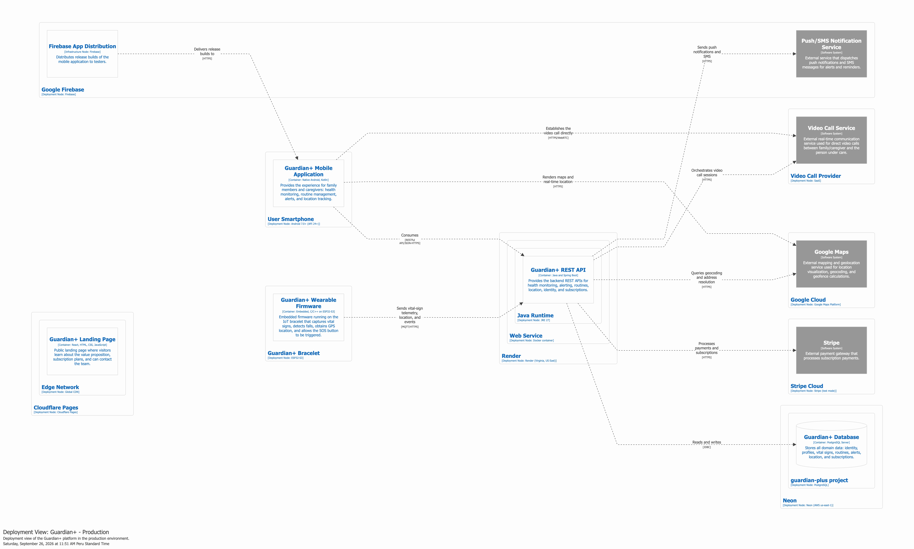

## 4.2. Landing Page & Mobile Application Implementation

En esta sección se documenta la implementación del Landing Page, la aplicación móvil y los Web Services de Guardian+ organizada por Sprint, con la planificación, el backlog y las evidencias presentadas en cada Sprint Review.

### 4.2.1. Sprint 1

En esta sección se documenta el Sprint 1 de Guardian+: su planificación, la distribución de responsabilidades, el Sprint Backlog, las evidencias de desarrollo, pruebas, ejecución, documentación de servicios y despliegue presentadas en el Sprint Review, y los insights de colaboración del equipo.

#### 4.2.1.1. Sprint Planning 1

El Sprint 1 constituye el primer Sprint de implementación de Guardian+ y se ejecuta entre el 7 y el 27 de septiembre de 2026. Su planificación se realizó en una reunión sincrónica del equipo al inicio del Sprint, en la que se revisó el Product Backlog priorizado de la sección 2.4.3, se acordó la capacidad de trabajo del equipo y se seleccionaron las User Stories que componen el alcance comprometido.

El criterio de selección combinó dos referencias. La primera es la prioridad de negocio establecida en el Product Backlog, que sitúa en los primeros lugares las historias de detección y respuesta ante emergencias por constituir la propuesta de valor central del producto. La segunda es el alcance esperado para el Stage Review de la semana 7, que requiere la Landing Page desplegada, el backend desplegado al 70% y las pantallas core de la aplicación en funcionamiento. De la intersección de ambas resulta el alcance comprometido: el circuito completo de emergencia —desde la pulsera hasta el teléfono del contacto de auxilio—, la geolocalización en tiempo real y la totalidad de las historias de la Landing Page.

Las pantallas core que se habilitan en este Sprint son, en consecuencia, las del circuito de emergencia: *Inicio*, con el estado general de la persona bajo cuidado; *Alertas*, con las alertas activas, el detalle del incidente y la configuración de contactos; y *Ubicación*, con la posición en tiempo real. Las pantallas de *Salud* y *Rutinas* dependen de historias planificadas para los Sprints siguientes. El siguiente cuadro resume los acuerdos de la reunión de planificación. La Tabla 4.29 resume la planificación del Sprint 1.

<a id="tabla-4-29"></a>**Tabla 4.29.** Sprint Planning del Sprint 1

| Sprint # | Sprint 1 |
|---|---|
| **Sprint Planning Background** | |
| Date | 2026-09-27 |
| Time | 07:00 PM |
| Location | Reunión virtual mediante Discord, en el canal de voz del equipo. |
| Prepared By | Equipo Healthify — Guardian+ |
| Attendees (to planning meeting) | Azama Fukuda, Juan Pablo / Lopez Monroy, Rodrigo Alfredo / Luis Miranda, Diego Andres / Mechan Montenegro, Luciana Carolina / Sanchez Cuadrado, Juan Antonio |
| Sprint 0 Review Summary | No aplica. El Sprint 1 es el primer Sprint de implementación del proyecto, por lo que no existe un Sprint previo del cual reportar resultados de software. El antecedente inmediato es el hito AV1, en el que se entregaron los Capítulos I y II del informe: el análisis de los segmentos objetivo, el Product Backlog con 33 User Stories estimadas en Story Points y el diseño estratégico del dominio con sus cinco Bounded Contexts. Esos artefactos constituyen la línea base sobre la que se planifica este Sprint. |
| Sprint 0 Retrospective Summary | No aplica por la misma razón. En su lugar, el equipo estableció en esta reunión los acuerdos de trabajo que regirán el Sprint: la estrategia de ramificación GitFlow y las convenciones de nomenclatura de ramas definidas en la sección 4.1.2.1, el uso de Conventional Commits, la obligatoriedad de revisión por Pull Request antes de integrar a `develop` y el registro del avance de cada tarea en el tablero de ClickUp. |
| **Sprint Goal & User Stories** | |
| Sprint 1 Goal | *Our focus is on letting a family reach Guardian+ and be warned in time: a person interested in the service can find it, understand it and choose a plan on their own, and a family that already uses it is warned on the phone when the person under their care suffers a fall or asks for help, wherever they are.*<br><br>*We believe it delivers to families and caregivers the peace of mind of knowing that a critical event will not go unnoticed during their absence, which is the reason they hire the service.*<br><br>*This will be confirmed when an interested visitor completes on their own the path from discovering Guardian+ to requesting information or choosing a plan, and when a fall or an SOS raised on the wrist of the person under care reaches their family's phone, is acknowledged from it, and is passed on to another contact of the care circle if nobody answers.*<br><br>**Métrica de cumplimiento:** un visitante recorre la Landing Page pública y envía una solicitud de contacto o selecciona un plan sin asistencia; una caída detectada o una activación del botón SOS llega al teléfono del contacto primario en menos de 5 segundos desde su detección (US08) y se escala a los contactos secundarios transcurridos 60 segundos sin reconocimiento (US11); el familiar reconoce la alerta y consulta la ubicación de la persona bajo cuidado desde la aplicación; y las 10 User Stories del alcance quedan verificadas contra sus criterios de aceptación (39 Story Points completados). |
| Sprint 1 Velocity | 40 Story Points. Corresponde a la capacidad estimada del equipo de cinco integrantes para un Sprint de tres semanas, calculada sobre una dedicación promedio de ocho horas semanales por integrante. Al ser el primer Sprint, este valor es una estimación inicial que será ajustada en la planificación del Sprint 2 con la velocidad real observada. |
| Sum of Story Points | 39 Story Points. |

Las User Stories que conforman el alcance comprometido del Sprint 1 son las siguientes, tomadas del Product Backlog en su orden de prioridad, como se presenta en la Tabla 4.30:

<a id="tabla-4-30"></a>**Tabla 4.30.** User Stories comprometidas en el Sprint 1

| # Orden | User Story Id | Título | Story Points | Bounded Context / Producto |
|---|---|---|---|---|
| 1 | US15 | Activación de auxilio mediante botón SOS en pulsera | 5 | Emergency & Alerting |
| 2 | US08 | Detección automática de caídas y despacho de emergencia | 8 | Emergency & Alerting |
| 3 | US09 | Generación de alertas por transgresión de umbrales biomédicos | 5 | Emergency & Alerting |
| 4 | US11 | Escalamiento automatizado de alertas críticas no atendidas | 5 | Emergency & Alerting |
| 5 | US16 | Administración de agenda de contactos de auxilio | 2 | Emergency & Alerting |
| 6 | US18 | Telemetría de geolocalización en tiempo real | 5 | Mobility & Geofencing |
| 7 | US30 | Navegación entre secciones informativas de la Landing Page | 1 | Landing Page |
| 8 | US31 | Presentación de características y beneficios clave del sistema | 2 | Landing Page |
| 9 | US32 | Captura y procesamiento de solicitudes de contacto institucional | 3 | Landing Page |
| 10 | US33 | Visualización comparativa de planes de suscripción Guardian+ | 3 | Landing Page |
| | | **Total** | **39** | |

La suma de 39 Story Points se ubica por debajo de la velocidad establecida de 40, dejando un margen deliberado para las tareas de configuración inicial del entorno de desarrollo, del repositorio y del despliegue descritas en la sección 4.1, que el equipo debe completar durante este primer Sprint y que no están representadas como User Stories en el Product Backlog.

#### 4.2.1.2. Aspect Leaders and Collaborators

Para el Sprint 1 el equipo organizó el trabajo en ocho aspectos: el **UX/UI Design**, que comprende la guía de estilos, la arquitectura de información, los wireframes y los mock-ups; los Bounded Contexts **Health Monitoring**, **Emergency & Alerting**, **Mobility & Geofencing**, **Care Routines & Wellness**, **IAM** y **Profile & Subscriptions**; y el **Testing**, con las pruebas unitarias, de integración y de aceptación del Sprint.

La Leadership-and-Collaboration Matrix (LACX) de la Tabla 4.31 indica el líder (L) y los colaboradores (C) de cada aspecto.

<a id="tabla-4-31"></a>**Tabla 4.31.** Leadership-and-Collaboration Matrix del Sprint 1

| Team Member (Last Name, First Name) | GitHub Username | UX/UI Design | Health Monitoring | Emergency & Alerting | Mobility & Geofencing | Care Routines & Wellness | IAM | Profile & Subscriptions | Testing |
|---|---|---|---|---|---|---|---|---|---|
| Azama Fukuda, Juan Pablo | Llummo | L | L | C | C | C | L | C | C |
| Mechan Montenegro, Luciana Carolina | luuu6 | C | C | C | C | L | C | C | C |
| Luis Miranda, Diego Andres | Andrewdmr | C | C | C | L | C | C | C | C |
| López Monroy, Rodrigo Alfredo | rodrigolopezu | C | C | L | C | C | C | C | C |
| Sanchez Cuadrado, Juan Antonio | JuanASC05 | C | C | C | C | C | C | L | L |

#### 4.2.1.3. Sprint Backlog 1

El objetivo del Sprint 1 es que una persona interesada pueda conocer Guardian+ desde la Landing Page y que una familia que ya usa el servicio reciba en su teléfono las alertas de caída o SOS de la persona bajo cuidado. Para lograrlo, el equipo organizó el trabajo del Sprint en ClickUp, distribuyendo las tareas de diseño, configuración, implementación y documentación entre los integrantes.

El tablero del Sprint 1 está disponible en el siguiente enlace: [Sprint Backlog 1 — Guardian+](https://sharing.clickup.com/9013201240/b/h/6-1400350000000524-2/1612e210bce4708) Las Figuras 4.2 y 4.3 muestran el tablero.

<a id="figura-4-2"></a>**Figura 4.2.** Tablero del Sprint 1 en ClickUp (parte 1)

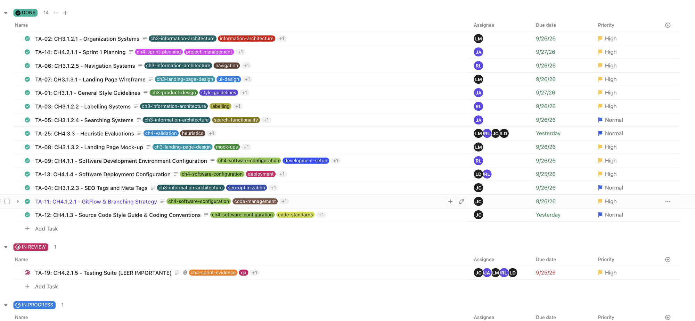

<a id="figura-4-3"></a>**Figura 4.3.** Tablero del Sprint 1 en ClickUp (parte 2)

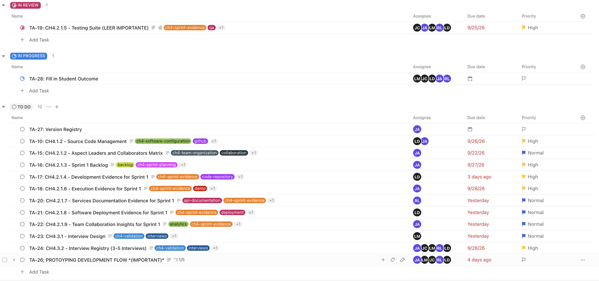

La Tabla 4.32 detalla las tareas del Sprint 1 y su estado.

<a id="tabla-4-32"></a>**Tabla 4.32.** Sprint Backlog 1

| Sprint # | Sprint 1 | | | | | | |
|---|---|---|---|---|---|---|---|
| **User Story Id** | **User Story Title** | **Work-Item / Task Id** | **Work-Item / Task Title** | **Description** | **Estimation (Hours)** | **Assigned To** | **Status** |
| — | — | TA-01 | General Style Guidelines | Definir la guía de estilos general: branding, tipografía, colores, espaciado y tono de comunicación. | 6 | Azama Fukuda, Juan Pablo | Done |
| — | — | TA-02 | Organization Systems | Documentar los sistemas de organización del contenido de la Landing Page y la aplicación. | 3 | Mechan Montenegro, Luciana Carolina | Done |
| — | — | TA-03 | Labelling Systems | Definir las etiquetas de las secciones y opciones de la Landing Page y la aplicación. | 3 | Lopez Monroy, Rodrigo Alfredo | Done |
| — | — | TA-04 | SEO Tags and Meta Tags | Definir los meta tags de la Landing Page y los metadatos de la aplicación para tiendas. | 2 | Sanchez Cuadrado, Juan Antonio | Done |
| — | — | TA-05 | Searching Systems | Documentar las opciones de búsqueda y filtrado de la aplicación. | 3 | Azama Fukuda, Juan Pablo | Done |
| — | — | TA-06 | Navigation Systems | Documentar la navegación entre secciones de la Landing Page y pantallas de la aplicación. | 3 | Lopez Monroy, Rodrigo Alfredo | Done |
| — | — | TA-07 | Landing Page Wireframe | Diseñar los wireframes de la Landing Page para escritorio y móvil. | 5 | Mechan Montenegro, Luciana Carolina | Done |
| — | — | TA-08 | Landing Page Mock-up | Diseñar los mock-ups de la Landing Page aplicando la guía de estilos. | 6 | Mechan Montenegro, Luciana Carolina | Done |
| — | — | TA-09 | Software Development Environment Configuration | Documentar las herramientas y el entorno de desarrollo del proyecto. | 3 | Lopez Monroy, Rodrigo Alfredo | Done |
| — | — | TA-10 | Source Code Management | Configurar los repositorios en GitHub y documentar su gestión. | 2 | Luis Miranda, Diego Andres / Azama Fukuda, Juan Pablo | To-do |
| — | — | TA-11 | GitFlow & Branching Strategy | Definir la estrategia GitFlow y las convenciones de ramas y commits. | 2 | Sanchez Cuadrado, Juan Antonio | Done |
| — | — | TA-12 | Source Code Style Guide & Coding Conventions | Definir las guías de estilo y convenciones de código por lenguaje. | 3 | Sanchez Cuadrado, Juan Antonio | Done |
| — | — | TA-13 | Software Deployment Configuration | Configurar y documentar el despliegue de la Landing Page y los Web Services. | 4 | Luis Miranda, Diego Andres / Lopez Monroy, Rodrigo Alfredo | Done |
| — | — | TA-14 | Sprint 1 Planning | Elaborar el Sprint Planning con el objetivo, la velocidad y las User Stories del Sprint. | 3 | Azama Fukuda, Juan Pablo | Done |
| — | — | TA-15 | Aspect Leaders and Collaborators Matrix | Elaborar la matriz de líderes y colaboradores por aspecto del Sprint. | 1 | Azama Fukuda, Juan Pablo | To-do |
| — | — | TA-16 | Sprint 1 Backlog | Elaborar el Sprint Backlog con el tablero y la tabla de tareas del Sprint. | 2 | Azama Fukuda, Juan Pablo | To-do |
| — | — | TA-17 | Development Evidence for Sprint 1 | Registrar los commits de implementación de cada repositorio. | 2 | Luis Miranda, Diego Andres | To-do |
| — | — | TA-18 | Execution Evidence for Sprint 1 | Registrar capturas y video de las funcionalidades implementadas. | 3 | Azama Fukuda, Juan Pablo | To-do |
| — | — | TA-19 | Testing Suite | Implementar las pruebas unitarias, de integración y de aceptación del Sprint. | 8 | Sanchez Cuadrado, Juan Antonio / Azama Fukuda, Juan Pablo / Mechan Montenegro, Luciana Carolina / Lopez Monroy, Rodrigo Alfredo / Luis Miranda, Diego Andres | To-Review |
| — | — | TA-20 | Services Documentation Evidence for Sprint 1 | Documentar los endpoints de los Web Services con OpenAPI. | 3 | Lopez Monroy, Rodrigo Alfredo | To-do |
| — | — | TA-21 | Software Deployment Evidence for Sprint 1 | Registrar la evidencia del despliegue de la Landing Page y los Web Services. | 2 | Luis Miranda, Diego Andres | To-do |
| — | — | TA-22 | Team Collaboration Insights for Sprint 1 | Registrar las analíticas de colaboración de los repositorios. | 1 | Azama Fukuda, Juan Pablo | To-do |
| — | — | TA-23 | Interview Design | Elaborar el guion de entrevistas de validación. | 2 | Mechan Montenegro, Luciana Carolina | To-do |
| — | — | TA-24 | Interview Registry | Realizar y registrar entre 3 y 5 entrevistas de validación. | 5 | Azama Fukuda, Juan Pablo / Sanchez Cuadrado, Juan Antonio / Mechan Montenegro, Luciana Carolina / Lopez Monroy, Rodrigo Alfredo / Luis Miranda, Diego Andres | To-do |
| — | — | TA-25 | Heuristic Evaluations | Evaluar la usabilidad de la Landing Page y la aplicación con principios heurísticos. | 4 | Mechan Montenegro, Luciana Carolina / Lopez Monroy, Rodrigo Alfredo / Sanchez Cuadrado, Juan Antonio / Luis Miranda, Diego Andres | Done |
| — | — | TA-26 | Prototyping Development Flow | Diseñar los flujos, wireframes y mock-ups de la aplicación por Bounded Context. | 10 | Azama Fukuda, Juan Pablo / Mechan Montenegro, Luciana Carolina / Sanchez Cuadrado, Juan Antonio / Lopez Monroy, Rodrigo Alfredo / Luis Miranda, Diego Andres | To-do |
| — | — | TA-27 | Version Registry | Registrar las versiones del informe y sus cambios. | 1 | Azama Fukuda, Juan Pablo | To-do |
| — | — | TA-28 | Fill in Student Outcome | Completar la sección de Student Outcome del informe. | 2 | Mechan Montenegro, Luciana Carolina / Sanchez Cuadrado, Juan Antonio / Luis Miranda, Diego Andres / Azama Fukuda, Juan Pablo / Lopez Monroy, Rodrigo Alfredo | In-Process |

#### 4.2.1.4. Development Evidence for Sprint Review

En esta sección se registran los commits que implementan las User Stories del Sprint 1 en cada repositorio.

##### Landing Page

Implementación del Landing Page de Guardian+ (US30, US31, US32 y US33): navegación entre secciones, presentación de las funcionalidades y beneficios, comparación de planes de suscripción y formulario de contacto, a partir de los tokens de diseño de las Style Guidelines. Se integró a `develop` mediante el Pull Request [#1](https://github.com/upc-pre-202620-1asi0238-13980-Healthify/guardian-plus-website/pull/1) y se publicó como versión 1.0.0. La Tabla 4.33 presenta los commits del Landing Page.

<a id="tabla-4-33"></a>**Tabla 4.33.** Commits del Landing Page

| Repository | Branch | Commit Id | Commit Message | Committed on |
|---|---|---|---|---|
| [guardian-plus-website](https://github.com/upc-pre-202620-1asi0238-13980-Healthify/guardian-plus-website) | `feat/landing-page-first-iteration` | `afa00cc` | `feat(styles): add design tokens and base styles from the style guidelines` | 2026-09-28 |
| [guardian-plus-website](https://github.com/upc-pre-202620-1asi0238-13980-Healthify/guardian-plus-website) | `feat/landing-page-first-iteration` | `c70c557` | `feat(navigation): add sticky header with active section, mobile menu and footer` | 2026-09-28 |
| [guardian-plus-website](https://github.com/upc-pre-202620-1asi0238-13980-Healthify/guardian-plus-website) | `feat/landing-page-first-iteration` | `121bc43` | `feat(landing): add hero, pain points and how it works sections` | 2026-09-28 |
| [guardian-plus-website](https://github.com/upc-pre-202620-1asi0238-13980-Healthify/guardian-plus-website) | `feat/landing-page-first-iteration` | `3b06be6` | `feat(landing): add benefits with expandable details and why guardian+ sections` | 2026-09-28 |
| [guardian-plus-website](https://github.com/upc-pre-202620-1asi0238-13980-Healthify/guardian-plus-website) | `feat/landing-page-first-iteration` | `15c1f4d` | `feat(pricing): add subscription plans comparison` | 2026-09-28 |
| [guardian-plus-website](https://github.com/upc-pre-202620-1asi0238-13980-Healthify/guardian-plus-website) | `feat/landing-page-first-iteration` | `cc3359e` | `feat(contact): add contact form with validation and submission service` | 2026-09-28 |
| [guardian-plus-website](https://github.com/upc-pre-202620-1asi0238-13980-Healthify/guardian-plus-website) | `feat/landing-page-first-iteration` | `556f945` | `test(landing): add tests for navigation, benefits, pricing and contact form` | 2026-09-28 |

##### Web Services — Emergency & Alerting

Implementación del Bounded Context Emergency & Alerting (US08, US09, US11, US15 y US16), integrada a `develop` mediante los Pull Requests [#7](https://github.com/upc-pre-202620-1asi0238-13980-Healthify/guardian-plus-platform/pull/7) y [#6](https://github.com/upc-pre-202620-1asi0238-13980-Healthify/guardian-plus-platform/pull/6). Este último corrige el manejo compartido de solicitudes mal formadas. La Tabla 4.34 presenta los commits de Emergency & Alerting en los Web Services.

<a id="tabla-4-34"></a>**Tabla 4.34.** Commits de Web Services: Emergency & Alerting

| Repository | Branch | Commit Id | Commit Message | Committed on |
|---|---|---|---|---|
| [guardian-plus-platform](https://github.com/upc-pre-202620-1asi0238-13980-Healthify/guardian-plus-platform) | `fix/shared-invalid-request-parameters` | `b49811f` | `fix(shared): return client error statuses for malformed or rejected requests` | 2026-10-01 |
| [guardian-plus-platform](https://github.com/upc-pre-202620-1asi0238-13980-Healthify/guardian-plus-platform) | `feat/emergency-alerting-core-flow` | `6ef2a84` | `feat(emergency-alerting): add domain model, commands, queries and events` | 2026-09-30 |
| [guardian-plus-platform](https://github.com/upc-pre-202620-1asi0238-13980-Healthify/guardian-plus-platform) | `feat/emergency-alerting-core-flow` | `62512c5` | `feat(emergency-alerting): add jpa persistence entities and repositories` | 2026-09-30 |
| [guardian-plus-platform](https://github.com/upc-pre-202620-1asi0238-13980-Healthify/guardian-plus-platform) | `feat/emergency-alerting-core-flow` | `785c9bb` | `feat(emergency-alerting): implement command and query services` | 2026-09-30 |
| [guardian-plus-platform](https://github.com/upc-pre-202620-1asi0238-13980-Healthify/guardian-plus-platform) | `feat/emergency-alerting-core-flow` | `92371b3` | `feat(emergency-alerting): add event handlers, integration events and context facade` | 2026-09-30 |
| [guardian-plus-platform](https://github.com/upc-pre-202620-1asi0238-13980-Healthify/guardian-plus-platform) | `feat/emergency-alerting-core-flow` | `54b5ce7` | `fix(emergency-alerting): retry alert commands that lose an optimistic-lock race` | 2026-10-01 |
| [guardian-plus-platform](https://github.com/upc-pre-202620-1asi0238-13980-Healthify/guardian-plus-platform) | `feat/emergency-alerting-core-flow` | `b704e95` | `feat(emergency-alerting): send alert notifications through channel adapters` | 2026-10-01 |
| [guardian-plus-platform](https://github.com/upc-pre-202620-1asi0238-13980-Healthify/guardian-plus-platform) | `feat/emergency-alerting-core-flow` | `05d11e7` | `feat(emergency-alerting): add fall confirmation and acknowledgement timeout schedulers` | 2026-10-01 |
| [guardian-plus-platform](https://github.com/upc-pre-202620-1asi0238-13980-Healthify/guardian-plus-platform) | `feat/emergency-alerting-core-flow` | `849eea9` | `fix(emergency-alerting): keep deliveries in dispatch order and avoid update deadlocks` | 2026-10-01 |
| [guardian-plus-platform](https://github.com/upc-pre-202620-1asi0238-13980-Healthify/guardian-plus-platform) | `feat/emergency-alerting-core-flow` | `7df392d` | `feat(emergency-alerting): add rest controllers, resources and assemblers` | 2026-10-01 |
| [guardian-plus-platform](https://github.com/upc-pre-202620-1asi0238-13980-Healthify/guardian-plus-platform) | `feat/emergency-alerting-core-flow` | `e19fb0a` | `docs(readme): document emergency and alerting bounded context` | 2026-10-01 |

##### Web Services — Care Routines & Wellness

Implementación anticipada del Bounded Context Care Routines & Wellness (US06, US13, US14, US17, US26, US27 y US29), correspondiente a la épica EP02, planificada para Sprints posteriores. Se integró a `develop` mediante los Pull Requests [#3](https://github.com/upc-pre-202620-1asi0238-13980-Healthify/guardian-plus-platform/pull/3) y [#5](https://github.com/upc-pre-202620-1asi0238-13980-Healthify/guardian-plus-platform/pull/5). La Tabla 4.35 presenta los commits de Care Routines & Wellness en los Web Services.

<a id="tabla-4-35"></a>**Tabla 4.35.** Commits de Web Services: Care Routines & Wellness

| Repository | Branch | Commit Id | Commit Message | Committed on |
|---|---|---|---|---|
| [guardian-plus-platform](https://github.com/upc-pre-202620-1asi0238-13980-Healthify/guardian-plus-platform) | `feat/care-routines-and-wellness` | `6ce3850` | `feat(care-routines-wellness): add domain model, commands and queries` | 2026-09-29 |
| [guardian-plus-platform](https://github.com/upc-pre-202620-1asi0238-13980-Healthify/guardian-plus-platform) | `feat/care-routines-and-wellness` | `c06a556` | `feat(care-routines-wellness): implement command and query services` | 2026-09-29 |
| [guardian-plus-platform](https://github.com/upc-pre-202620-1asi0238-13980-Healthify/guardian-plus-platform) | `feat/care-routines-and-wellness` | `dcd1955` | `feat(care-routines-wellness): add jpa repositories` | 2026-09-29 |
| [guardian-plus-platform](https://github.com/upc-pre-202620-1asi0238-13980-Healthify/guardian-plus-platform) | `feat/care-routines-and-wellness` | `1ac4bfb` | `feat(care-routines-wellness): add rest controllers, resources and assemblers` | 2026-09-29 |
| [guardian-plus-platform](https://github.com/upc-pre-202620-1asi0238-13980-Healthify/guardian-plus-platform) | `refactor/pluralize-medication-stock-endpoint` | `ce653fc` | `refactor(care-routines-wellness): pluralize medication stock endpoint path` | 2026-09-30 |

##### Web Services — Health Monitoring

Implementación anticipada del Bounded Context Health Monitoring (US01, US02, US03, US04, US05, US07 y US24), correspondiente a la épica EP01, planificada para Sprints posteriores. Incluye la recepción de la telemetría de signos vitales del simulador IoT por MQTT sobre WebSocket y la generación de alertas ante signos vitales fuera de rango en Emergency & Alerting. Se integró a `develop` mediante los Pull Requests [#12](https://github.com/upc-pre-202620-1asi0238-13980-Healthify/guardian-plus-platform/pull/12) y [#14](https://github.com/upc-pre-202620-1asi0238-13980-Healthify/guardian-plus-platform/pull/14). La Tabla 4.36 presenta los commits de Health Monitoring en los Web Services.

<a id="tabla-4-36"></a>**Tabla 4.36.** Commits de Web Services: Health Monitoring

| Repository | Branch | Commit Id | Commit Message | Committed on |
|---|---|---|---|---|
| [guardian-plus-platform](https://github.com/upc-pre-202620-1asi0238-13980-Healthify/guardian-plus-platform) | `feat/health-monitoring` | `1574326` | `feat(health-monitoring): add value objects` | 2026-10-04 |
| [guardian-plus-platform](https://github.com/upc-pre-202620-1asi0238-13980-Healthify/guardian-plus-platform) | `feat/health-monitoring` | `337093b` | `feat(healthmonitoring): add identifier value objects` | 2026-10-05 |
| [guardian-plus-platform](https://github.com/upc-pre-202620-1asi0238-13980-Healthify/guardian-plus-platform) | `feat/health-monitoring` | `6d50a43` | `feat(healthmonitoring): add measurement value objects` | 2026-10-05 |
| [guardian-plus-platform](https://github.com/upc-pre-202620-1asi0238-13980-Healthify/guardian-plus-platform) | `feat/health-monitoring` | `7ecb740` | `feat(healthmonitoring): add enumeration value objects` | 2026-10-05 |
| [guardian-plus-platform](https://github.com/upc-pre-202620-1asi0238-13980-Healthify/guardian-plus-platform) | `feat/health-monitoring` | `bd78cf3` | `test(healthmonitoring): add value object unit tests` | 2026-10-05 |
| [guardian-plus-platform](https://github.com/upc-pre-202620-1asi0238-13980-Healthify/guardian-plus-platform) | `feat/health-monitoring` | `2208497` | `feat(healthmonitoring): add domain commands` | 2026-10-05 |
| [guardian-plus-platform](https://github.com/upc-pre-202620-1asi0238-13980-Healthify/guardian-plus-platform) | `feat/health-monitoring` | `3a559c1` | `feat(healthmonitoring): add domain queries` | 2026-10-05 |
| [guardian-plus-platform](https://github.com/upc-pre-202620-1asi0238-13980-Healthify/guardian-plus-platform) | `feat/health-monitoring` | `3d4a155` | `feat(healthmonitoring): add domain events` | 2026-10-05 |
| [guardian-plus-platform](https://github.com/upc-pre-202620-1asi0238-13980-Healthify/guardian-plus-platform) | `feat/health-monitoring` | `6120907` | `feat(healthmonitoring): add domain and application guard messages` | 2026-10-05 |
| [guardian-plus-platform](https://github.com/upc-pre-202620-1asi0238-13980-Healthify/guardian-plus-platform) | `feat/health-monitoring` | `93266ec` | `feat(healthmonitoring): add VitalSignThreshold aggregate` | 2026-10-05 |
| [guardian-plus-platform](https://github.com/upc-pre-202620-1asi0238-13980-Healthify/guardian-plus-platform) | `feat/health-monitoring` | `bcdd5a3` | `feat(healthmonitoring): add VitalSign aggregate` | 2026-10-05 |
| [guardian-plus-platform](https://github.com/upc-pre-202620-1asi0238-13980-Healthify/guardian-plus-platform) | `feat/health-monitoring` | `58a06d7` | `feat(healthmonitoring): add WearableDevice aggregate` | 2026-10-05 |
| [guardian-plus-platform](https://github.com/upc-pre-202620-1asi0238-13980-Healthify/guardian-plus-platform) | `feat/health-monitoring` | `cfb089b` | `feat(healthmonitoring): add VitalSignType aggregate` | 2026-10-05 |
| [guardian-plus-platform](https://github.com/upc-pre-202620-1asi0238-13980-Healthify/guardian-plus-platform) | `feat/health-monitoring` | `0d29ec6` | `feat(healthmonitoring): add VitalSignSummary entity` | 2026-10-05 |
| [guardian-plus-platform](https://github.com/upc-pre-202620-1asi0238-13980-Healthify/guardian-plus-platform) | `feat/health-monitoring` | `1012bec` | `feat(healthmonitoring): add HealthReport aggregate` | 2026-10-05 |
| [guardian-plus-platform](https://github.com/upc-pre-202620-1asi0238-13980-Healthify/guardian-plus-platform) | `feat/health-monitoring` | `ab9afdf` | `feat(healthmonitoring): add repository ports` | 2026-10-05 |
| [guardian-plus-platform](https://github.com/upc-pre-202620-1asi0238-13980-Healthify/guardian-plus-platform) | `feat/health-monitoring` | `5261388` | `feat(healthmonitoring): add command service contracts` | 2026-10-05 |
| [guardian-plus-platform](https://github.com/upc-pre-202620-1asi0238-13980-Healthify/guardian-plus-platform) | `feat/health-monitoring` | `5797baa` | `feat(healthmonitoring): add query service contracts` | 2026-10-05 |
| [guardian-plus-platform](https://github.com/upc-pre-202620-1asi0238-13980-Healthify/guardian-plus-platform) | `feat/health-monitoring` | `a6cf0c7` | `feat(healthmonitoring): implement vital sign command service` | 2026-10-05 |
| [guardian-plus-platform](https://github.com/upc-pre-202620-1asi0238-13980-Healthify/guardian-plus-platform) | `feat/health-monitoring` | `4634895` | `feat(healthmonitoring): implement vital sign threshold command service` | 2026-10-05 |
| [guardian-plus-platform](https://github.com/upc-pre-202620-1asi0238-13980-Healthify/guardian-plus-platform) | `feat/health-monitoring` | `f3053ad` | `feat(healthmonitoring): implement wearable device command service` | 2026-10-05 |
| [guardian-plus-platform](https://github.com/upc-pre-202620-1asi0238-13980-Healthify/guardian-plus-platform) | `feat/health-monitoring` | `1349495` | `feat(healthmonitoring): implement vital sign type command service` | 2026-10-05 |
| [guardian-plus-platform](https://github.com/upc-pre-202620-1asi0238-13980-Healthify/guardian-plus-platform) | `feat/health-monitoring` | `5952114` | `feat(healthmonitoring): implement health report command service` | 2026-10-05 |
| [guardian-plus-platform](https://github.com/upc-pre-202620-1asi0238-13980-Healthify/guardian-plus-platform) | `feat/health-monitoring` | `57fed00` | `feat(healthmonitoring): implement query services` | 2026-10-05 |
| [guardian-plus-platform](https://github.com/upc-pre-202620-1asi0238-13980-Healthify/guardian-plus-platform) | `feat/health-monitoring` | `04ec377` | `feat(healthmonitoring): add integration events` | 2026-10-05 |
| [guardian-plus-platform](https://github.com/upc-pre-202620-1asi0238-13980-Healthify/guardian-plus-platform) | `feat/health-monitoring` | `8a96b17` | `feat(healthmonitoring): chain detect, emit and evaluate event handlers` | 2026-10-05 |
| [guardian-plus-platform](https://github.com/upc-pre-202620-1asi0238-13980-Healthify/guardian-plus-platform) | `feat/health-monitoring` | `c1b1f6f` | `feat(healthmonitoring): add tolerance rule event handler` | 2026-10-05 |
| [guardian-plus-platform](https://github.com/upc-pre-202620-1asi0238-13980-Healthify/guardian-plus-platform) | `feat/health-monitoring` | `fc3a5fb` | `feat(healthmonitoring): add weekly summary compiled event handler` | 2026-10-05 |
| [guardian-plus-platform](https://github.com/upc-pre-202620-1asi0238-13980-Healthify/guardian-plus-platform) | `feat/health-monitoring` | `92ef3e5` | `feat(healthmonitoring): add context facade ACL` | 2026-10-05 |
| [guardian-plus-platform](https://github.com/upc-pre-202620-1asi0238-13980-Healthify/guardian-plus-platform) | `feat/health-monitoring` | `2443938` | `test(healthmonitoring): add in-memory test support` | 2026-10-05 |
| [guardian-plus-platform](https://github.com/upc-pre-202620-1asi0238-13980-Healthify/guardian-plus-platform) | `feat/health-monitoring` | `bbc3b5d` | `test(healthmonitoring): add threshold and health report service tests` | 2026-10-05 |
| [guardian-plus-platform](https://github.com/upc-pre-202620-1asi0238-13980-Healthify/guardian-plus-platform) | `feat/health-monitoring` | `191bf5b` | `test(healthmonitoring): add tolerance rule tests` | 2026-10-05 |
| [guardian-plus-platform](https://github.com/upc-pre-202620-1asi0238-13980-Healthify/guardian-plus-platform) | `feat/health-monitoring` | `197e1f4` | `feat(healthmonitoring): add CareRecipientProfileId persistence converter` | 2026-10-05 |
| [guardian-plus-platform](https://github.com/upc-pre-202620-1asi0238-13980-Healthify/guardian-plus-platform) | `feat/health-monitoring` | `bde885a` | `feat(healthmonitoring): add vital sign type persistence` | 2026-10-05 |
| [guardian-plus-platform](https://github.com/upc-pre-202620-1asi0238-13980-Healthify/guardian-plus-platform) | `feat/health-monitoring` | `938b190` | `feat(healthmonitoring): add wearable device persistence` | 2026-10-05 |
| [guardian-plus-platform](https://github.com/upc-pre-202620-1asi0238-13980-Healthify/guardian-plus-platform) | `feat/health-monitoring` | `c4c4f00` | `feat(healthmonitoring): add vital sign threshold persistence` | 2026-10-05 |
| [guardian-plus-platform](https://github.com/upc-pre-202620-1asi0238-13980-Healthify/guardian-plus-platform) | `feat/health-monitoring` | `4e8cbcf` | `feat(healthmonitoring): add vital sign reading persistence` | 2026-10-05 |
| [guardian-plus-platform](https://github.com/upc-pre-202620-1asi0238-13980-Healthify/guardian-plus-platform) | `feat/health-monitoring` | `77220e3` | `feat(healthmonitoring): add health report persistence` | 2026-10-05 |
| [guardian-plus-platform](https://github.com/upc-pre-202620-1asi0238-13980-Healthify/guardian-plus-platform) | `feat/health-monitoring` | `901e6c3` | `feat(healthmonitoring): add weekly health summary scheduler` | 2026-10-05 |
| [guardian-plus-platform](https://github.com/upc-pre-202620-1asi0238-13980-Healthify/guardian-plus-platform) | `feat/health-monitoring` | `20d8f9d` | `feat(healthmonitoring): seed the vital sign type catalog` | 2026-10-05 |
| [guardian-plus-platform](https://github.com/upc-pre-202620-1asi0238-13980-Healthify/guardian-plus-platform) | `feat/health-monitoring` | `e819129` | `chore(healthmonitoring): add configuration properties` | 2026-10-05 |
| [guardian-plus-platform](https://github.com/upc-pre-202620-1asi0238-13980-Healthify/guardian-plus-platform) | `feat/health-monitoring` | `34e0d53` | `feat(healthmonitoring): add not-found error messages` | 2026-10-05 |
| [guardian-plus-platform](https://github.com/upc-pre-202620-1asi0238-13980-Healthify/guardian-plus-platform) | `feat/health-monitoring` | `59cc595` | `feat(healthmonitoring): expose vital sign types REST endpoints` | 2026-10-05 |
| [guardian-plus-platform](https://github.com/upc-pre-202620-1asi0238-13980-Healthify/guardian-plus-platform) | `feat/health-monitoring` | `e3b5722` | `feat(healthmonitoring): expose wearable devices REST endpoints` | 2026-10-05 |
| [guardian-plus-platform](https://github.com/upc-pre-202620-1asi0238-13980-Healthify/guardian-plus-platform) | `feat/health-monitoring` | `599487e` | `feat(healthmonitoring): expose vital sign thresholds REST endpoints` | 2026-10-05 |
| [guardian-plus-platform](https://github.com/upc-pre-202620-1asi0238-13980-Healthify/guardian-plus-platform) | `feat/health-monitoring` | `563b0dd` | `feat(healthmonitoring): expose vital signs REST endpoints` | 2026-10-05 |
| [guardian-plus-platform](https://github.com/upc-pre-202620-1asi0238-13980-Healthify/guardian-plus-platform) | `feat/health-monitoring` | `560176e` | `feat(healthmonitoring): expose health reports REST endpoints` | 2026-10-05 |
| [guardian-plus-platform](https://github.com/upc-pre-202620-1asi0238-13980-Healthify/guardian-plus-platform) | `feat/health-monitoring` | `3eaa733` | `feat(emergencyalerting): raise alerts from vital sign anomalies` | 2026-10-05 |
| [guardian-plus-platform](https://github.com/upc-pre-202620-1asi0238-13980-Healthify/guardian-plus-platform) | `feat/health-monitoring` | `ab6ee82` | `test(healthmonitoring): add REST integration tests` | 2026-10-05 |
| [guardian-plus-platform](https://github.com/upc-pre-202620-1asi0238-13980-Healthify/guardian-plus-platform) | `feat/health-monitoring` | `da873da` | `build: add Cucumber for BDD acceptance tests` | 2026-10-05 |
| [guardian-plus-platform](https://github.com/upc-pre-202620-1asi0238-13980-Healthify/guardian-plus-platform) | `feat/health-monitoring` | `c147b33` | `test(healthmonitoring): add Gherkin acceptance features` | 2026-10-05 |
| [guardian-plus-platform](https://github.com/upc-pre-202620-1asi0238-13980-Healthify/guardian-plus-platform) | `feat/health-monitoring` | `48306d0` | `test(healthmonitoring): add acceptance step definitions and runner` | 2026-10-05 |
| [guardian-plus-platform](https://github.com/upc-pre-202620-1asi0238-13980-Healthify/guardian-plus-platform) | `feat/health-monitoring` | `93a48ce` | `feat(healthmonitoring): add reference range error messages` | 2026-10-05 |
| [guardian-plus-platform](https://github.com/upc-pre-202620-1asi0238-13980-Healthify/guardian-plus-platform) | `feat/health-monitoring` | `6e39410` | `feat(healthmonitoring): add VitalSignRange value object` | 2026-10-05 |
| [guardian-plus-platform](https://github.com/upc-pre-202620-1asi0238-13980-Healthify/guardian-plus-platform) | `feat/health-monitoring` | `d089279` | `feat(healthmonitoring): add reference ranges to vital sign types` | 2026-10-05 |
| [guardian-plus-platform](https://github.com/upc-pre-202620-1asi0238-13980-Healthify/guardian-plus-platform) | `feat/health-monitoring` | `b67c7db` | `feat(healthmonitoring): persist vital sign type reference ranges` | 2026-10-05 |
| [guardian-plus-platform](https://github.com/upc-pre-202620-1asi0238-13980-Healthify/guardian-plus-platform) | `feat/health-monitoring` | `73e0084` | `feat(healthmonitoring): seed vital sign types with reference ranges` | 2026-10-05 |
| [guardian-plus-platform](https://github.com/upc-pre-202620-1asi0238-13980-Healthify/guardian-plus-platform) | `feat/health-monitoring` | `14f8d7d` | `feat(healthmonitoring): evaluate readings against vital sign type ranges` | 2026-10-05 |
| [guardian-plus-platform](https://github.com/upc-pre-202620-1asi0238-13980-Healthify/guardian-plus-platform) | `feat/health-monitoring` | `b98a712` | `feat(healthmonitoring): keep thresholds within physical limits` | 2026-10-05 |
| [guardian-plus-platform](https://github.com/upc-pre-202620-1asi0238-13980-Healthify/guardian-plus-platform) | `feat/health-monitoring` | `a1d5c83` | `feat(healthmonitoring): expose reference ranges in vital sign types endpoints` | 2026-10-05 |
| [guardian-plus-platform](https://github.com/upc-pre-202620-1asi0238-13980-Healthify/guardian-plus-platform) | `feat/health-monitoring` | `296619a` | `test(healthmonitoring): add reference range domain tests` | 2026-10-05 |
| [guardian-plus-platform](https://github.com/upc-pre-202620-1asi0238-13980-Healthify/guardian-plus-platform) | `feat/health-monitoring` | `38c4281` | `test(healthmonitoring): cover reference ranges in service tests` | 2026-10-05 |
| [guardian-plus-platform](https://github.com/upc-pre-202620-1asi0238-13980-Healthify/guardian-plus-platform) | `feat/health-monitoring` | `cee04e4` | `test(healthmonitoring): cover reference ranges in REST integration tests` | 2026-10-05 |
| [guardian-plus-platform](https://github.com/upc-pre-202620-1asi0238-13980-Healthify/guardian-plus-platform) | `feat/health-monitoring` | `cf8bead` | `fix(healthmonitoring): parse acceptance decimals regardless of feature locale` | 2026-10-05 |
| [guardian-plus-platform](https://github.com/upc-pre-202620-1asi0238-13980-Healthify/guardian-plus-platform) | `feat/health-monitoring` | `8ce1043` | `feat(healthmonitoring): add VitalSignType value object with per-type ranges` | 2026-10-05 |
| [guardian-plus-platform](https://github.com/upc-pre-202620-1asi0238-13980-Healthify/guardian-plus-platform) | `feat/health-monitoring` | `367bde8` | `refactor(healthmonitoring): evaluate vital signs against the normal range of their type` | 2026-10-05 |
| [guardian-plus-platform](https://github.com/upc-pre-202620-1asi0238-13980-Healthify/guardian-plus-platform) | `feat/health-monitoring` | `6415fb8` | `feat(healthmonitoring): link wearable devices to care recipients` | 2026-10-05 |
| [guardian-plus-platform](https://github.com/upc-pre-202620-1asi0238-13980-Healthify/guardian-plus-platform) | `feat/health-monitoring` | `14f78d3` | `refactor(healthmonitoring): summarize health reports against type normal ranges` | 2026-10-05 |
| [guardian-plus-platform](https://github.com/upc-pre-202620-1asi0238-13980-Healthify/guardian-plus-platform) | `feat/health-monitoring` | `18d9f94` | `refactor(healthmonitoring): remove the VitalSignThreshold and VitalSignType aggregates` | 2026-10-05 |
| [guardian-plus-platform](https://github.com/upc-pre-202620-1asi0238-13980-Healthify/guardian-plus-platform) | `feat/health-monitoring` | `64a3c38` | `refactor(healthmonitoring): persist the vital sign type as an enum column` | 2026-10-05 |
| [guardian-plus-platform](https://github.com/upc-pre-202620-1asi0238-13980-Healthify/guardian-plus-platform) | `feat/health-monitoring` | `fcc7d61` | `refactor(healthmonitoring): apply the tolerance rule over type normal ranges` | 2026-10-05 |
| [guardian-plus-platform](https://github.com/upc-pre-202620-1asi0238-13980-Healthify/guardian-plus-platform) | `feat/health-monitoring` | `1954ce5` | `refactor(healthmonitoring): expose device linking and vital sign types REST endpoints` | 2026-10-05 |
| [guardian-plus-platform](https://github.com/upc-pre-202620-1asi0238-13980-Healthify/guardian-plus-platform) | `feat/health-monitoring` | `76ef5e7` | `chore(healthmonitoring): update messages and configuration` | 2026-10-05 |
| [guardian-plus-platform](https://github.com/upc-pre-202620-1asi0238-13980-Healthify/guardian-plus-platform) | `feat/health-monitoring` | `bd5d81e` | `test(healthmonitoring): cover VitalSignType and the reworked aggregates` | 2026-10-05 |
| [guardian-plus-platform](https://github.com/upc-pre-202620-1asi0238-13980-Healthify/guardian-plus-platform) | `feat/health-monitoring` | `edfe9af` | `test(healthmonitoring): update service, tolerance rule and test support` | 2026-10-05 |
| [guardian-plus-platform](https://github.com/upc-pre-202620-1asi0238-13980-Healthify/guardian-plus-platform) | `feat/health-monitoring` | `80818e5` | `test(healthmonitoring): update REST integration tests` | 2026-10-05 |
| [guardian-plus-platform](https://github.com/upc-pre-202620-1asi0238-13980-Healthify/guardian-plus-platform) | `feat/health-monitoring` | `3965d2f` | `test(healthmonitoring): evaluate acceptance scenarios against type normal ranges` | 2026-10-05 |
| [guardian-plus-platform](https://github.com/upc-pre-202620-1asi0238-13980-Healthify/guardian-plus-platform) | `feat/iot-connection` | `3e8c09b` | `build: add Eclipse Paho MQTT client for wearable telemetry over WebSocket` | 2026-10-06 |
| [guardian-plus-platform](https://github.com/upc-pre-202620-1asi0238-13980-Healthify/guardian-plus-platform) | `feat/iot-connection` | `fc9dce4` | `feat(healthmonitoring): add get all wearable devices query` | 2026-10-06 |
| [guardian-plus-platform](https://github.com/upc-pre-202620-1asi0238-13980-Healthify/guardian-plus-platform) | `feat/iot-connection` | `fa066c8` | `feat(healthmonitoring): resolve get all wearable devices query` | 2026-10-06 |
| [guardian-plus-platform](https://github.com/upc-pre-202620-1asi0238-13980-Healthify/guardian-plus-platform) | `feat/iot-connection` | `47e97f6` | `feat(healthmonitoring): expose all wearable devices for the IoT simulator` | 2026-10-06 |
| [guardian-plus-platform](https://github.com/upc-pre-202620-1asi0238-13980-Healthify/guardian-plus-platform) | `feat/iot-connection` | `755275b` | `test(healthmonitoring): cover listing all wearable devices` | 2026-10-06 |
| [guardian-plus-platform](https://github.com/upc-pre-202620-1asi0238-13980-Healthify/guardian-plus-platform) | `feat/iot-connection` | `7e8b1c9` | `feat(healthmonitoring): add vital sign telemetry message` | 2026-10-06 |
| [guardian-plus-platform](https://github.com/upc-pre-202620-1asi0238-13980-Healthify/guardian-plus-platform) | `feat/iot-connection` | `0440b59` | `feat(healthmonitoring): assemble detect vital signs command from telemetry message` | 2026-10-06 |
| [guardian-plus-platform](https://github.com/upc-pre-202620-1asi0238-13980-Healthify/guardian-plus-platform) | `feat/iot-connection` | `99aff05` | `feat(healthmonitoring): handle vital sign telemetry messages from the broker` | 2026-10-06 |
| [guardian-plus-platform](https://github.com/upc-pre-202620-1asi0238-13980-Healthify/guardian-plus-platform) | `feat/iot-connection` | `d853ef2` | `feat(healthmonitoring): subscribe to vital sign telemetry over MQTT WebSocket` | 2026-10-06 |
| [guardian-plus-platform](https://github.com/upc-pre-202620-1asi0238-13980-Healthify/guardian-plus-platform) | `feat/iot-connection` | `63e4080` | `feat(healthmonitoring): configure MQTT WebSocket telemetry connection` | 2026-10-06 |
| [guardian-plus-platform](https://github.com/upc-pre-202620-1asi0238-13980-Healthify/guardian-plus-platform) | `feat/iot-connection` | `e2ce6db` | `test(healthmonitoring): cover vital sign telemetry message handling` | 2026-10-06 |
| [guardian-plus-platform](https://github.com/upc-pre-202620-1asi0238-13980-Healthify/guardian-plus-platform) | `feat/iot-connection` | `08f0962` | `build(docker): add mosquitto broker with websocket listener to the dev stack` | 2026-10-06 |
| [guardian-plus-platform](https://github.com/upc-pre-202620-1asi0238-13980-Healthify/guardian-plus-platform) | `feat/iot-connection` | `de5ad3a` | `feat(healthmonitoring): enable vital sign telemetry by default in the dev profile` | 2026-10-06 |
| [guardian-plus-platform](https://github.com/upc-pre-202620-1asi0238-13980-Healthify/guardian-plus-platform) | `feat/iot-connection` | `87c55b3` | `build(docker): run the backend and IoT simulator in the dev stack under the full profile` | 2026-10-06 |
| [guardian-plus-platform](https://github.com/upc-pre-202620-1asi0238-13980-Healthify/guardian-plus-platform) | `feat/iot-connection` | `3bd33dd` | `docs(deploy): document vital sign telemetry settings for production` | 2026-10-06 |
| [guardian-plus-platform](https://github.com/upc-pre-202620-1asi0238-13980-Healthify/guardian-plus-platform) | `feat/iot-connection` | `0d775e0` | `docs(readme): document the local IoT stack and telemetry settings` | 2026-10-06 |

##### Web Services — Mobility & Geofencing

Implementación del Bounded Context Mobility & Geofencing (US18), que recibe la ubicación del wearable, mantiene el seguimiento de la persona bajo cuidado y expone su ubicación actual, su estado y su historial. Incluye de forma anticipada la administración de zonas seguras y la detección de sus violaciones (US28). Se integró a `develop` mediante el Pull Request [#11](https://github.com/upc-pre-202620-1asi0238-13980-Healthify/guardian-plus-platform/pull/11). La Tabla 4.37 presenta los commits de Mobility & Geofencing en los Web Services.

<a id="tabla-4-37"></a>**Tabla 4.37.** Commits de Web Services: Mobility & Geofencing

| Repository | Branch | Commit Id | Commit Message | Committed on |
|---|---|---|---|---|
| [guardian-plus-platform](https://github.com/upc-pre-202620-1asi0238-13980-Healthify/guardian-plus-platform) | `feat/mobility-geofencing-context` | `0856a96` | `feat(mobilitygeofencing): add SafeZone aggregate root` | 2026-10-04 |
| [guardian-plus-platform](https://github.com/upc-pre-202620-1asi0238-13980-Healthify/guardian-plus-platform) | `feat/mobility-geofencing-context` | `6b3cec4` | `refactor(mobilitygeofencing): introduce LocationTracking aggregate root for domain state management` | 2026-10-04 |
| [guardian-plus-platform](https://github.com/upc-pre-202620-1asi0238-13980-Healthify/guardian-plus-platform) | `feat/mobility-geofencing-context` | `7c02fd6` | `refactor(mobilitygeofencing): implement ZoneViolation entity within the domain model` | 2026-10-04 |
| [guardian-plus-platform](https://github.com/upc-pre-202620-1asi0238-13980-Healthify/guardian-plus-platform) | `feat/mobility-geofencing-context` | `12f7df1` | `feat refactor(mobilitygeofencing): implement WearableLocationTransformer to map external telemetry to domain commands` | 2026-10-04 |
| [guardian-plus-platform](https://github.com/upc-pre-202620-1asi0238-13980-Healthify/guardian-plus-platform) | `feat/mobility-geofencing-context` | `f8a2374` | `refactor(mobilitygeofencing): implement database persistence adapter for LocationTracking aggregate` | 2026-10-04 |
| [guardian-plus-platform](https://github.com/upc-pre-202620-1asi0238-13980-Healthify/guardian-plus-platform) | `feat/mobility-geofencing-context` | `ebb4c64` | `feat(mobilitygeofencing): expose controller http metods endpoints for current location, status, and history tracking` | 2026-10-04 |
| [guardian-plus-platform](https://github.com/upc-pre-202620-1asi0238-13980-Healthify/guardian-plus-platform) | `feat/mobility-geofencing-context` | `b25d298` | `feat(mobilitygeofencing): expose REST controller for safe zone CRUD and lifecycle management and feat identifier zone violationID` | 2026-10-04 |

##### Web Services — Profile

Implementación del Bounded Context Profile, que gestiona los perfiles de usuario, los perfiles de las personas bajo cuidado, las relaciones de cuidado y las preferencias de idioma y accesibilidad que utiliza la sección Perfil de la aplicación. Se integró a `develop` mediante el Pull Request [#13](https://github.com/upc-pre-202620-1asi0238-13980-Healthify/guardian-plus-platform/pull/13). La Tabla 4.38 presenta los commits de Profile en los Web Services.

<a id="tabla-4-38"></a>**Tabla 4.38.** Commits de Web Services: Profile

| Repository | Branch | Commit Id | Commit Message | Committed on |
|---|---|---|---|---|
| [guardian-plus-platform](https://github.com/upc-pre-202620-1asi0238-13980-Healthify/guardian-plus-platform) | `feat/profile-bounded-context` | `b447710` | `feat(profile): add user and care recipient domain model` | 2026-10-04 |
| [guardian-plus-platform](https://github.com/upc-pre-202620-1asi0238-13980-Healthify/guardian-plus-platform) | `feat/profile-bounded-context` | `12dd1c1` | `feat(profile): add jpa persistence entities and repositories` | 2026-10-04 |
| [guardian-plus-platform](https://github.com/upc-pre-202620-1asi0238-13980-Healthify/guardian-plus-platform) | `feat/profile-bounded-context` | `399d5a3` | `feat(profile): implement command and query services` | 2026-10-04 |
| [guardian-plus-platform](https://github.com/upc-pre-202620-1asi0238-13980-Healthify/guardian-plus-platform) | `feat/profile-bounded-context` | `1103d1d` | `feat(profile): add care relationship domain model` | 2026-10-04 |
| [guardian-plus-platform](https://github.com/upc-pre-202620-1asi0238-13980-Healthify/guardian-plus-platform) | `feat/profile-bounded-context` | `01ca094` | `feat(profile): add user preferences domain model` | 2026-10-04 |
| [guardian-plus-platform](https://github.com/upc-pre-202620-1asi0238-13980-Healthify/guardian-plus-platform) | `feat/profile-bounded-context` | `251e137` | `feat(profile): add user profile rest endpoints` | 2026-10-04 |
| [guardian-plus-platform](https://github.com/upc-pre-202620-1asi0238-13980-Healthify/guardian-plus-platform) | `feat/profile-bounded-context` | `9e4e959` | `feat(profile): add care relationship rest endpoints` | 2026-10-04 |

##### Mobile App — Emergency & Alerting

Implementación de las pantallas del Bounded Context Emergency & Alerting en la aplicación móvil: alertas activas, detalle de alerta, historial, contactos de emergencia y configuración de alertas, conectadas a los Web Services del mismo contexto (US08, US09, US11, US15 y US16). Se integró a `develop` mediante el Pull Request [#1](https://github.com/upc-pre-202620-1asi0238-13980-Healthify/guardian-plus-mobile-app/pull/1). La Tabla 4.39 presenta los commits de Emergency & Alerting en la aplicación móvil.

<a id="tabla-4-39"></a>**Tabla 4.39.** Commits de Mobile App: Emergency & Alerting

| Repository | Branch | Commit Id | Commit Message | Committed on |
|---|---|---|---|---|
| [guardian-plus-mobile-app](https://github.com/upc-pre-202620-1asi0238-13980-Healthify/guardian-plus-mobile-app) | `feat/emergency-alerting-screens` | `70a7bf9` | `build: add hilt, retrofit, navigation and java time desugaring` | 2026-10-03 |
| [guardian-plus-mobile-app](https://github.com/upc-pre-202620-1asi0238-13980-Healthify/guardian-plus-mobile-app) | `feat/emergency-alerting-screens` | `9ae9f15` | `feat(emergency-alerting): add active alerts and alert detail screens` | 2026-10-03 |
| [guardian-plus-mobile-app](https://github.com/upc-pre-202620-1asi0238-13980-Healthify/guardian-plus-mobile-app) | `feat/emergency-alerting-screens` | `b32bc08` | `feat(emergency-alerting): add alert history screen` | 2026-10-03 |
| [guardian-plus-mobile-app](https://github.com/upc-pre-202620-1asi0238-13980-Healthify/guardian-plus-mobile-app) | `feat/emergency-alerting-screens` | `e2a0e42` | `feat(emergency-alerting): add emergency contacts and alert settings screens` | 2026-10-03 |

##### Mobile App — Health Monitoring

Implementación de la capa de dominio, infraestructura y presentación del Bounded Context Health Monitoring en la aplicación móvil: pantalla de inicio, signos vitales en tiempo real e historial semanal de lecturas. Se integró a `develop` mediante los Pull Requests [#3](https://github.com/upc-pre-202620-1asi0238-13980-Healthify/guardian-plus-mobile-app/pull/3), [#5](https://github.com/upc-pre-202620-1asi0238-13980-Healthify/guardian-plus-mobile-app/pull/5) y [#6](https://github.com/upc-pre-202620-1asi0238-13980-Healthify/guardian-plus-mobile-app/pull/6). La Tabla 4.40 presenta los commits de Health Monitoring en la aplicación móvil.

<a id="tabla-4-40"></a>**Tabla 4.40.** Commits de Mobile App: Health Monitoring

| Repository | Branch | Commit Id | Commit Message | Committed on |
|---|---|---|---|---|
| [guardian-plus-mobile-app](https://github.com/upc-pre-202620-1asi0238-13980-Healthify/guardian-plus-mobile-app) | `feat/health-monitoring` | `16c7b01` | `feat(health-monitoring): add VitalSignType` | 2026-10-05 |
| [guardian-plus-mobile-app](https://github.com/upc-pre-202620-1asi0238-13980-Healthify/guardian-plus-mobile-app) | `feat/health-monitoring` | `e98d424` | `feat(health-monitoring): add core enums` | 2026-10-05 |
| [guardian-plus-mobile-app](https://github.com/upc-pre-202620-1asi0238-13980-Healthify/guardian-plus-mobile-app) | `feat/health-monitoring` | `7950b92` | `feat(health-monitoring): add LiveVitalSign data class` | 2026-10-05 |
| [guardian-plus-mobile-app](https://github.com/upc-pre-202620-1asi0238-13980-Healthify/guardian-plus-mobile-app) | `feat/health-monitoring` | `bc1bf41` | `feat(health-monitoring): add LiveVitalSigns class` | 2026-10-05 |
| [guardian-plus-mobile-app](https://github.com/upc-pre-202620-1asi0238-13980-Healthify/guardian-plus-mobile-app) | `feat/health-monitoring` | `6a11b00` | `feat(health-monitoring): add LiveVitalSigns class` | 2026-10-05 |
| [guardian-plus-mobile-app](https://github.com/upc-pre-202620-1asi0238-13980-Healthify/guardian-plus-mobile-app) | `feat/health-monitoring` | `ebdd8a7` | `feat(health-monitoring): add WearalbeDevice data class` | 2026-10-05 |
| [guardian-plus-mobile-app](https://github.com/upc-pre-202620-1asi0238-13980-Healthify/guardian-plus-mobile-app) | `feat/health-monitoring` | `74d0b55` | `feat(health-monitoring): add domain repositories` | 2026-10-05 |
| [guardian-plus-mobile-app](https://github.com/upc-pre-202620-1asi0238-13980-Healthify/guardian-plus-mobile-app) | `feat/health-monitoring` | `1dea8db` | `feat(health-monitoring): add DTOs, also, moved apiCall.kt to a core/network package` | 2026-10-05 |
| [guardian-plus-mobile-app](https://github.com/upc-pre-202620-1asi0238-13980-Healthify/guardian-plus-mobile-app) | `feat/health-monitoring` | `cc90381` | `feat(health-monitoring): add services and repository implementations` | 2026-10-05 |
| [guardian-plus-mobile-app](https://github.com/upc-pre-202620-1asi0238-13980-Healthify/guardian-plus-mobile-app) | `feat/health-monitoring` | `944de96` | `feat(health-monitoring): add hilt modules` | 2026-10-05 |
| [guardian-plus-mobile-app](https://github.com/upc-pre-202620-1asi0238-13980-Healthify/guardian-plus-mobile-app) | `feat/health-monitoring` | `f2e9bdd` | `feat(health-monitoring): add use cases` | 2026-10-05 |
| [guardian-plus-mobile-app](https://github.com/upc-pre-202620-1asi0238-13980-Healthify/guardian-plus-mobile-app) | `feat/health-monitoring` | `9c39adc` | `feat(health-monitoring): partially added presentation layer` | 2026-10-06 |
| [guardian-plus-mobile-app](https://github.com/upc-pre-202620-1asi0238-13980-Healthify/guardian-plus-mobile-app) | `feat/health-monitoring` | `71824de` | `feat(health-monitoring): add vital sign readings from history` | 2026-10-06 |
| [guardian-plus-mobile-app](https://github.com/upc-pre-202620-1asi0238-13980-Healthify/guardian-plus-mobile-app) | `feat/health-monitoring` | `b1a64c7` | `refactor(health-monitoring): move live vitals state and labels into common package` | 2026-10-06 |
| [guardian-plus-mobile-app](https://github.com/upc-pre-202620-1asi0238-13980-Healthify/guardian-plus-mobile-app) | `feat/health-monitoring` | `76e15d6` | `docs(health-monitoring): add view model and screens guides` | 2026-10-06 |
| [guardian-plus-mobile-app](https://github.com/upc-pre-202620-1asi0238-13980-Healthify/guardian-plus-mobile-app) | `feat/health-monitoring` | `45cba1f` | `fix(health-monitoring): match patch device type name with the platform` | 2026-10-06 |
| [guardian-plus-mobile-app](https://github.com/upc-pre-202620-1asi0238-13980-Healthify/guardian-plus-mobile-app) | `feat/health-monitoring` | `462d59a` | `feat(health-monitoring): add reading badge, value formatting and screen strings` | 2026-10-06 |
| [guardian-plus-mobile-app](https://github.com/upc-pre-202620-1asi0238-13980-Healthify/guardian-plus-mobile-app) | `feat/health-monitoring` | `bec4e2e` | `feat(health-monitoring): track server time and blood pressure in live vitals state` | 2026-10-06 |
| [guardian-plus-mobile-app](https://github.com/upc-pre-202620-1asi0238-13980-Healthify/guardian-plus-mobile-app) | `feat/health-monitoring` | `42c2171` | `feat(health-monitoring): add home screen` | 2026-10-06 |
| [guardian-plus-mobile-app](https://github.com/upc-pre-202620-1asi0238-13980-Healthify/guardian-plus-mobile-app) | `feat/health-monitoring` | `03a9c90` | `feat(health-monitoring): add vital history state and view model` | 2026-10-06 |
| [guardian-plus-mobile-app](https://github.com/upc-pre-202620-1asi0238-13980-Healthify/guardian-plus-mobile-app) | `feat/health-monitoring` | `c954a23` | `feat(health-monitoring): add live vitals screen` | 2026-10-06 |
| [guardian-plus-mobile-app](https://github.com/upc-pre-202620-1asi0238-13980-Healthify/guardian-plus-mobile-app) | `feat/health-monitoring` | `f7f5486` | `feat(health-monitoring): add vital history screen with weekly chart` | 2026-10-06 |
| [guardian-plus-mobile-app](https://github.com/upc-pre-202620-1asi0238-13980-Healthify/guardian-plus-mobile-app) | `feat/health-monitoring` | `badd6fd` | `feat(health-monitoring): add health screen with now and history tabs` | 2026-10-06 |
| [guardian-plus-mobile-app](https://github.com/upc-pre-202620-1asi0238-13980-Healthify/guardian-plus-mobile-app) | `feat/health-monitoring` | `1c4eeb9` | `feat(health-monitoring): wire health monitoring nav graph and open the app on home` | 2026-10-06 |
| [guardian-plus-mobile-app](https://github.com/upc-pre-202620-1asi0238-13980-Healthify/guardian-plus-mobile-app) | `feat/mqtt-connection` | `a185d07` | `chore: simulator connection implemented` | 2026-10-06 |

##### IoT Simulator

Implementación del simulador de la pulsera Guardian+: catálogo de señales y generador con estado por dispositivo, publicación por MQTT en canales por Bounded Context, API HTTP de control y monitoreo, y CLI. La imagen de contenedor del simulador se integró a `main` mediante el Pull Request [#1](https://github.com/upc-pre-202620-1asi0238-13980-Healthify/guardian-plus-iot-simulator/pull/1). La Tabla 4.41 presenta los commits del IoT Simulator.

<a id="tabla-4-41"></a>**Tabla 4.41.** Commits de IoT Simulator

| Repository | Branch | Commit Id | Commit Message | Committed on |
|---|---|---|---|---|
| [guardian-plus-iot-simulator](https://github.com/upc-pre-202620-1asi0238-13980-Healthify/guardian-plus-iot-simulator) | `main` | `e264c53` | `chore: scaffold project structure and dependencies` | 2026-09-27 |
| [guardian-plus-iot-simulator](https://github.com/upc-pre-202620-1asi0238-13980-Healthify/guardian-plus-iot-simulator) | `main` | `db68bde` | `feat(model): add signal catalogue and stateful generator` | 2026-09-27 |
| [guardian-plus-iot-simulator](https://github.com/upc-pre-202620-1asi0238-13980-Healthify/guardian-plus-iot-simulator) | `main` | `259769a` | `feat(interfaces): add MQTT publisher and simulator HTTP API` | 2026-09-27 |
| [guardian-plus-iot-simulator](https://github.com/upc-pre-202620-1asi0238-13980-Healthify/guardian-plus-iot-simulator) | `main` | `c2a8dd1` | `feat(cli): add control and monitoring CLI` | 2026-09-27 |
| [guardian-plus-iot-simulator](https://github.com/upc-pre-202620-1asi0238-13980-Healthify/guardian-plus-iot-simulator) | `main` | `c8d4eb9` | `docs: document signals, thresholds and usage` | 2026-09-27 |
| [guardian-plus-iot-simulator](https://github.com/upc-pre-202620-1asi0238-13980-Healthify/guardian-plus-iot-simulator) | `build/docker-image` | `67eec4a` | `build(docker): add simulator container image` | 2026-10-06 |
| [guardian-plus-iot-simulator](https://github.com/upc-pre-202620-1asi0238-13980-Healthify/guardian-plus-iot-simulator) | `build/docker-image` | `12e0b64` | `feat: simulator functions now` | 2026-10-06 |

#### 4.2.1.5. Testing Suite Evidence for Sprint Review

Durante el presente Sprint se incorporaron pruebas automatizadas como parte del proceso de implementación de los Web Services de Guardian+. El objetivo de estas pruebas es verificar los comportamientos principales de los componentes desarrollados y reducir la posibilidad de introducir errores antes de integrar los cambios hacia las ramas principales del proyecto.

De acuerdo con el alcance del Sprint, que contempla el desarrollo progresivo del backend, las pruebas se implementan de manera incremental junto con las funcionalidades correspondientes a cada Bounded Context.

Para el Bounded Context **Profile** se desarrollaron Unit Tests orientados principalmente a validar los Aggregate Roots del dominio y un Application Service. Las pruebas fueron implementadas utilizando **JUnit Jupiter**, mientras que **Mockito** fue utilizado para aislar dependencias externas en las pruebas de servicios de aplicación.

Las pruebas siguen el patrón **Arrange - Act - Assert (AAA)**:

- **Arrange:** preparación de datos, objetos y dependencias necesarias para ejecutar el escenario.
- **Act:** ejecución de la operación o comportamiento que se desea comprobar.
- **Assert:** verificación de que el resultado obtenido corresponda con el comportamiento esperado.

En el presente avance, la evidencia automatizada desarrollada para Profile corresponde a **Unit Tests**. Los Integration Tests y Acceptance Tests bajo BDD no forman parte todavía de la implementación actual y podrán incorporarse en siguientes incrementos conforme se completen las integraciones entre Bounded Contexts y los flujos funcionales del producto.

##### Unit Tests - Bounded Context Profile

Las pruebas desarrolladas para Profile verifican las principales reglas y comportamientos de los Aggregate Roots `UserProfile`, `CareRecipientProfile`, `CareRelationship` y `UserPreferences`.

Adicionalmente, se incluye una prueba del servicio `UserProfileCommandServiceImpl`, utilizando Mockito para reemplazar temporalmente la implementación del repositorio y verificar el comportamiento del servicio de manera aislada. La Tabla 4.42 resume las pruebas implementadas.

<a id="tabla-4-42"></a>**Tabla 4.42.** Unit Tests del Bounded Context Profile

| Test Class | Class Under Test | Test | Behavior Verified |
|---|---|---|---|
| `UserProfileTest` | `UserProfile` | `shouldCreateUserProfileWithValidData` | Verifica que un perfil de usuario pueda crearse correctamente cuando recibe información válida. |
| `UserProfileTest` | `UserProfile` | `shouldUpdatePersonalInformation` | Verifica la actualización del nombre y apellido del perfil de usuario. |
| `UserProfileTest` | `UserProfile` | `shouldUpdateContactInformation` | Verifica la actualización de la información de contacto asociada al perfil. |
| `UserProfileTest` | `UserProfile` | `shouldRejectBlankPersonalInformation` | Verifica que el Aggregate Root rechace información personal inválida o vacía. |
| `CareRecipientProfileTest` | `CareRecipientProfile` | `shouldCreateCareRecipientProfileWithValidData` | Verifica la creación correcta de un perfil de persona bajo cuidado. |
| `CareRecipientProfileTest` | `CareRecipientProfile` | `shouldUpdatePersonalInformation` | Verifica la actualización de nombres y fecha de nacimiento de la persona bajo cuidado. |
| `CareRecipientProfileTest` | `CareRecipientProfile` | `shouldUpdateProfileImage` | Verifica la actualización de la imagen del perfil de la persona bajo cuidado. |
| `CareRecipientProfileTest` | `CareRecipientProfile` | `shouldRejectNullBirthDate` | Verifica que el Aggregate Root rechace una fecha de nacimiento inválida. |
| `CareRelationshipTest` | `CareRelationship` | `shouldEstablishCareRelationshipWithValidData` | Verifica que una relación de cuidado válida sea creada correctamente con estado `ACTIVE`. |
| `CareRelationshipTest` | `CareRelationship` | `shouldEndActiveCareRelationship` | Verifica la transición de una relación de cuidado desde `ACTIVE` hacia `ENDED`. |
| `CareRelationshipTest` | `CareRelationship` | `shouldRejectEndingRelationshipTwice` | Verifica que una relación que ya fue finalizada no pueda volver a finalizarse. |
| `CareRelationshipTest` | `CareRelationship` | `shouldRejectNullRelationshipType` | Verifica que no pueda establecerse una relación de cuidado sin un tipo válido. |
| `UserPreferencesTest` | `UserPreferences` | `shouldCreateUserPreferencesWithDefaultValues` | Verifica la creación de preferencias con los valores iniciales definidos por Guardian+. |
| `UserPreferencesTest` | `UserPreferences` | `shouldUpdateApplicationPreferences` | Verifica la actualización de las preferencias generales de aplicación. |
| `UserPreferencesTest` | `UserPreferences` | `shouldUpdateLanguageAndAccessibilityPreferences` | Verifica la actualización conjunta de idioma, alto contraste, reducción de movimiento y tamaño de fuente. |
| `UserPreferencesTest` | `UserPreferences` | `shouldRejectNullLanguage` | Verifica que el dominio rechace una actualización cuando no se proporciona un idioma válido. |
| `UserProfileCommandServiceImplTest` | `UserProfileCommandServiceImpl` | `shouldCreateUserProfileWhenUserHasNoProfile` | Verifica que el servicio cree y persista un nuevo perfil cuando el usuario todavía no posee uno. |
| `UserProfileCommandServiceImplTest` | `UserProfileCommandServiceImpl` | `shouldReturnConflictWhenUserAlreadyHasProfile` | Verifica que el servicio retorne un conflicto y no persista un nuevo perfil cuando el usuario ya posee uno. |

##### Domain Unit Tests

Las pruebas `UserProfileTest`, `CareRecipientProfileTest`, `CareRelationshipTest` y `UserPreferencesTest` se ejecutan directamente sobre los Aggregate Roots del Bounded Context Profile.

Estas pruebas no requieren inicializar Spring, una base de datos ni contenedores Docker, debido a que su objetivo es comprobar de manera aislada las reglas propias del dominio.

Entre los principales comportamientos validados se encuentran:

- creación de Aggregate Roots con información válida;
- modificación de información personal;
- actualización de información de contacto;
- actualización de imágenes de perfil;
- control del ciclo de vida de las relaciones de cuidado;
- validación de estados inválidos;
- configuración y modificación de preferencias de usuario;
- validación de parámetros obligatorios.

##### Application Service Unit Test

`UserProfileCommandServiceImplTest` verifica el comportamiento de la capa de aplicación.

En este caso se utiliza **Mockito** debido a que `UserProfileCommandServiceImpl` depende de `UserProfileRepository`.

El repositorio es reemplazado mediante un mock para controlar sus respuestas durante cada escenario de prueba.

Se verifican principalmente dos comportamientos:

- cuando el usuario todavía no posee un perfil, el servicio crea el Aggregate Root y ejecuta la operación de persistencia;
- cuando ya existe un perfil asociado al mismo usuario, el servicio retorna un resultado de conflicto y evita realizar una nueva operación de persistencia.

De esta manera, se comprueba el comportamiento del Application Service sin depender de una base de datos real.

##### Testing Execution Evidence

Los Unit Tests del Bounded Context **Profile** fueron ejecutados mediante Maven.

Para ejecutar únicamente las pruebas correspondientes a Profile se utilizó:

~~~powershell
.\mvnw.cmd "-Dtest=UserProfileTest,CareRecipientProfileTest,CareRelationshipTest,UserPreferencesTest,UserProfileCommandServiceImplTest" test
~~~

La Figura 4.4 muestra la ejecución de las pruebas correspondientes a `UserProfileCommandServiceImplTest`, `CareRecipientProfileTest`, `CareRelationshipTest`, `UserPreferencesTest` y `UserProfileTest`.

<a id="figura-4-4"></a>**Figura 4.4.** Ejecución de los Unit Tests de Profile

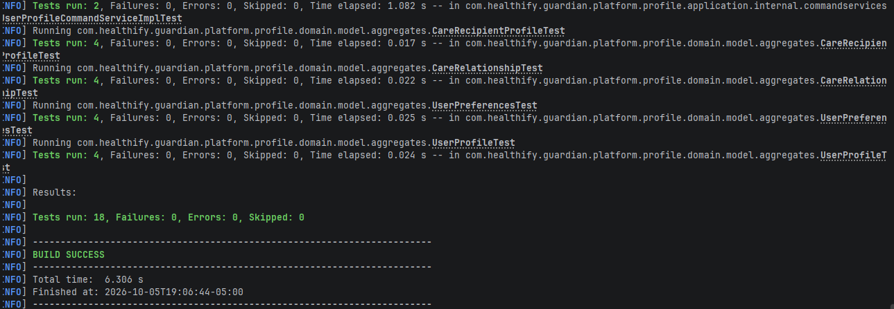

La ejecución comprende un total de **18 Unit Tests** distribuidos entre los cuatro Aggregate Roots principales de Profile y el Application Service `UserProfileCommandServiceImpl`.

Los resultados obtenidos fueron:

- `UserProfileCommandServiceImplTest`: 2 tests ejecutados.
- `CareRecipientProfileTest`: 4 tests ejecutados.
- `CareRelationshipTest`: 4 tests ejecutados.
- `UserPreferencesTest`: 4 tests ejecutados.
- `UserProfileTest`: 4 tests ejecutados.

La ejecución finalizó correctamente con los siguientes resultados:

~~~text
Tests run: 18, Failures: 0, Errors: 0, Skipped: 0
BUILD SUCCESS
~~~

Esto confirma que los Unit Tests implementados para el Bounded Context **Profile** se ejecutan satisfactoriamente y validan los comportamientos definidos tanto en los Aggregate Roots como en el Application Service probado.

##### Integration Tests and Acceptance Tests

Estas pruebas podrán incorporarse en siguientes incrementos cuando se encuentren disponibles las integraciones necesarias entre los diferentes Bounded Contexts y se implementen los flujos funcionales completos correspondientes a los User Stories del producto.


##### Testing Repository

Las pruebas automatizadas de Profile se encuentran dentro del mismo repositorio utilizado para la implementación de los Web Services de Guardian+.

**Repository:**

`upc-pre-202620-1asi0238-13980-Healthify/guardian-plus-platform`

**Branch:**

`feat/profile-bounded-context`

**Testing source path:**

~~~text
src/test/java/com/healthify/guardian/platform/profile
~~~

La estructura principal utilizada para las pruebas es:

~~~text
profile
├── application
│   └── internal
│       └── commandservices
│           └── UserProfileCommandServiceImplTest.java
│
└── domain
    └── model
        └── aggregates
            ├── UserProfileTest.java
            ├── CareRecipientProfileTest.java
            ├── CareRelationshipTest.java
            └── UserPreferencesTest.java
~~~

##### Testing Commits

El commit de la Tabla 4.43 contiene la implementación de los Unit Tests correspondientes al Bounded Context Profile durante el presente Sprint.

<a id="tabla-4-43"></a>**Tabla 4.43.** Commit de los Unit Tests de Profile

| Repository | Branch | Commit Id | Commit Message | Commit Message Body | Committed on (Date) |
|---|---|---|---|---|---|
| `upc-pre-202620-1asi0238-13980-Healthify/guardian-plus-platform` | `feat/profile-bounded-context` | `711c50c` | `test(profile): add unit tests for profile bounded context` | — | `2026-10-03` |

Este commit incorpora las pruebas unitarias correspondientes a los cuatro Aggregate Roots principales de Profile y la prueba del Application Service `UserProfileCommandServiceImpl`.


#### 4.2.1.6. Execution Evidence for Sprint Review

Al cierre del Sprint 1, Guardian+ cuenta con el Landing Page desplegado, con una primera versión de la aplicación móvil y con los Web Services desplegados que esta consume. En el Landing Page se completaron las User Stories US30, US31, US32 y US33: el visitante puede recorrer las secciones del sitio desde el menú, conocer las funcionalidades y beneficios de la pulsera y la aplicación, comparar los planes de suscripción y enviar una solicitud de contacto. En la aplicación móvil se implementaron el inicio de sesión, la pantalla de Inicio, la sección de Salud y la sección de Alertas con sus alertas activas, el detalle de cada alerta, el historial, la configuración de alertas y los contactos de emergencia. Los Web Services exponen los endpoints de Emergency & Alerting, Health Monitoring, Care Routines & Wellness, Mobility & Geofencing y Profile desde su despliegue en Microsoft Azure.

##### Landing Page

El Landing Page se encuentra publicado en [guardian-plus.pages.dev](https://guardian-plus.pages.dev). La Figura 4.5 muestra la sección principal del sitio en su versión de escritorio.

<a id="figura-4-5"></a>**Figura 4.5.** Landing Page en ejecución

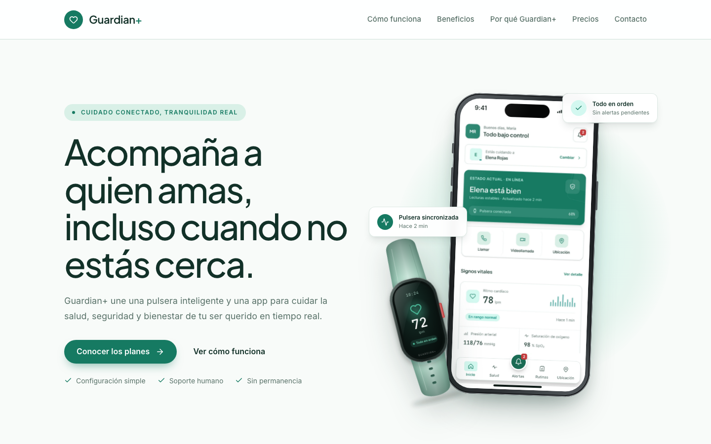

La Tabla 4.44 presenta el enlace al video de ejecución del Landing Page.

<a id="tabla-4-44"></a>**Tabla 4.44.** Video de ejecución del Landing Page

| Producto | Video de ejecución |
|---|---|
| Landing Page | [Guardian+ — Landing Page (Sprint 1)](https://youtu.be/ZqqCONDHst8) |

##### Mobile Application

La Figura 4.6 muestra la pantalla de Inicio de la aplicación móvil ejecutándose en el emulador de Android Studio (Pixel 8, API 37).

<a id="figura-4-6"></a>**Figura 4.6.** Aplicación móvil en ejecución en el emulador

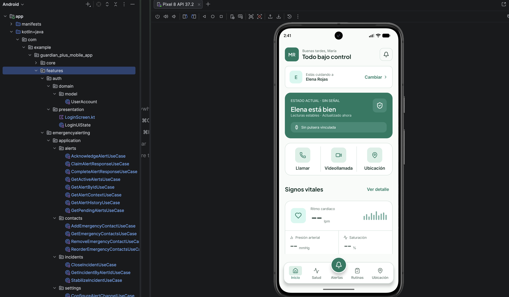

La Tabla 4.45 presenta el enlace al video de ejecución de la aplicación móvil.

<a id="tabla-4-45"></a>**Tabla 4.45.** Video de ejecución de la aplicación móvil

| Producto | Video de ejecución |
|---|---|
| Mobile Application | [Guardian+ — Mobile Application (Sprint 1)](https://www.youtube.com/watch?v=Q-VMpyzhfJM) |

##### Web Services

Los Web Services se encuentran publicados en Microsoft Azure y su documentación puede consultarse en [Swagger UI](https://guardian-plus-api.chilecentral.cloudapp.azure.com/swagger-ui/index.html). La Figura 4.7 muestra los endpoints disponibles en el entorno desplegado.

<a id="figura-4-7"></a>**Figura 4.7.** Web Services en ejecución en Swagger UI

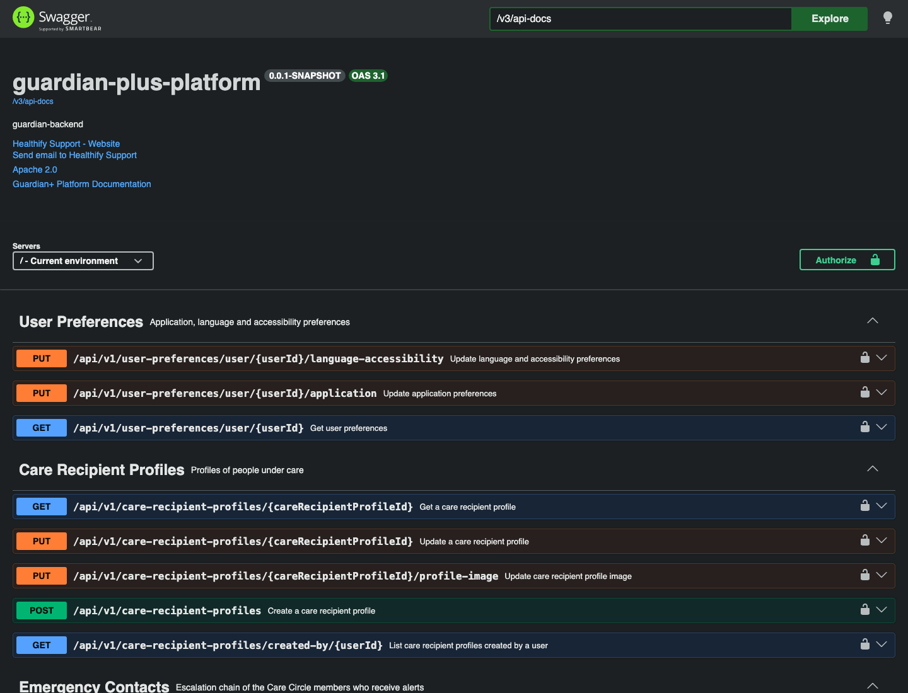

La Tabla 4.46 presenta el enlace al video de ejecución de los Web Services.

<a id="tabla-4-46"></a>**Tabla 4.46.** Video de ejecución de los Web Services

| Producto | Video de ejecución |
|---|---|
| Web Services | [Guardian+ — Web Services (Sprint 1)](https://youtu.be/GIFvYs21GDY) |

#### 4.2.1.7. Services Documentation Evidence for Sprint Review

Los Web Services se documentan con OpenAPI mediante springdoc-openapi. La especificación se publica en `/v3/api-docs` y puede explorarse en Swagger UI (`/swagger-ui/index.html`). Los errores siguen un formato común (`code`, `message`, `details`) con los códigos `400`, `404`, `409` y `422`.

##### Emergency & Alerting

La Tabla 4.47 presenta los endpoints de Emergency & Alerting.

<a id="tabla-4-47"></a>**Tabla 4.47.** Endpoints de Emergency & Alerting

| Verbo | Endpoint | Acción | Parámetros | Respuesta |
|---|---|---|---|---|
| POST | `/api/v1/alerts` | Dispara una alerta de caída o SOS desde el wearable | Body: `careRecipientProfileId`, `sourceType`, `sourceReferenceId` | 201 `AlertResource` |
| GET | `/api/v1/alerts` | Historial paginado | Query: `careRecipientProfileId`, `severity`, `from`, `to`, `page`, `size` | 200 `PageResource` |
| GET | `/api/v1/alerts/active/care-recipient/{careRecipientProfileId}` | Alertas activas de la persona bajo cuidado | Path: `careRecipientProfileId` | 200 lista |
| GET | `/api/v1/alerts/pending/recipient/{userId}` | Alertas pendientes de reconocimiento (canal in-app) | Path: `userId` | 200 lista |
| GET | `/api/v1/alerts/{alertId}` | Detalle con entregas y respuestas | Path: `alertId` | 200 / 404 |
| POST | `/api/v1/alerts/{alertId}/dismiss` | Descarta una caída dentro de los 20 s | Path: `alertId` | 200 / 422 |
| POST | `/api/v1/alerts/{alertId}/acknowledge` | Reconoce la alerta y abre el incidente | Body: `userId` | 200 / 422 |
| POST | `/api/v1/alerts/{alertId}/responses` | Asume la respuesta y avisa al Care Circle | Body: `responderUserId` | 201 / 422 |
| POST | `/api/v1/alerts/{alertId}/responses/{responseId}/complete` | Registra el resultado de la intervención | Body: `notes` | 200 |
| GET | `/api/v1/incidents/{incidentId}` | Detalle del incidente | Path: `incidentId` | 200 / 404 |
| GET | `/api/v1/incidents/alert/{alertId}` | Incidente de una alerta | Path: `alertId` | 200 / 404 |
| POST | `/api/v1/incidents/{incidentId}/stabilize` | Declara estabilizada la situación | Body: `notes` | 200 / 422 |
| POST | `/api/v1/incidents/{incidentId}/close` | Cierra el incidente y resuelve la alerta | Body: `notes` | 200 / 422 |
| GET | `/api/v1/alert-settings/care-recipient/{careRecipientProfileId}` | Configuración de alertamiento | Path: `careRecipientProfileId` | 200 |
| PUT | `/api/v1/alert-settings/care-recipient/{careRecipientProfileId}` | Actualiza tiempo de espera y escalamiento | Body: `primaryAckTimeoutSec`, `escalationEnabled`, `broadcastCriticalImmediately` | 200 / 400 |
| POST / DELETE | `/api/v1/alert-settings/care-recipient/{careRecipientProfileId}/silent-mode` | Activa o desactiva el modo silencioso | Path: `careRecipientProfileId` | 200 |
| GET | `/api/v1/emergency-contacts/care-recipient/{careRecipientProfileId}` | Contactos de emergencia por prioridad | Path: `careRecipientProfileId` | 200 lista |
| POST | `/api/v1/emergency-contacts` | Registra un contacto de emergencia | Body: `careRecipientProfileId`, `userId`, `displayName`, `relationship`, `phoneNumber`, `priorityOrder` | 201 / 400 / 409 |
| PUT | `/api/v1/emergency-contacts/care-recipient/{careRecipientProfileId}/order` | Reordena las prioridades | Body: `orderedEmergencyContactIds` | 200 / 400 |
| DELETE | `/api/v1/emergency-contacts/{emergencyContactId}` | Da de baja un contacto | Path: `emergencyContactId` | 200 / 422 |
| GET | `/api/v1/alert-channel-settings/user/{userId}` | Canales de notificación del usuario | Path: `userId` | 200 lista |
| PUT | `/api/v1/alert-channel-settings/user/{userId}/channels/{channel}` | Habilita o deshabilita un canal | Body: `enabled`, `deviceToken` | 200 / 422 |
| POST | `/api/v1/webhooks/notification-deliveries` | Resultado de una entrega informado por el proveedor | Body: `alertId`, `deliveryId`, `status` | 204 / 404 |

##### Health Monitoring

La Tabla 4.48 presenta los endpoints de Health Monitoring.

<a id="tabla-4-48"></a>**Tabla 4.48.** Endpoints de Health Monitoring

| Verbo | Endpoint | Acción | Parámetros | Respuesta |
|---|---|---|---|---|
| POST | `/api/v1/vital-signs` | Registra una lectura enviada por el wearable y evalúa su rango normal | Body: `wearableDeviceId`, `careRecipientProfileId`, `vitalSignType`, `value`, `measuredAt` | 201 `VitalSignResource` / 400 / 404 / 409 / 422 |
| POST | `/api/v1/vital-signs/batches` | Sincroniza las lecturas almacenadas por el wearable sin conexión | Body: `readings` | 202 `TelemetryBatchResultResource` / 400 / 422 |
| POST | `/api/v1/vital-signs/{vitalSignId}/emit` | Reemite una lectura para la vista en vivo | Path: `vitalSignId` | 200 / 404 / 422 |
| GET | `/api/v1/vital-signs/{vitalSignId}` | Detalle de una lectura | Path: `vitalSignId` | 200 / 404 |
| GET | `/api/v1/vital-signs/live/{careRecipientProfileId}` | Última lectura de cada signo vital con su clasificación | Path: `careRecipientProfileId` | 200 `LiveVitalSignsResource` |
| GET | `/api/v1/vital-signs/history/{careRecipientProfileId}` | Historial de lecturas en un periodo | Path: `careRecipientProfileId`; Query: `from`, `to` | 200 lista / 400 |
| GET | `/api/v1/vital-sign-types` | Tipos de signo vital con rango normal y límites físicos | - | 200 lista |
| POST | `/api/v1/wearable-devices` | Vincula un wearable a la persona bajo cuidado | Body: `careRecipientProfileId`, `serialNumber`, `deviceType` | 201 / 400 / 409 |
| GET | `/api/v1/wearable-devices` | Lista todos los wearables vinculados | - | 200 lista |
| GET | `/api/v1/wearable-devices/care-recipient/{careRecipientProfileId}` | Wearables de la persona bajo cuidado | Path: `careRecipientProfileId` | 200 lista |
| POST | `/api/v1/health-reports` | Genera un reporte de salud del periodo indicado | Body: `careRecipientProfileId`, `generatedByUserId`, `periodStart`, `periodEnd` | 201 `HealthReportResource` / 400 / 422 |
| GET | `/api/v1/health-reports/{reportId}` | Detalle de un reporte de salud | Path: `reportId` | 200 / 404 |
| GET | `/api/v1/health-reports/care-recipient/{careRecipientProfileId}` | Reportes de la persona bajo cuidado, del más reciente al más antiguo | Path: `careRecipientProfileId` | 200 lista |

##### Care Routines & Wellness

La Tabla 4.49 presenta los endpoints de Care Routines & Wellness.

<a id="tabla-4-49"></a>**Tabla 4.49.** Endpoints de Care Routines & Wellness

| Verbo | Endpoint | Acción | Parámetros | Respuesta |
|---|---|---|---|---|
| POST | `/api/v1/reminders` | Programa un recordatorio de medicación, cita, actividad física o hidratación | Body: `personUnderCareId`, `type`, `scheduledTime` | 201 `ReminderResource` / 400 |
| PUT | `/api/v1/reminders/{reminderId}/confirm` | Confirma un recordatorio emitido o reemitido | Path: `reminderId` | 200 / 404 / 422 |
| DELETE | `/api/v1/reminders/{reminderId}` | Cancela un recordatorio programado, emitido o reemitido | Path: `reminderId` | 200 / 404 / 422 |
| GET | `/api/v1/reminders/citizen/{personUnderCareId}` | Lista los recordatorios de la persona bajo cuidado | Path: `personUnderCareId` | 200 lista |
| PUT | `/api/v1/medication-stocks/citizen/{personUnderCareId}/acquisition` | Confirma la adquisición de un envase; crea el stock en la primera adquisición | Path: `personUnderCareId`; Body: `dosesAdded` | 200 `MedicationStockResource` / 400 |
| GET | `/api/v1/medication-stocks/citizen/{personUnderCareId}` | Saldo de dosis y días de suministro proyectados | Path: `personUnderCareId` | 200 / 404 |


Los demás comandos del contexto no se exponen por REST, porque los dispara el sistema, como se detalla en la Tabla 4.50:

<a id="tabla-4-50"></a>**Tabla 4.50.** Procesos de Care Routines & Wellness disparados por el sistema

| Proceso | Componente | Descripción |
|---|---|---|
| Emisión de recordatorios | `ReminderDueCheckScheduler` | Cada 30 s emite los recordatorios `SCHEDULED` cuyo horario se cumplió. Los de hidratación dentro de la ventana de sueño (22:00–06:00, zona `America/Lima`) pasan a `SUPPRESSED`. |
| Reemisión | `ReminderReissueScheduler` | Cada 60 s reemite los recordatorios de medicación `ISSUED` sin confirmar tras 10 minutos. |
| Descuento de stock | `ReminderConfirmedEventHandler` | Al confirmarse un recordatorio de medicación descuenta una dosis y, si quedan 3 días de suministro o menos, genera la sugerencia de reabastecimiento. |
| Telemetría del wearable | `ActivityTelemetryConsumer`, `SleepTelemetryConsumer` | Traducen los mensajes de actividad y sueño a comandos del dominio. La suscripción al broker MQTT se encuentra pendiente de integración. |
| Eventos de integración | `ProlongedInactivityDetectedIntegrationEvent`, `ReminderReissuedIntegrationEvent`, `MedicationRestockSuggestedIntegrationEvent` | Se publican en memoria mediante Spring Application Events para Emergency & Alerting. |

Los umbrales son configurables mediante `care-routines-wellness.*` en `application.properties`: tolerancia de reemisión (10 min), ventana de sueño (22:00–06:00), umbral de reabastecimiento (3 días), consumo diario por defecto (1 dosis) y frecuencia de los schedulers (30 s y 60 s).

##### Mobility & Geofencing

La Tabla 4.51 presenta los endpoints de Mobility & Geofencing, que cubren la administración de zonas seguras y la consulta de la ubicación de la persona bajo cuidado.

<a id="tabla-4-51"></a>**Tabla 4.51.** Endpoints de Mobility & Geofencing

| Verbo | Endpoint | Acción | Parámetros | Respuesta |
|---|---|---|---|---|
| POST | `/api/v1/safe-zones` | Crea una zona segura circular para la persona bajo cuidado | Body: `fragileCitizenId`, `name`, `centerLatitude`, `centerLongitude`, `radiusInMeters` | 201 identificador de la zona segura |
| PUT | `/api/v1/safe-zones/{safeZoneId}` | Actualiza el nombre, el centro y el radio de una zona segura | Path: `safeZoneId`. Body: `name`, `centerLatitude`, `centerLongitude`, `radiusInMeters` | 200 |
| PATCH | `/api/v1/safe-zones/{safeZoneId}/activate` | Activa una zona segura | Path: `safeZoneId` | 200 |
| PATCH | `/api/v1/safe-zones/{safeZoneId}/deactivate` | Desactiva una zona segura | Path: `safeZoneId` | 200 |
| GET | `/api/v1/safe-zones/fragile-citizen/{fragileCitizenId}/active` | Zona segura activa de la persona bajo cuidado | Path: `fragileCitizenId` | 200 `SafeZoneResource` / 404 |
| GET | `/api/v1/location-tracking/{fragileCitizenId}/current` | Última ubicación registrada | Path: `fragileCitizenId` | 200 `CurrentLocationResource` / 404 |
| GET | `/api/v1/location-tracking/{fragileCitizenId}/status` | Estado actual de la ubicación respecto de la zona segura | Path: `fragileCitizenId` | 200 `WITHIN_SAFE_ZONE` u `OUTSIDE_SAFE_ZONE` / 404 |
| GET | `/api/v1/location-tracking/{fragileCitizenId}/history` | Historial de ubicaciones en un rango de tiempo (por defecto, las últimas 24 horas) | Path: `fragileCitizenId`. Query: `start`, `end` | 200 lista de `LocationHistoryResource` |

##### Profile

La Tabla 4.52 presenta los endpoints de Profile, organizados en perfiles de usuario, preferencias, perfiles de personas bajo cuidado y relaciones de cuidado.

<a id="tabla-4-52"></a>**Tabla 4.52.** Endpoints de Profile

| Verbo | Endpoint | Acción | Parámetros | Respuesta |
|---|---|---|---|---|
| POST | `/api/v1/user-profiles` | Crea el perfil de un usuario | Body: `userId`, `firstName`, `lastName`, `phoneNumber`, `profileImageUrl` | 201 `UserProfileResource` / 400 / 409 |
| GET | `/api/v1/user-profiles/user/{userId}` | Perfil de un usuario | Path: `userId` | 200 `UserProfileResource` / 404 |
| PUT | `/api/v1/user-profiles/{userProfileId}` | Actualiza los datos personales | Path: `userProfileId`. Body: `firstName`, `lastName` | 200 `UserProfileResource` / 400 / 404 |
| PUT | `/api/v1/user-profiles/{userProfileId}/contact-information` | Actualiza la información de contacto | Path: `userProfileId`. Body: `phoneNumber` | 200 `UserProfileResource` / 400 / 404 |
| PUT | `/api/v1/user-profiles/{userProfileId}/profile-image` | Actualiza la imagen de perfil | Path: `userProfileId`. Body: `profileImageUrl` | 200 `UserProfileResource` / 404 |
| GET | `/api/v1/user-preferences/user/{userId}` | Preferencias de un usuario | Path: `userId` | 200 `UserPreferencesResource` / 404 |
| PUT | `/api/v1/user-preferences/user/{userId}/application` | Actualiza las preferencias de la aplicación | Path: `userId`. Body: `notificationsEnabled` | 200 `UserPreferencesResource` / 400 |
| PUT | `/api/v1/user-preferences/user/{userId}/language-accessibility` | Actualiza el idioma y las opciones de accesibilidad | Path: `userId`. Body: `language`, `highContrastEnabled`, `reduceMotionEnabled`, `fontScale` | 200 `UserPreferencesResource` / 400 / 404 |
| POST | `/api/v1/care-recipient-profiles` | Crea el perfil de una persona bajo cuidado | Body: `createdByUserId`, `firstName`, `lastName`, `birthDate`, `profileImageUrl` | 201 `CareRecipientProfileResource` / 400 |
| GET | `/api/v1/care-recipient-profiles/{careRecipientProfileId}` | Perfil de una persona bajo cuidado | Path: `careRecipientProfileId` | 200 `CareRecipientProfileResource` / 404 |
| GET | `/api/v1/care-recipient-profiles/created-by/{userId}` | Perfiles de personas bajo cuidado creados por un usuario | Path: `userId` | 200 lista |
| PUT | `/api/v1/care-recipient-profiles/{careRecipientProfileId}` | Actualiza el perfil de una persona bajo cuidado | Path: `careRecipientProfileId`. Body: `firstName`, `lastName`, `birthDate` | 200 `CareRecipientProfileResource` / 400 / 404 |
| PUT | `/api/v1/care-recipient-profiles/{careRecipientProfileId}/profile-image` | Actualiza la imagen de perfil de la persona bajo cuidado | Path: `careRecipientProfileId`. Body: `profileImageUrl` | 200 `CareRecipientProfileResource` / 404 |
| POST | `/api/v1/care-relationships` | Establece una relación de cuidado entre un usuario y una persona bajo cuidado | Body: `userId`, `careRecipientProfileId`, `relationshipType` | 201 `CareRelationshipResource` / 400 / 404 / 409 |
| GET | `/api/v1/care-relationships/user/{userId}` | Relaciones de cuidado activas de un usuario | Path: `userId` | 200 lista |
| GET | `/api/v1/care-relationships/care-recipient/{careRecipientProfileId}` | Relaciones de cuidado activas de una persona bajo cuidado | Path: `careRecipientProfileId` | 200 lista |
| DELETE | `/api/v1/care-relationships/{careRelationshipId}` | Finaliza una relación de cuidado | Path: `careRelationshipId` | 200 `CareRelationshipResource` / 404 / 422 |

#### 4.2.1.8. Software Deployment Evidence for Sprint Review

En este Sprint se realizó el primer despliegue del Landing Page de Guardian+ en Cloudflare Pages y de los Web Services en Microsoft Azure, además del IoT Simulator en Google Cloud, siguiendo la configuración descrita en la sección 4.1.4. En el Landing Page, cada integración en la rama `main` publica automáticamente una nueva versión del sitio; en los Web Services, cada integración en `develop` ejecuta las pruebas y actualiza la API publicada mediante GitHub Actions.

##### Landing Page

La Tabla 4.53 resume el despliegue del Landing Page.

<a id="tabla-4-53"></a>**Tabla 4.53.** Despliegue del Landing Page en el Sprint 1

| Aspecto | Detalle |
|---|---|
| **Plataforma** | Cloudflare Pages |
| **URL pública** | [guardian-plus.pages.dev](https://guardian-plus.pages.dev) |
| **Repositorio** | [guardian-plus-website](https://github.com/upc-pre-202620-1asi0238-13980-Healthify/guardian-plus-website) |
| **Rama de producción** | `main` |
| **Versión desplegada** | `v1.0.0` |
| **Configuración de build** | *Framework preset* `Create React App`, *Build command* `npm run build`, *Build output directory* `build` y `NODE_VERSION` con el valor `24` |

El despliegue se realizó en los pasos de la Tabla 4.54:

<a id="tabla-4-54"></a>**Tabla 4.54.** Pasos del despliegue del Landing Page en el Sprint 1

| Step | Acción | Resultado |
|---|---|---|
| **1** | Integración de la rama `feat/landing-page-first-iteration` en `develop` mediante el Pull Request #1. | Implementación de las User Stories US30, US31, US32 y US33 disponible en la rama de integración. |
| **2** | Creación del proyecto `guardian-plus` en Cloudflare Pages conectado al repositorio. | El primer build, ejecutado sobre el commit inicial de `main`, falló en la instalación de dependencias porque el `package-lock.json` no era compatible con npm 10, versión incluida en el entorno de build. |
| **3** | Creación de la rama `release/v1.0.0` desde `develop`, actualización de la versión a `1.0.0` y regeneración del `package-lock.json` para que `npm ci` funcione con npm 10 y npm 11. | Build y 26 pruebas automatizadas ejecutadas satisfactoriamente sobre una instalación limpia. |
| **4** | Integración de `release/v1.0.0` en `main` mediante el Pull Request #2. | Despliegue automático en Cloudflare Pages y publicación del sitio en la URL pública. |
| **5** | Validación del sitio publicado. | Navegación entre secciones, meta tags de la sección 3.1.2.3 y resultados de Lighthouse verificados. |

La Tabla 4.55 presenta los resultados de Lighthouse sobre la URL pública:

<a id="tabla-4-55"></a>**Tabla 4.55.** Resultados de Lighthouse del Landing Page

| Categoría | Mobile | Desktop |
|---|---|---|
| **Performance** | 71 | 85 |
| **Accessibility** | 97 | 97 |
| **Best Practices** | 100 | 100 |
| **SEO** | 100 | 100 |

La Figura 4.8 muestra el Landing Page publicado.

<a id="figura-4-8"></a>**Figura 4.8.** Landing Page publicado en Cloudflare Pages


##### Web Services

La Tabla 4.56 resume el despliegue de los Web Services.

<a id="tabla-4-56"></a>**Tabla 4.56.** Despliegue de los Web Services en el Sprint 1

| Aspecto | Detalle |
|---|---|
| **Plataforma** | Microsoft Azure (suscripción Azure for Students), región Chile Central |
| **URL pública** | [guardian-plus-api.chilecentral.cloudapp.azure.com](https://guardian-plus-api.chilecentral.cloudapp.azure.com/swagger-ui/index.html) |
| **Repositorio** | [guardian-plus-platform](https://github.com/upc-pre-202620-1asi0238-13980-Healthify/guardian-plus-platform) |
| **Rama desplegada** | `develop` |
| **Infraestructura** | Máquina virtual `guardian-plus-vm` (Ubuntu 24.04, Standard B2ats v2) y Azure Database for PostgreSQL `guardian-plus-db-54c33b` (PostgreSQL 17, Burstable B1ms) |
| **Contenedores en la VM** | `app` (imagen de GHCR) y `caddy` (HTTPS), gestionados con Docker Compose |
| **Automatización** | Workflow `Deploy` de GitHub Actions: `test` → `build` → `deploy` |
| **Bounded Contexts publicados** | Emergency & Alerting, Health Monitoring, Care Routines & Wellness, Mobility & Geofencing y Profile, con 63 rutas documentadas en Swagger UI |

El despliegue se realizó en los pasos de la Tabla 4.57:

<a id="tabla-4-57"></a>**Tabla 4.57.** Pasos del despliegue de los Web Services en el Sprint 1

| Step | Acción | Resultado |
|---|---|---|
| **1** | Integración de la rama `chore/azure-vm-deployment` en `develop` mediante el Pull Request #8, con el `Dockerfile`, los archivos de `deploy/` y los workflows `ci.yml` y `deploy.yml`. | Repositorio preparado para construir la imagen de la API y desplegarla de forma automática. |
| **2** | Creación del grupo de recursos `guardian-plus-rg` en Chile Central, del servidor de Azure Database for PostgreSQL con la base de datos `guardian_plus` y de la máquina virtual `guardian-plus-vm` con la etiqueta DNS `guardian-plus-api`. | Siete recursos creados el 3 de octubre de 2026: la base de datos, la máquina virtual y sus recursos de red y disco. |
| **3** | Instalación de Docker en la máquina virtual y registro del archivo `.env` en `~/guardian-plus`. Registro de `VM_HOST`, `VM_USER` y `VM_SSH_PRIVATE_KEY` en el repositorio de GitHub. | Máquina virtual lista para recibir los despliegues del workflow. |
| **4** | Cambio del disparador del despliegue de `main` a `develop` mediante el Pull Request #10, para validar cada incremento integrado durante el Sprint. | Primera ejecución del workflow `Deploy` completada y API publicada por HTTPS. |
| **5** | Integración de Mobility & Geofencing (Pull Request #11). | El job `test` falló porque el contexto de la aplicación no se cargaba, por lo que el workflow omitió `build` y `deploy` y la versión publicada se mantuvo sin cambios. |
| **6** | Integración de Health Monitoring, Profile y la conexión con el IoT Simulator (Pull Requests #12, #13 y #14). | Tres despliegues consecutivos completados, el último el 6 de octubre de 2026. |
| **7** | Validación de la API publicada. | `/v3/api-docs` y Swagger UI responden por HTTPS, y las solicitudes HTTP se redirigen automáticamente a HTTPS. |

El grupo de recursos `guardian-plus-rg` reúne todos los recursos de Azure de los Web Services, como se muestra en la Figura 4.9.

<a id="figura-4-9"></a>**Figura 4.9.** Grupo de recursos guardian-plus-rg en Azure

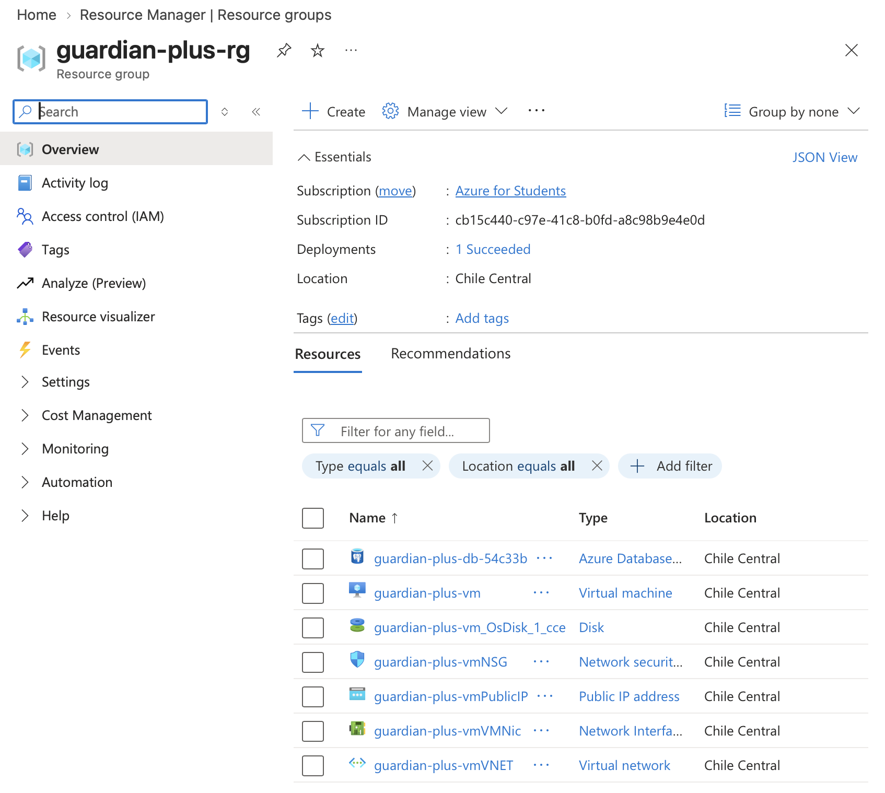

La máquina virtual `guardian-plus-vm` se encuentra en ejecución con el nombre DNS público de la API, como se muestra en la Figura 4.10.

<a id="figura-4-10"></a>**Figura 4.10.** Máquina virtual guardian-plus-vm en Azure

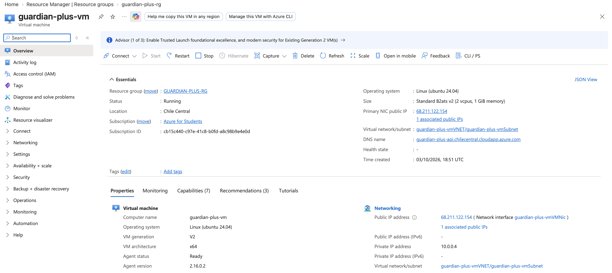

El servidor de Azure Database for PostgreSQL aloja la base de datos `guardian_plus`, como se muestra en la Figura 4.11.

<a id="figura-4-11"></a>**Figura 4.11.** Servidor de Azure Database for PostgreSQL

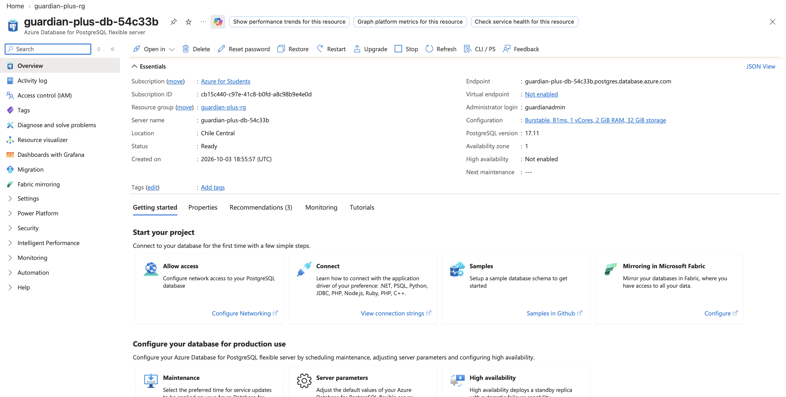

Las ejecuciones de GitHub Actions muestran los workflows `CI`, ejecutado en cada Pull Request, y `Deploy`, ejecutado en cada integración en `develop`, como se muestra en la Figura 4.12.

<a id="figura-4-12"></a>**Figura 4.12.** Ejecuciones de los workflows de GitHub Actions

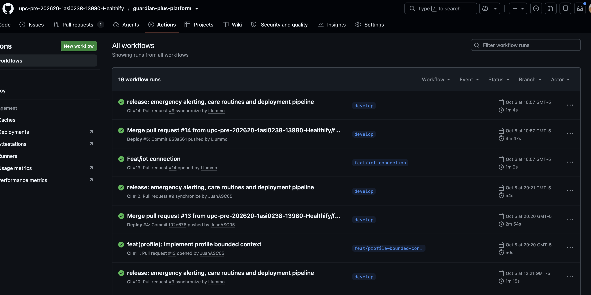

Finalmente, la documentación de los Web Services queda disponible públicamente en Swagger UI, como se muestra en la Figura 4.13.

<a id="figura-4-13"></a>**Figura 4.13.** Documentación de los Web Services en Swagger UI


##### IoT Simulator

En este Sprint se desplegó el IoT Simulator en Google Cloud siguiendo la configuración descrita en la sección 4.1.4. La Tabla 4.58 resume este despliegue.

<a id="tabla-4-58"></a>**Tabla 4.58.** Despliegue del IoT Simulator en el Sprint 1

| Aspecto | Detalle |
|---|---|
| **Plataforma** | Google Cloud Compute Engine, aprovisionada con Terraform |
| **Acceso** | `http://34.45.141.10:5000` (API) y `34.45.141.10:1883` (MQTT), restringido por firewall |
| **Repositorio** | [guardian-plus-iot-simulator](https://github.com/upc-pre-202620-1asi0238-13980-Healthify/guardian-plus-iot-simulator) |
| **Rama desplegada** | `main` |
| **Infraestructura** | VM `e2-small` con Debian 12, IP estática, 2 reglas de firewall y cuenta de servicio con permisos mínimos |
| **Servicios en la VM** | `mosquitto` y `guardian-simulator` (`systemd`, con reinicio automático) |

El despliegue se realizó en los pasos de la Tabla 4.59:

<a id="tabla-4-59"></a>**Tabla 4.59.** Pasos del despliegue del IoT Simulator en el Sprint 1

| Step | Acción | Resultado |
|---|---|---|
| **1** | Instalación de Terraform en Google Cloud Shell, que no lo incluía preinstalado. | Terraform 1.9.8 disponible en el directorio personal. |
| **2** | Configuración de `terraform.tfvars` y ejecución de `terraform init` y `terraform apply`. | Se crearon la IP estática y las dos reglas de firewall. La creación de la cuenta de servicio falló porque la API de IAM estaba deshabilitada en el proyecto. |
| **3** | Habilitación de `iam.googleapis.com` y `cloudresourcemanager.googleapis.com`, y nueva ejecución de `terraform apply`. | Se crearon la cuenta de servicio, sus permisos y la máquina virtual. En total, 8 recursos. |
| **4** | Ejecución del script de arranque de la VM. | Mosquitto y el simulador quedaron instalados y en ejecución como servicios. |
| **5** | Validación del estado en `/health`. | El simulador responde `status: ok`, con `mqttConnected: true` y `loopRunning: true`. |
| **6** | Carga de los wearables desde `GET /api/v1/wearable-devices` y verificación en `/signals`. | El backend devuelve las 4 pulseras registradas (`GP-ESP32-S3-0001` a `GP-ESP32-S3-0004`) y el simulador publica su telemetría: `GET /api/v1/vital-signs/live/{careRecipientProfileId}` entrega lecturas actualizadas cada segundo, con `liveSignal: true`. |


#### 4.2.1.9. Team Collaboration Insights during Sprint

Durante el Sprint 1 (del 6 de septiembre al 6 de octubre de 2026), el equipo trabajó en los repositorios de cada producto mediante ramas por funcionalidad integradas con pull requests. A continuación se muestran las analíticas de colaboración (Pulse) de cada repositorio.

**Backend (Web Services):** 13 pull requests fusionados y 1 abierto, con 180 commits de 5 autores en todas las ramas. La Figura 4.14 muestra los insights del repositorio de los Web Services.

<a id="figura-4-14"></a>**Figura 4.14.** Insights del repositorio de los Web Services

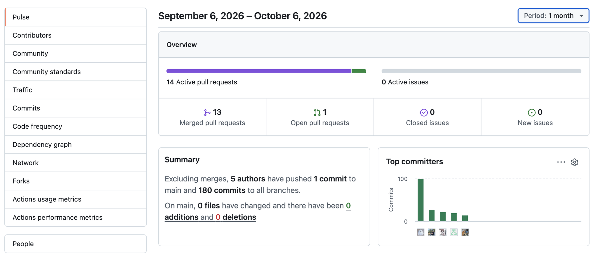

**Mobile App:** 6 pull requests fusionados, con 46 commits de 2 autores en todas las ramas. La Figura 4.15 muestra los insights del repositorio de la aplicación móvil.

<a id="figura-4-15"></a>**Figura 4.15.** Insights del repositorio de la aplicación móvil

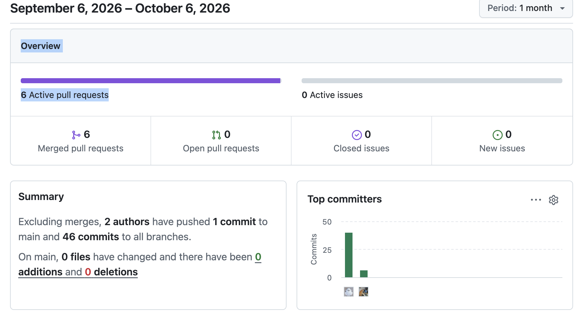

**Website (Landing Page):** 4 pull requests fusionados, con 25 commits de 2 autores en main. La Figura 4.16 muestra los insights del repositorio del Landing Page.

<a id="figura-4-16"></a>**Figura 4.16.** Insights del repositorio del Landing Page

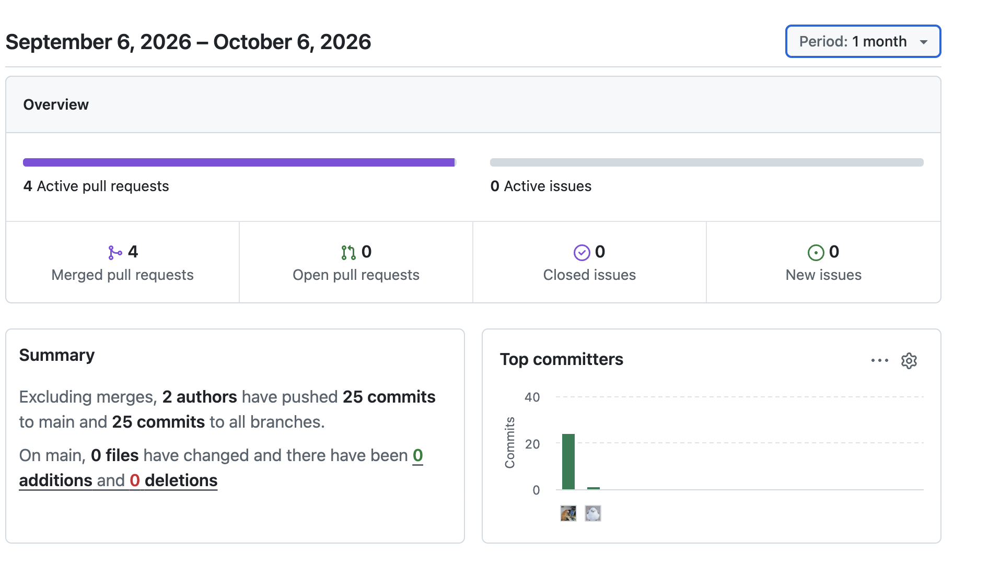

**IoT Simulator:** 1 pull request fusionado, con 7 commits de 1 autor en main. La Figura 4.17 muestra los insights del repositorio del IoT Simulator.

<a id="figura-4-17"></a>**Figura 4.17.** Insights del repositorio del IoT Simulator

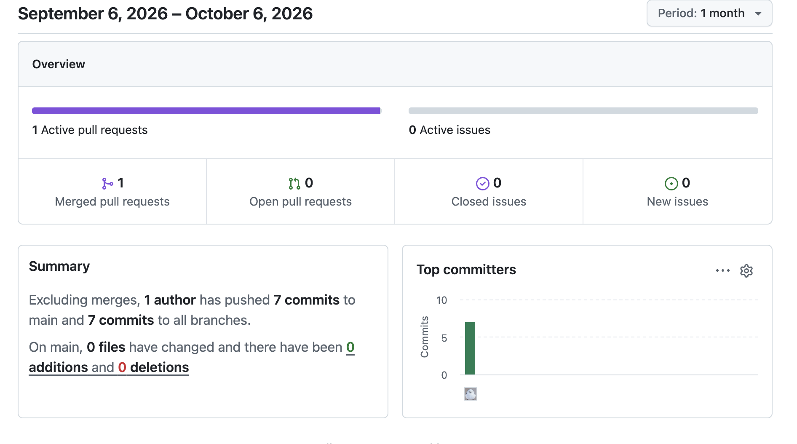

### 4.2.2. Sprint 2

En esta sección se documenta el Sprint 2 de Guardian+: su planificación, la distribución de responsabilidades, el Sprint Backlog, las evidencias de desarrollo, pruebas, ejecución, documentación de servicios y despliegue presentadas en el Sprint Review, y los insights de colaboración del equipo.

#### 4.2.2.1. Sprint Planning 2

El Sprint 2 se ejecuta entre el 20 de octubre y el 13 de noviembre de 2026 y concluye con la entrega AV2 de la semana 12. Su planificación se realizó en una reunión sincrónica del equipo al inicio del Sprint, en la que se revisaron los resultados del Sprint 1, se recalculó la capacidad del equipo con la velocidad observada y se seleccionaron del Product Backlog de la sección 2.4.3 las User Stories asignadas al Sprint 2.

El alcance comprometido corresponde a las nueve User Stories que el Product Backlog asigna al Sprint 2. La primera parte completa la épica EP01: la visualización en tiempo real de los cinco signos vitales que mide la pulsera (US01 a US05) y la sincronización de las lecturas que el wearable almacena mientras no tiene conexión (US21). La segunda parte continúa la épica EP03 sobre el circuito de emergencia entregado en el Sprint 1: la confirmación de bienestar tras un incidente (US10), el aviso de batería crítica de la pulsera (US20) y el despacho simultáneo de las alertas críticas a todo el Care Circle (US25).

Junto con ese alcance, el equipo acordó dos frentes de trabajo que no figuran como User Stories en el Product Backlog y que absorben la capacidad restante del Sprint. El primero es la incorporación de los Bounded Contexts que la aplicación necesita para operar con cuentas reales: IAM, con registro, verificación de correo, inicio de sesión con código OTP y recuperación de contraseña, y Profile & Subscriptions, con el perfil de la persona bajo cuidado y el ciclo de vida de la suscripción. El segundo es la segunda implementación de la aplicación móvil en Flutter, requerida por el curso, que reproduce los Bounded Contexts de la aplicación en Kotlin con la arquitectura de cuatro capas y las librerías `http` y `get_it`. La Tabla 4.60 resume la planificación del Sprint 2.

<a id="tabla-4-60"></a>**Tabla 4.60.** Sprint Planning del Sprint 2

| Sprint # | Sprint 2 |
|---|---|
| **Sprint Planning Background** | |
| Date | 2026-10-20 |
| Time | 07:00 PM |
| Location | Reunión virtual mediante Discord, en el canal de voz del equipo. |
| Prepared By | Equipo Healthify — Guardian+ |
| Attendees (to planning meeting) | Azama Fukuda, Juan Pablo / Lopez Monroy, Rodrigo Alfredo / Luis Miranda, Diego Andres / Mechan Montenegro, Luciana Carolina / Sanchez Cuadrado, Juan Antonio |
| Sprint 1 Review Summary | El Sprint 1 cerró con las 10 User Stories comprometidas implementadas (39 Story Points). El Landing Page quedó publicado en Cloudflare Pages en su versión `v1.0.0`, con las User Stories US30 a US33. Los Web Services quedaron desplegados en Microsoft Azure con los Bounded Contexts Emergency & Alerting, Health Monitoring, Care Routines & Wellness, Mobility & Geofencing y Profile, y 63 rutas documentadas en Swagger UI. La aplicación móvil en Kotlin implementó las pantallas de Inicio, Salud y Alertas conectadas a esos servicios, y el IoT Simulator publicó la telemetría de cuatro pulseras desde Google Cloud. Como avance no comprometido, Health Monitoring y Care Routines & Wellness se implementaron en el backend antes de su Sprint planificado. |
| Sprint 1 Retrospective Summary | El equipo identificó tres aspectos por mejorar. Primero, el tablero de ClickUp no reflejó el avance real: varias tareas implementadas permanecieron en estado *To-do*. Segundo, la integración del Pull Request #11 de Mobility & Geofencing hizo fallar el job `test` del workflow `Deploy`, por lo que esa versión no se publicó hasta la integración siguiente. Tercero, la mayor parte de las integraciones se concentró en los dos últimos días del Sprint (5 y 6 de octubre). Los acuerdos para el Sprint 2 fueron actualizar el estado de cada tarea al abrir y al integrar su Pull Request, ejecutar las pruebas del backend antes de solicitar la revisión e integrar cada Bounded Context apenas esté listo, sin esperar al cierre del Sprint. |
| **Sprint Goal & User Stories** | |
| Sprint 2 Goal | *Our focus is on letting a family follow the vital signs of the person under their care as they happen —heart rate, blood pressure, oxygen saturation, temperature and respiratory rate— without losing the readings taken while the wristband was offline, and on making a critical alert reach the whole care circle at the same time.*<br><br>*We believe it delivers to caregivers a continuous and trustworthy picture of the health of the person under their care, and a faster response when an emergency happens, because every member of the care circle is warned at once instead of one after another.*<br><br>*This will be confirmed when a caregiver opens the Health section and sees each vital sign refreshed live and classified against its normal range, when the readings the wristband kept while offline appear in the history after it reconnects, and when a critical alert reaches the phone of every emergency contact as a push notification.*<br><br>**Métrica de cumplimiento:** la sección Salud muestra la última lectura de los cinco signos vitales con su clasificación (normal, en observación o fuera de rango) según los rangos de US01 a US05; las lecturas enviadas en lote por el wearable tras recuperar la conexión se registran en el historial en su orden cronológico (US21); una alerta crítica con difusión inmediata se entrega como notificación push a todos los contactos de emergencia activos, y cuando uno asume la respuesta los demás son informados (US25); y las 9 User Stories del alcance quedan verificadas contra sus criterios de aceptación (31 Story Points completados). |
| Sprint 2 Velocity | 40 Story Points. El equipo mantuvo la velocidad del Sprint 1, cuya estimación se confirmó al completarse los 39 Story Points comprometidos con la misma dedicación de cinco integrantes. |
| Sum of Story Points | 31 Story Points. |

Las User Stories que conforman el alcance comprometido del Sprint 2 son las siguientes, tomadas del Product Backlog en su orden de prioridad, como se presenta en la Tabla 4.61:

<a id="tabla-4-61"></a>**Tabla 4.61.** User Stories comprometidas en el Sprint 2

| # Orden | User Story Id | Título | Story Points | Bounded Context / Producto |
|---|---|---|---|---|
| 1 | US01 | Visualización de ritmo cardíaco en tiempo real | 3 | Health Monitoring |
| 2 | US02 | Visualización de presión arterial estimada | 3 | Health Monitoring |
| 3 | US03 | Visualización de saturación de oxígeno periférico (SpO₂) | 3 | Health Monitoring |
| 4 | US04 | Supervisión de temperatura corporal continua | 3 | Health Monitoring |
| 5 | US05 | Visualización de frecuencia respiratoria estimada | 3 | Health Monitoring |
| 6 | US10 | Confirmación manual de estado de bienestar tras incidente | 3 | Emergency & Alerting |
| 7 | US20 | Notificación de nivel crítico de batería en wearable | 2 | Emergency & Alerting |
| 8 | US25 | Despacho simultáneo a múltiples contactos de auxilio | 3 | Emergency & Alerting |
| 9 | US21 | Sincronización y persistencia resiliente de telemetría (Offline Sync) | 8 | Health Monitoring |
| | | **Total** | **31** | |

La suma de 31 Story Points se ubica 9 puntos por debajo de la velocidad establecida. Ese margen se reservó para los dos frentes acordados en la reunión que no están representados como User Stories: los Bounded Contexts IAM y Profile & Subscriptions, de los que dependen el inicio de sesión con cuentas reales y el contexto de cuidado de cada usuario, y la implementación de la aplicación en Flutter.

#### 4.2.2.2. Aspect Leaders and Collaborators

Para el Sprint 2 el equipo mantuvo los ocho aspectos del Sprint 1 y agregó dos: **Mobile App (Flutter)**, que comprende la segunda implementación de la aplicación móvil, y **Push Notifications**, que comprende la configuración de Firebase Cloud Messaging en el backend y en la aplicación. La Direct Communication, incorporada en este Sprint, se considera parte del aspecto Mobility & Geofencing, porque su punto de entrada es la pantalla de ubicación de la persona bajo cuidado.

La Leadership-and-Collaboration Matrix (LACX) de la Tabla 4.62 indica el líder (L) y los colaboradores (C) de cada aspecto.

<a id="tabla-4-62"></a>**Tabla 4.62.** Leadership-and-Collaboration Matrix del Sprint 2

| Team Member (Last Name, First Name) | GitHub Username | UX/UI Design | Health Monitoring | Emergency & Alerting | Mobility & Geofencing | Care Routines & Wellness | IAM | Profile & Subscriptions | Push Notifications | Mobile App (Flutter) | Testing |
|---|---|---|---|---|---|---|---|---|---|---|---|
| Azama Fukuda, Juan Pablo | Llummo | L | L | C | C | C | L | C | C | L | C |
| Mechan Montenegro, Luciana Carolina | luuu6 | C | C | C | C | L | C | C | C | C | C |
| Luis Miranda, Diego Andres | Andrewdmr | C | C | C | L | C | C | C | C | C | C |
| López Monroy, Rodrigo Alfredo | rodrigolopezu | C | C | L | C | C | C | C | L | C | C |
| Sanchez Cuadrado, Juan Antonio | JuanASC05 | C | C | C | C | C | C | L | C | C | L |

#### 4.2.2.3. Sprint Backlog 2

El objetivo del Sprint 2 es que la familia siga en tiempo real los signos vitales de la persona bajo cuidado, sin perder las lecturas tomadas sin conexión, y que una alerta crítica llegue a la vez a todo el Care Circle. Para lograrlo, el equipo organizó el trabajo en la lista *Sprint Backlog AV2* de ClickUp, con una tarea por User Story comprometida, una tarea por cada Bounded Context incorporado o completado en la aplicación y las tareas de validación y de video de la entrega.

El tablero del Sprint 2 está disponible en el siguiente enlace: [Sprint Backlog 2 — Guardian+](https://sharing.clickup.com/9013201240/l/h/6-1400350000003933-1/992529f0831298c) Las Figuras 4.18 y 4.19 muestran el tablero.

<a id="figura-4-18"></a>**Figura 4.18.** Tablero del Sprint 2 en ClickUp (parte 1)

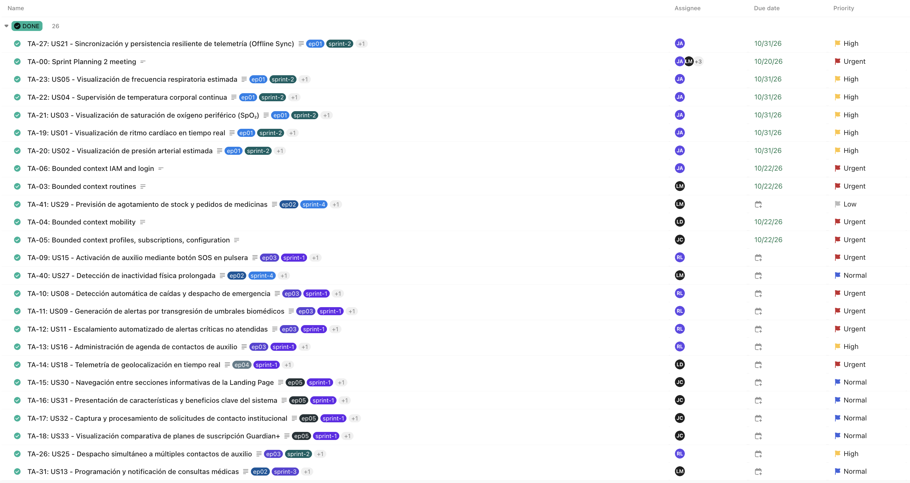

<a id="figura-4-19"></a>**Figura 4.19.** Tablero del Sprint 2 en ClickUp (parte 2)

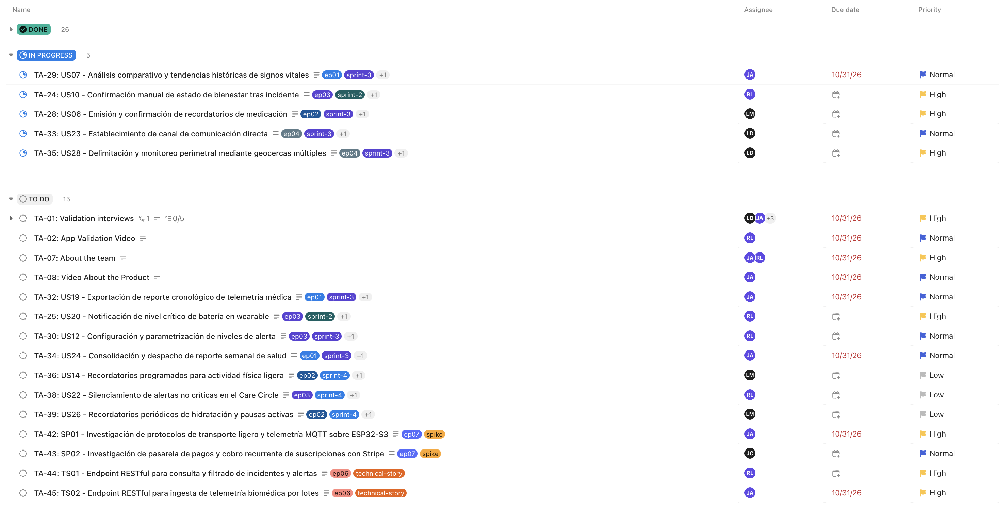

La Tabla 4.63 detalla las tareas del Sprint 2 y su estado al cierre del Sprint. Las tareas US06, US07, US13, US23 y US28 pertenecen al Sprint 3 en el Product Backlog y se registran porque su implementación se adelantó durante este Sprint.

<a id="tabla-4-63"></a>**Tabla 4.63.** Sprint Backlog 2

| Sprint # | Sprint 2 | | | | | | |
|---|---|---|---|---|---|---|---|
| **User Story Id** | **User Story Title** | **Work-Item / Task Id** | **Work-Item / Task Title** | **Description** | **Estimation (Hours)** | **Assigned To** | **Status** |
| — | — | TA-00 | Sprint Planning 2 meeting | Revisar los resultados del Sprint 1, recalcular la velocidad y seleccionar las User Stories del Sprint 2. | 2 | Mechan Montenegro, Luciana Carolina / Azama Fukuda, Juan Pablo / Lopez Monroy, Rodrigo Alfredo / Luis Miranda, Diego Andres / Sanchez Cuadrado, Juan Antonio | Done |
| US01 | Visualización de ritmo cardíaco en tiempo real | TA-19 | US01 - Visualización de ritmo cardíaco en tiempo real | Mostrar la frecuencia cardíaca en vivo y clasificarla contra el rango de 60 a 100 lpm. | 6 | Azama Fukuda, Juan Pablo | Done |
| US02 | Visualización de presión arterial estimada | TA-20 | US02 - Visualización de presión arterial estimada | Mostrar la presión sistólica y diastólica en vivo y señalar los picos hipertensivos. | 6 | Azama Fukuda, Juan Pablo | Done |
| US03 | Visualización de saturación de oxígeno periférico (SpO₂) | TA-21 | US03 - Visualización de saturación de oxígeno periférico (SpO₂) | Mostrar la SpO₂ en vivo y señalar la hipoxemia bajo el 90 %. | 6 | Azama Fukuda, Juan Pablo | Done |
| US04 | Supervisión de temperatura corporal continua | TA-22 | US04 - Supervisión de temperatura corporal continua | Mostrar la temperatura en vivo y registrar su serie temporal en el historial. | 6 | Azama Fukuda, Juan Pablo | Done |
| US05 | Visualización de frecuencia respiratoria estimada | TA-23 | US05 - Visualización de frecuencia respiratoria estimada | Mostrar la frecuencia respiratoria en vivo y señalar los valores fuera de 12 a 20 rpm. | 6 | Azama Fukuda, Juan Pablo | Done |
| US21 | Sincronización y persistencia resiliente de telemetría (Offline Sync) | TA-27 | US21 - Sincronización y persistencia resiliente de telemetría (Offline Sync) | Registrar en orden cronológico las lecturas que el wearable envía en lote al recuperar la conexión. | 16 | Azama Fukuda, Juan Pablo | Done |
| US10 | Confirmación manual de estado de bienestar tras incidente | TA-24 | US10 - Confirmación manual de estado de bienestar tras incidente | Permitir descartar una advertencia desde la pulsera y avisar al cuidador que fue descartada. | 6 | Lopez Monroy, Rodrigo Alfredo | In Progress |
| US20 | Notificación de nivel crítico de batería en wearable | TA-25 | US20 - Notificación de nivel crítico de batería en wearable | Avisar al cuidador cuando la batería de la pulsera baje del 20 % y del 5 %. | 4 | Lopez Monroy, Rodrigo Alfredo | To-do |
| US25 | Despacho simultáneo a múltiples contactos de auxilio | TA-26 | US25 - Despacho simultáneo a múltiples contactos de auxilio | Difundir las alertas críticas a todo el Care Circle por notificación push e informar quién asumió la respuesta. | 6 | Lopez Monroy, Rodrigo Alfredo | Done |
| — | — | TA-06 | Bounded context IAM and login | Implementar el registro, la verificación de correo, el inicio de sesión con OTP, la recuperación de contraseña y el acceso con Google. | 20 | Azama Fukuda, Juan Pablo | Done |
| — | — | TA-03 | Bounded context routines | Conectar las pantallas de Rutinas de la aplicación a los Web Services de Care Routines & Wellness. | 16 | Mechan Montenegro, Luciana Carolina | Done |
| — | — | TA-04 | Bounded context mobility | Implementar las pantallas de ubicación y zonas seguras de la aplicación y completar sus Web Services. | 16 | Luis Miranda, Diego Andres | Done |
| — | — | TA-05 | Bounded context profiles, subscriptions, configuration | Implementar el ciclo de vida de la suscripción y los flujos de perfil y configuración de la aplicación. | 16 | Sanchez Cuadrado, Juan Antonio | Done |
| US06 | Emisión y confirmación de recordatorios de medicación | TA-28 | US06 - Emisión y confirmación de recordatorios de medicación | Programar, confirmar y marcar como omitidos los recordatorios de medicación desde la aplicación. | 10 | Mechan Montenegro, Luciana Carolina | In Progress |
| US13 | Programación y notificación de consultas médicas | TA-31 | US13 - Programación y notificación de consultas médicas | Programar citas médicas y notificarlas por push a los cuidadores antes de su hora. | 6 | Mechan Montenegro, Luciana Carolina | Done |
| US07 | Análisis comparativo y tendencias históricas de signos vitales | TA-29 | US07 - Análisis comparativo y tendencias históricas de signos vitales | Filtrar el historial por periodo, signo vital y estado y comparar sus tendencias. | 10 | Azama Fukuda, Juan Pablo | In Progress |
| US23 | Establecimiento de canal de comunicación directa | TA-33 | US23 - Establecimiento de canal de comunicación directa | Iniciar llamadas de voz o video con la pulsera y registrar las llamadas no atendidas. | 10 | Luis Miranda, Diego Andres | In Progress |
| US28 | Delimitación y monitoreo perimetral mediante geocercas múltiples | TA-35 | US28 - Delimitación y monitoreo perimetral mediante geocercas múltiples | Administrar varias zonas seguras por persona y alertar cuando sale de la zona activa. | 10 | Luis Miranda, Diego Andres / Lopez Monroy, Rodrigo Alfredo | In Progress |
| — | — | TA-01 | Validation interviews | Realizar las entrevistas de validación de la aplicación móvil. | 8 | Azama Fukuda, Juan Pablo / Luis Miranda, Diego Andres / Lopez Monroy, Rodrigo Alfredo / Mechan Montenegro, Luciana Carolina / Sanchez Cuadrado, Juan Antonio | To-do |
| — | — | TA-02 | App Validation Video | Grabar el video de validación de la aplicación móvil. | 4 | Lopez Monroy, Rodrigo Alfredo | To-do |
| — | — | TA-07 | About the team | Grabar el video de presentación del equipo. | 2 | Lopez Monroy, Rodrigo Alfredo / Azama Fukuda, Juan Pablo | To-do |
| — | — | TA-08 | Video About the Product | Grabar el video de presentación del producto. | 4 | Azama Fukuda, Juan Pablo | To-do |

#### 4.2.2.4. Development Evidence for Sprint Review

En esta sección se registran los commits que implementan el alcance del Sprint 2 en cada repositorio. Para los Bounded Contexts con un volumen alto de commits se presentan los más representativos de cada Pull Request. Se incluyen además los commits integrados el 8 y el 9 de octubre, posteriores al cierre del Sprint 1, que no se registraron en la sección 4.2.1.4. El Landing Page no tuvo cambios funcionales en este Sprint, y en el IoT Simulator solo se integró una corrección de seguridad del entorno de desarrollo (Pull Request [#2](https://github.com/upc-pre-202620-1asi0238-13980-Healthify/guardian-plus-iot-simulator/pull/2)).

##### Web Services — IAM

Implementación del Bounded Context IAM: registro de credenciales con verificación del correo, inicio de sesión en dos pasos con un código OTP de seis dígitos enviado por correo mediante Brevo, recuperación de contraseña, emisión de tokens de sesión JWT firmados con RS256 y una cadena de seguridad sin estado. Las contraseñas se almacenan con BCrypt y los códigos con HMAC-SHA256, y la emisión de códigos se limita a cinco por cada quince minutos. Se integró a `develop` mediante el Pull Request [#17](https://github.com/upc-pre-202620-1asi0238-13980-Healthify/guardian-plus-platform/pull/17), y el inicio de sesión con Google, que valida el ID token con Nimbus y vincula la cuenta existente con el mismo correo, mediante el Pull Request [#26](https://github.com/upc-pre-202620-1asi0238-13980-Healthify/guardian-plus-platform/pull/26). La Tabla 4.64 presenta los commits de IAM en los Web Services.

<a id="tabla-4-64"></a>**Tabla 4.64.** Commits de Web Services: IAM

| Repository | Branch | Commit Id | Commit Message | Committed on |
|---|---|---|---|---|
| [guardian-plus-platform](https://github.com/upc-pre-202620-1asi0238-13980-Healthify/guardian-plus-platform) | `feat/iam` | `bf5f4c2` | `chore: add security dependency` | 2026-10-22 |
| [guardian-plus-platform](https://github.com/upc-pre-202620-1asi0238-13980-Healthify/guardian-plus-platform) | `feat/iam` | `df71fb7` | `feat(iam): add user account aggregate` | 2026-10-22 |
| [guardian-plus-platform](https://github.com/upc-pre-202620-1asi0238-13980-Healthify/guardian-plus-platform) | `feat/iam` | `b27ea4d` | `feat(iam): add one-time password aggregate` | 2026-10-22 |
| [guardian-plus-platform](https://github.com/upc-pre-202620-1asi0238-13980-Healthify/guardian-plus-platform) | `feat/iam` | `2724d20` | `refactor(iam): move the password reset token into the user account aggregate` | 2026-10-22 |
| [guardian-plus-platform](https://github.com/upc-pre-202620-1asi0238-13980-Healthify/guardian-plus-platform) | `feat/iam` | `1e4c149` | `feat(iam): add user account, one-time password and authentication command services` | 2026-10-22 |
| [guardian-plus-platform](https://github.com/upc-pre-202620-1asi0238-13980-Healthify/guardian-plus-platform) | `feat/iam` | `4ff079f` | `feat(iam): add registration, login and e-mail verified policies` | 2026-10-22 |
| [guardian-plus-platform](https://github.com/upc-pre-202620-1asi0238-13980-Healthify/guardian-plus-platform) | `feat/iam` | `db56552` | `feat(iam): add user account and one-time password JPA persistence` | 2026-10-22 |
| [guardian-plus-platform](https://github.com/upc-pre-202620-1asi0238-13980-Healthify/guardian-plus-platform) | `feat/iam` | `1a4e406` | `feat(iam): add BCrypt, HMAC-SHA256 and SecureRandom security adapters` | 2026-10-22 |
| [guardian-plus-platform](https://github.com/upc-pre-202620-1asi0238-13980-Healthify/guardian-plus-platform) | `feat/iam` | `1cbf6ed` | `feat(iam): add RS256 JWT session tokens` | 2026-10-22 |
| [guardian-plus-platform](https://github.com/upc-pre-202620-1asi0238-13980-Healthify/guardian-plus-platform) | `feat/iam` | `6603aae` | `feat(iam): add stateless security filter chain` | 2026-10-22 |
| [guardian-plus-platform](https://github.com/upc-pre-202620-1asi0238-13980-Healthify/guardian-plus-platform) | `feat/iam` | `8373c1a` | `feat(iam): add Brevo e-mail provider adapter` | 2026-10-22 |
| [guardian-plus-platform](https://github.com/upc-pre-202620-1asi0238-13980-Healthify/guardian-plus-platform) | `feat/iam` | `6235c01` | `feat(iam): add Guardian+ e-mail templates based on the mobile app palette` | 2026-10-22 |
| [guardian-plus-platform](https://github.com/upc-pre-202620-1asi0238-13980-Healthify/guardian-plus-platform) | `feat/iam` | `edc624d` | `feat(iam): rate limit one-time passwords and resend the login code during a login` | 2026-10-22 |
| [guardian-plus-platform](https://github.com/upc-pre-202620-1asi0238-13980-Healthify/guardian-plus-platform) | `feat/iam` | `082027e` | `feat(iam): add the signed-in account endpoint (/user-accounts/me)` | 2026-10-22 |
| [guardian-plus-platform](https://github.com/upc-pre-202620-1asi0238-13980-Healthify/guardian-plus-platform) | `feat/iam` | `617277a` | `test(iam): add command service tests` | 2026-10-22 |
| [guardian-plus-platform](https://github.com/upc-pre-202620-1asi0238-13980-Healthify/guardian-plus-platform) | `feat/iam` | `cb243e6` | `test(iam): add auth controller tests` | 2026-10-22 |
| [guardian-plus-platform](https://github.com/upc-pre-202620-1asi0238-13980-Healthify/guardian-plus-platform) | `feat/oauth` | `932f2a3` | `feat(iam): let a user account sign up and link with google` | 2026-11-12 |
| [guardian-plus-platform](https://github.com/upc-pre-202620-1asi0238-13980-Healthify/guardian-plus-platform) | `feat/oauth` | `76e82aa` | `feat(iam): verify google id tokens with nimbus` | 2026-11-12 |
| [guardian-plus-platform](https://github.com/upc-pre-202620-1asi0238-13980-Healthify/guardian-plus-platform) | `feat/oauth` | `7e0eec5` | `feat(iam): add the google sign-in endpoint` | 2026-11-12 |
| [guardian-plus-platform](https://github.com/upc-pre-202620-1asi0238-13980-Healthify/guardian-plus-platform) | `feat/oauth` | `74a52ef` | `test(iam): cover google sign-in in the authentication service` | 2026-11-12 |

##### Web Services — Emergency & Alerting

Implementación de la entrega de alertas como notificaciones push mediante Firebase Cloud Messaging (US25): cada alerta se envía a los teléfonos que el Care Circle registró en el canal `PUSH`, de modo que la difusión inmediata de una alerta crítica (`BROADCAST`) llega a todos los contactos activos a la vez. Incluye la alerta por salida de la zona segura, generada a partir del evento de integración de Mobility & Geofencing, y, de forma anticipada, el envío por push de los recordatorios de citas médicas a todos los cuidadores de la persona (US13), que obtiene a través de la fachada del contexto Profile. Se integró a `develop` mediante los Pull Requests [#19](https://github.com/upc-pre-202620-1asi0238-13980-Healthify/guardian-plus-platform/pull/19), [#23](https://github.com/upc-pre-202620-1asi0238-13980-Healthify/guardian-plus-platform/pull/23) y [#29](https://github.com/upc-pre-202620-1asi0238-13980-Healthify/guardian-plus-platform/pull/29). La Tabla 4.65 presenta los commits de Emergency & Alerting en los Web Services.

<a id="tabla-4-65"></a>**Tabla 4.65.** Commits de Web Services: Emergency & Alerting

| Repository | Branch | Commit Id | Commit Message | Committed on |
|---|---|---|---|---|
| [guardian-plus-platform](https://github.com/upc-pre-202620-1asi0238-13980-Healthify/guardian-plus-platform) | `feat/emergency-alerting-safe-zone-violation-alerts` | `fc72826` | `feat(emergency-alerting): raise a safe zone violation alert from mobility's integration event` | 2026-10-23 |
| [guardian-plus-platform](https://github.com/upc-pre-202620-1asi0238-13980-Healthify/guardian-plus-platform) | `feat/emergency-alerting-fcm-push-delivery` | `900c60f` | `feat(emergency-alerting): send push alerts through firebase cloud messaging` | 2026-10-25 |
| [guardian-plus-platform](https://github.com/upc-pre-202620-1asi0238-13980-Healthify/guardian-plus-platform) | `feat/emergency-alerting-fcm-push-delivery` | `12b9046` | `chore(emergency-alerting): document the firebase service account setting` | 2026-10-25 |
| [guardian-plus-platform](https://github.com/upc-pre-202620-1asi0238-13980-Healthify/guardian-plus-platform) | `feat/appointment-reminder-push` | `366aa35` | `feat(emergency-alerting): read caregivers through the profile context facade` | 2026-11-12 |
| [guardian-plus-platform](https://github.com/upc-pre-202620-1asi0238-13980-Healthify/guardian-plus-platform) | `feat/appointment-reminder-push` | `2884c81` | `feat(emergency-alerting): send appointment reminders to every caregiver` | 2026-11-12 |
| [guardian-plus-platform](https://github.com/upc-pre-202620-1asi0238-13980-Healthify/guardian-plus-platform) | `feat/appointment-reminder-push` | `cc5b205` | `feat(emergency-alerting): push appointment reminders through FCM` | 2026-11-12 |
| [guardian-plus-platform](https://github.com/upc-pre-202620-1asi0238-13980-Healthify/guardian-plus-platform) | `feat/appointment-reminder-push` | `823a513` | `test(emergency-alerting): cover appointment reminder push notifications` | 2026-11-12 |

##### Web Services — Mobility & Geofencing

Continuación del Bounded Context Mobility & Geofencing: eliminación de zonas seguras y sus eventos de ciclo de vida, documentación OpenAPI de sus endpoints y recepción de la ubicación del wearable desde el broker MQTT en el tópico `guardian/location/+`. Las violaciones de la zona segura se publican como evento de integración para Emergency & Alerting. De forma anticipada (US28), se agregó la consulta de todas las zonas seguras de una persona, con una sola zona activa a la vez, y el estado `UNKNOWN` mientras el wearable no envía su primera ubicación. Se integró a `develop` mediante los Pull Requests [#16](https://github.com/upc-pre-202620-1asi0238-13980-Healthify/guardian-plus-platform/pull/16), [#18](https://github.com/upc-pre-202620-1asi0238-13980-Healthify/guardian-plus-platform/pull/18), [#19](https://github.com/upc-pre-202620-1asi0238-13980-Healthify/guardian-plus-platform/pull/19), [#22](https://github.com/upc-pre-202620-1asi0238-13980-Healthify/guardian-plus-platform/pull/22) y [#24](https://github.com/upc-pre-202620-1asi0238-13980-Healthify/guardian-plus-platform/pull/24). La Tabla 4.66 presenta los commits de Mobility & Geofencing en los Web Services.

<a id="tabla-4-66"></a>**Tabla 4.66.** Commits de Web Services: Mobility & Geofencing

| Repository | Branch | Commit Id | Commit Message | Committed on |
|---|---|---|---|---|
| [guardian-plus-platform](https://github.com/upc-pre-202620-1asi0238-13980-Healthify/guardian-plus-platform) | `feat/mobility-geofencing-context` | `6aa39eb` | `feat(mobilitygeogfencing): Add event safe zone activate, desactiva, deleted and updated` | 2026-10-21 |
| [guardian-plus-platform](https://github.com/upc-pre-202620-1asi0238-13980-Healthify/guardian-plus-platform) | `feat/mobility-geofencing-context` | `412f27f` | `feat(mobilitygeogfencing): add command service delete safe zone` | 2026-10-21 |
| [guardian-plus-platform](https://github.com/upc-pre-202620-1asi0238-13980-Healthify/guardian-plus-platform) | `feat/mobility-geofencing-context` | `8ba1556` | `feat(mobilitygeogfencing): documentation endpoinds controller safe zone and location tracking` | 2026-10-21 |
| [guardian-plus-platform](https://github.com/upc-pre-202620-1asi0238-13980-Healthify/guardian-plus-platform) | `feat/mobility-wearable-location-mqtt` | `0514b07` | `feat(mobility-geofencing): consume the wearable location from the MQTT broker` | 2026-10-23 |
| [guardian-plus-platform](https://github.com/upc-pre-202620-1asi0238-13980-Healthify/guardian-plus-platform) | `feat/mobility-wearable-location-mqtt` | `0c6332b` | `test(mobility-geofencing): add wearable location message handler tests` | 2026-10-23 |
| [guardian-plus-platform](https://github.com/upc-pre-202620-1asi0238-13980-Healthify/guardian-plus-platform) | `feat/mobility-wearable-location-mqtt` | `e6de505` | `chore(mobility-geofencing): document the location telemetry settings` | 2026-10-23 |
| [guardian-plus-platform](https://github.com/upc-pre-202620-1asi0238-13980-Healthify/guardian-plus-platform) | `feat/emergency-alerting-safe-zone-violation-alerts` | `8e63401` | `feat(mobility-geofencing): publish safe zone violations as an integration event` | 2026-10-23 |
| [guardian-plus-platform](https://github.com/upc-pre-202620-1asi0238-13980-Healthify/guardian-plus-platform) | `feat/emergency-alerting-safe-zone-violation-alerts` | `38fdced` | `test(mobility-geofencing): add safe zone violation event handler tests` | 2026-10-23 |
| [guardian-plus-platform](https://github.com/upc-pre-202620-1asi0238-13980-Healthify/guardian-plus-platform) | `feat/mobility-geofencing-context` | `3f83522` | `refactor(mobilitygeogfencing):  location status resource factory fix` | 2026-10-25 |
| [guardian-plus-platform](https://github.com/upc-pre-202620-1asi0238-13980-Healthify/guardian-plus-platform) | `fix/mobility-geofencing-safe-zone-endpoints` | `504f2d0` | `fix(mobility-geofencing): list a fragile citizen's safe zones and keep one active zone at a time` | 2026-10-28 |
| [guardian-plus-platform](https://github.com/upc-pre-202620-1asi0238-13980-Healthify/guardian-plus-platform) | `fix/mobility-geofencing-safe-zone-endpoints` | `2bbf844` | `test(mobility-geofencing): add safe zone command service tests` | 2026-10-28 |
| [guardian-plus-platform](https://github.com/upc-pre-202620-1asi0238-13980-Healthify/guardian-plus-platform) | `fix/mobility-geofencing-safe-zone-endpoints` | `e8a785c` | `fix(mobility-geofencing): report an unknown status until the wearable sends a location` | 2026-10-28 |

##### Web Services — Direct Communication

Implementación anticipada de la comunicación directa con la pulsera (US23): inicio y fin de sesiones de llamada de voz o video, consulta de las capacidades del dispositivo, registro de las llamadas no atendidas tras 30 segundos y envío de alertas hápticas al wearable. Se integró a `develop` mediante el Pull Request [#25](https://github.com/upc-pre-202620-1asi0238-13980-Healthify/guardian-plus-platform/pull/25). La Tabla 4.67 presenta los commits de Direct Communication en los Web Services.

<a id="tabla-4-67"></a>**Tabla 4.67.** Commits de Web Services: Direct Communication

| Repository | Branch | Commit Id | Commit Message | Committed on |
|---|---|---|---|---|
| [guardian-plus-platform](https://github.com/upc-pre-202620-1asi0238-13980-Healthify/guardian-plus-platform) | `feat/comunications` | `451bfec` | `feat(communication): implement CommunicationCommandService for call management and alerts` | 2026-11-12 |
| [guardian-plus-platform](https://github.com/upc-pre-202620-1asi0238-13980-Healthify/guardian-plus-platform) | `feat/comunications` | `409c59c` | `feat(communication): add CommunicationQueryService, CallSession, and CallLogEntry for call management` | 2026-11-12 |
| [guardian-plus-platform](https://github.com/upc-pre-202620-1asi0238-13980-Healthify/guardian-plus-platform) | `feat/comunications` | `866e544` | `feat(communication): add CallSessionRepository, CallStatus, and CallType for call management` | 2026-11-12 |
| [guardian-plus-platform](https://github.com/upc-pre-202620-1asi0238-13980-Healthify/guardian-plus-platform) | `feat/comunications` | `670310f` | `feat(communication): add CallSessionJpaEntity and SpringDataCallSessionRepository for call session management` | 2026-11-12 |
| [guardian-plus-platform](https://github.com/upc-pre-202620-1asi0238-13980-Healthify/guardian-plus-platform) | `feat/comunications` | `fdbcb42` | `feat(communication): implement CommunicationController for managing direct communication and call sessions` | 2026-11-12 |
| [guardian-plus-platform](https://github.com/upc-pre-202620-1asi0238-13980-Healthify/guardian-plus-platform) | `feat/comunications` | `66415ef` | `feat(communication): add CallSessionResource and DeviceCapabilitiesResource for call session and device capability representation` | 2026-11-12 |

##### Web Services — Care Routines & Wellness

Alineación del Bounded Context Care Routines & Wellness con las pantallas de la aplicación: recurrencia de los recordatorios, recordatorios omitidos y resumen de adherencia, registro y consumo del stock de medicación, plan de hidratación, detección de inactividad y registros de ciclos de sueño. En este Sprint se agregó la publicación de un evento de integración al emitirse un recordatorio de cita médica, que Emergency & Alerting envía por push. Se integró a `develop` mediante los Pull Requests [#15](https://github.com/upc-pre-202620-1asi0238-13980-Healthify/guardian-plus-platform/pull/15) y [#29](https://github.com/upc-pre-202620-1asi0238-13980-Healthify/guardian-plus-platform/pull/29). La Tabla 4.68 presenta los commits de Care Routines & Wellness en los Web Services.

<a id="tabla-4-68"></a>**Tabla 4.68.** Commits de Web Services: Care Routines & Wellness

| Repository | Branch | Commit Id | Commit Message | Committed on |
|---|---|---|---|---|
| [guardian-plus-platform](https://github.com/upc-pre-202620-1asi0238-13980-Healthify/guardian-plus-platform) | `feat/care-routines-wellness-frontend-alignment` | `4481f76` | `feat(care-routines): add reminder recurrence, missed handling and adherence summary` | 2026-10-08 |
| [guardian-plus-platform](https://github.com/upc-pre-202620-1asi0238-13980-Healthify/guardian-plus-platform) | `feat/care-routines-wellness-frontend-alignment` | `1d37506` | `feat(care-routines): add medication stock registration and consumption tracking` | 2026-10-08 |
| [guardian-plus-platform](https://github.com/upc-pre-202620-1asi0238-13980-Healthify/guardian-plus-platform) | `feat/care-routines-wellness-frontend-alignment` | `11fa615` | `feat(care-routines): add hydration plan aggregate, progress query and REST endpoints` | 2026-10-08 |
| [guardian-plus-platform](https://github.com/upc-pre-202620-1asi0238-13980-Healthify/guardian-plus-platform) | `feat/care-routines-wellness-frontend-alignment` | `3f12fdf` | `feat(care-routines): add activity log, inactivity detection settings and movement/walk events` | 2026-10-08 |
| [guardian-plus-platform](https://github.com/upc-pre-202620-1asi0238-13980-Healthify/guardian-plus-platform) | `feat/care-routines-wellness-frontend-alignment` | `9ed097c` | `feat(care-routines): add sleep cycle records query service and REST endpoint` | 2026-10-08 |
| [guardian-plus-platform](https://github.com/upc-pre-202620-1asi0238-13980-Healthify/guardian-plus-platform) | `feat/care-routines-wellness-frontend-alignment` | `08258e6` | `test(care-routines): add unit tests for care routines and wellness bounded context` | 2026-10-08 |
| [guardian-plus-platform](https://github.com/upc-pre-202620-1asi0238-13980-Healthify/guardian-plus-platform) | `feat/care-routines-wellness-frontend-alignment` | `c60ec55` | `feat(care-routines): update reminder REST resources and schedule endpoint` | 2026-10-08 |
| [guardian-plus-platform](https://github.com/upc-pre-202620-1asi0238-13980-Healthify/guardian-plus-platform) | `feat/appointment-reminder-push` | `6153a07` | `feat(care-routines-wellness): publish an integration event when an appointment reminder is issued` | 2026-11-12 |
| [guardian-plus-platform](https://github.com/upc-pre-202620-1asi0238-13980-Healthify/guardian-plus-platform) | `feat/appointment-reminder-push` | `f3f82c9` | `test(care-routines-wellness): cover the appointment reminder integration event` | 2026-11-12 |

##### Web Services — Health Monitoring

Los endpoints de signos vitales en vivo, historial y sincronización en lote que soportan US01 a US05 y US21 se implementaron en el Sprint 1 (sección 4.2.1.4). En este Sprint se agregó la desvinculación de un wearable de la persona bajo cuidado, que la aplicación utiliza desde el detalle de la pulsera. Se integró a `develop` mediante el Pull Request [#28](https://github.com/upc-pre-202620-1asi0238-13980-Healthify/guardian-plus-platform/pull/28). La Tabla 4.69 presenta los commits de Health Monitoring en los Web Services.

<a id="tabla-4-69"></a>**Tabla 4.69.** Commits de Web Services: Health Monitoring

| Repository | Branch | Commit Id | Commit Message | Committed on |
|---|---|---|---|---|
| [guardian-plus-platform](https://github.com/upc-pre-202620-1asi0238-13980-Healthify/guardian-plus-platform) | `feat/unlink-wearable-device` | `7ae7564` | `feat(health-monitoring): add the unlink wearable device command` | 2026-11-12 |
| [guardian-plus-platform](https://github.com/upc-pre-202620-1asi0238-13980-Healthify/guardian-plus-platform) | `feat/unlink-wearable-device` | `3e41361` | `feat(health-monitoring): unlink wearable devices in the command service` | 2026-11-12 |
| [guardian-plus-platform](https://github.com/upc-pre-202620-1asi0238-13980-Healthify/guardian-plus-platform) | `feat/unlink-wearable-device` | `0e88f76` | `feat(health-monitoring): add the unlink wearable device endpoint` | 2026-11-12 |
| [guardian-plus-platform](https://github.com/upc-pre-202620-1asi0238-13980-Healthify/guardian-plus-platform) | `feat/unlink-wearable-device` | `533aefd` | `test(health-monitoring): cover unlinking wearable devices` | 2026-11-12 |

##### Web Services — Profile & Subscriptions

Implementación del ciclo de vida de la suscripción: solicitud, activación tras el pago, cambio de plan, cancelación programada, renovación y consulta de los beneficios (*entitlements*) del plan, con un proveedor de pagos simulado. Incluye la conservación de los campos de auditoría de Profile en las actualizaciones y la fachada del contexto Profile que consume Emergency & Alerting. Se integró a `develop` mediante los Pull Requests [#20](https://github.com/upc-pre-202620-1asi0238-13980-Healthify/guardian-plus-platform/pull/20), [#21](https://github.com/upc-pre-202620-1asi0238-13980-Healthify/guardian-plus-platform/pull/21) y [#29](https://github.com/upc-pre-202620-1asi0238-13980-Healthify/guardian-plus-platform/pull/29). La Tabla 4.70 presenta los commits de Profile & Subscriptions en los Web Services.

<a id="tabla-4-70"></a>**Tabla 4.70.** Commits de Web Services: Profile & Subscriptions

| Repository | Branch | Commit Id | Commit Message | Committed on |
|---|---|---|---|---|
| [guardian-plus-platform](https://github.com/upc-pre-202620-1asi0238-13980-Healthify/guardian-plus-platform) | `feat/subscriptions-backend-final` | `d0270aa` | `feat: implement subscriptions lifecycle and payment flow` | 2026-10-24 |
| [guardian-plus-platform](https://github.com/upc-pre-202620-1asi0238-13980-Healthify/guardian-plus-platform) | `fix/profile-audit-fields-final` | `5a907df` | `fix(profile): preserve persistence audit fields on updates` | 2026-10-23 |
| [guardian-plus-platform](https://github.com/upc-pre-202620-1asi0238-13980-Healthify/guardian-plus-platform) | `feat/appointment-reminder-push` | `48ec9e3` | `feat(profile): add the profile context facade` | 2026-11-12 |
| [guardian-plus-platform](https://github.com/upc-pre-202620-1asi0238-13980-Healthify/guardian-plus-platform) | `feat/appointment-reminder-push` | `38ac332` | `test(profile): cover the profile context facade` | 2026-11-12 |

##### Mobile App — IAM & Profile

Reemplazo del inicio de sesión simulado por el de IAM: pantallas de registro, código OTP obligatorio en cada inicio de sesión, recuperación de contraseña e inicio de sesión y registro con Google mediante Credential Manager. La sesión se conserva en el dispositivo con su vencimiento y su token se envía en cada solicitud. Tras iniciar sesión, la aplicación carga el contexto de cuidado de la cuenta y, si no existe, guía al usuario en el registro de la persona bajo cuidado; desde Inicio el usuario puede cambiar entre las personas que cuida. Se integró a `develop` mediante los Pull Requests [#8](https://github.com/upc-pre-202620-1asi0238-13980-Healthify/guardian-plus-mobile-app/pull/8), [#11](https://github.com/upc-pre-202620-1asi0238-13980-Healthify/guardian-plus-mobile-app/pull/11), [#23](https://github.com/upc-pre-202620-1asi0238-13980-Healthify/guardian-plus-mobile-app/pull/23), [#27](https://github.com/upc-pre-202620-1asi0238-13980-Healthify/guardian-plus-mobile-app/pull/27), [#29](https://github.com/upc-pre-202620-1asi0238-13980-Healthify/guardian-plus-mobile-app/pull/29) y [#31](https://github.com/upc-pre-202620-1asi0238-13980-Healthify/guardian-plus-mobile-app/pull/31). La Tabla 4.71 presenta los commits de IAM y Profile en la aplicación móvil.

<a id="tabla-4-71"></a>**Tabla 4.71.** Commits de Mobile App: IAM & Profile

| Repository | Branch | Commit Id | Commit Message | Committed on |
|---|---|---|---|---|
| [guardian-plus-mobile-app](https://github.com/upc-pre-202620-1asi0238-13980-Healthify/guardian-plus-mobile-app) | `fix/nag-login` | `aaba93b` | `feat(auth): add login route and navigation graph` | 2026-10-09 |
| [guardian-plus-mobile-app](https://github.com/upc-pre-202620-1asi0238-13980-Healthify/guardian-plus-mobile-app) | `feat/iam-implementation` | `0d2da36` | `feat(iam): model the user account aggregate with its status and login outcome` | 2026-10-21 |
| [guardian-plus-mobile-app](https://github.com/upc-pre-202620-1asi0238-13980-Healthify/guardian-plus-mobile-app) | `feat/iam-implementation` | `5094c19` | `feat(iam): keep the session on the device and send its token with every request` | 2026-10-21 |
| [guardian-plus-mobile-app](https://github.com/upc-pre-202620-1asi0238-13980-Healthify/guardian-plus-mobile-app) | `feat/iam-implementation` | `411cb58` | `feat(iam): sign in through IAM instead of the mocked login` | 2026-10-21 |
| [guardian-plus-mobile-app](https://github.com/upc-pre-202620-1asi0238-13980-Healthify/guardian-plus-mobile-app) | `feat/iam-implementation` | `23c056f` | `feat(iam): add the sign-up screen and its email verification step` | 2026-10-21 |
| [guardian-plus-mobile-app](https://github.com/upc-pre-202620-1asi0238-13980-Healthify/guardian-plus-mobile-app) | `feat/iam-implementation` | `24a7985` | `feat(iam): add the two-factor OTP challenge screen` | 2026-10-21 |
| [guardian-plus-mobile-app](https://github.com/upc-pre-202620-1asi0238-13980-Healthify/guardian-plus-mobile-app) | `feat/iam-implementation` | `6f48755` | `feat(iam): add the password recovery screens` | 2026-10-21 |
| [guardian-plus-mobile-app](https://github.com/upc-pre-202620-1asi0238-13980-Healthify/guardian-plus-mobile-app) | `feat/iam-implementation` | `3ce38a6` | `refactor(iam): make the OTP mandatory on every sign-in` | 2026-10-22 |
| [guardian-plus-mobile-app](https://github.com/upc-pre-202620-1asi0238-13980-Healthify/guardian-plus-mobile-app) | `feat/iam-implementation` | `6527ec5` | `feat(iam): connect the auth repositories to the platform` | 2026-10-22 |
| [guardian-plus-mobile-app](https://github.com/upc-pre-202620-1asi0238-13980-Healthify/guardian-plus-mobile-app) | `feat/iam-implementation` | `0626767` | `feat(profile): load the care context and complete the onboarding` | 2026-10-22 |
| [guardian-plus-mobile-app](https://github.com/upc-pre-202620-1asi0238-13980-Healthify/guardian-plus-mobile-app) | `feat/iam-implementation` | `e8db5d2` | `feat(profile): add the session start and onboarding screens` | 2026-10-22 |
| [guardian-plus-mobile-app](https://github.com/upc-pre-202620-1asi0238-13980-Healthify/guardian-plus-mobile-app) | `feat/iam-implementation` | `5a1dfd5` | `test(iam): update the auth tests to the platform contract` | 2026-10-22 |
| [guardian-plus-mobile-app](https://github.com/upc-pre-202620-1asi0238-13980-Healthify/guardian-plus-mobile-app) | `feat/oauth` | `b6dc4dd` | `feat(iam): exchange a Google ID token for a session through the platform` | 2026-11-12 |
| [guardian-plus-mobile-app](https://github.com/upc-pre-202620-1asi0238-13980-Healthify/guardian-plus-mobile-app) | `feat/oauth` | `795046b` | `feat(iam): request the Google ID token through Credential Manager` | 2026-11-12 |
| [guardian-plus-mobile-app](https://github.com/upc-pre-202620-1asi0238-13980-Healthify/guardian-plus-mobile-app) | `feat/google-sign-up` | `6f3d9bf` | `feat(iam): sign up with Google from the register screen` | 2026-11-12 |
| [guardian-plus-mobile-app](https://github.com/upc-pre-202620-1asi0238-13980-Healthify/guardian-plus-mobile-app) | `feat/remove-biometric-button` | `2e0c000` | `feat(iam): remove the biometric access button from the login screen` | 2026-11-12 |
| [guardian-plus-mobile-app](https://github.com/upc-pre-202620-1asi0238-13980-Healthify/guardian-plus-mobile-app) | `feat/switch-care-recipient` | `dd9a012` | `feat(profile): add the use cases to list and switch people under care` | 2026-11-12 |
| [guardian-plus-mobile-app](https://github.com/upc-pre-202620-1asi0238-13980-Healthify/guardian-plus-mobile-app) | `feat/switch-care-recipient` | `37d9771` | `feat(profile): add the sheet to switch the person under care` | 2026-11-12 |
| [guardian-plus-mobile-app](https://github.com/upc-pre-202620-1asi0238-13980-Healthify/guardian-plus-mobile-app) | `feat/switch-care-recipient` | `f6147f1` | `test(profile): cover choosing the person under care` | 2026-11-12 |

##### Mobile App — Emergency & Alerting

Registro del teléfono en el canal `PUSH` mientras hay una sesión iniciada, recepción de las alertas como notificaciones de Firebase Cloud Messaging en un canal de alta prioridad y apertura del detalle de la alerta al tocar la notificación (US25). El detalle de la alerta muestra el contexto del incidente a partir de las últimas lecturas de la pulsera y el lugar donde ocurrió a partir de su última ubicación. Se integró a `develop` mediante los Pull Requests [#13](https://github.com/upc-pre-202620-1asi0238-13980-Healthify/guardian-plus-mobile-app/pull/13), [#14](https://github.com/upc-pre-202620-1asi0238-13980-Healthify/guardian-plus-mobile-app/pull/14), [#18](https://github.com/upc-pre-202620-1asi0238-13980-Healthify/guardian-plus-mobile-app/pull/18) y [#19](https://github.com/upc-pre-202620-1asi0238-13980-Healthify/guardian-plus-mobile-app/pull/19). La Tabla 4.72 presenta los commits de Emergency & Alerting en la aplicación móvil.

<a id="tabla-4-72"></a>**Tabla 4.72.** Commits de Mobile App: Emergency & Alerting

| Repository | Branch | Commit Id | Commit Message | Committed on |
|---|---|---|---|---|
| [guardian-plus-mobile-app](https://github.com/upc-pre-202620-1asi0238-13980-Healthify/guardian-plus-mobile-app) | `feat/emergency-alerting-live-alert-context` | `b96ddae` | `feat(emergency-alerting): read the alert context from the wristband's live readings` | 2026-10-22 |
| [guardian-plus-mobile-app](https://github.com/upc-pre-202620-1asi0238-13980-Healthify/guardian-plus-mobile-app) | `feat/emergency-alerting-live-alert-context` | `c177886` | `test(emergency-alerting): add alert context repository tests` | 2026-10-22 |
| [guardian-plus-mobile-app](https://github.com/upc-pre-202620-1asi0238-13980-Healthify/guardian-plus-mobile-app) | `feat/emergency-alerting-alert-location` | `5cf0e8f` | `feat(emergency-alerting): show where the alert happened from the wristband's last location` | 2026-10-23 |
| [guardian-plus-mobile-app](https://github.com/upc-pre-202620-1asi0238-13980-Healthify/guardian-plus-mobile-app) | `feat/emergency-alerting-alert-location` | `6cb83d1` | `test(emergency-alerting): cover the alert location in the context repository tests` | 2026-10-23 |
| [guardian-plus-mobile-app](https://github.com/upc-pre-202620-1asi0238-13980-Healthify/guardian-plus-mobile-app) | `feat/emergency-alerting-push-device-registration` | `6a3a004` | `chore(build): add firebase cloud messaging and the definitive application id` | 2026-10-25 |
| [guardian-plus-mobile-app](https://github.com/upc-pre-202620-1asi0238-13980-Healthify/guardian-plus-mobile-app) | `feat/emergency-alerting-push-device-registration` | `d595077` | `feat(emergency-alerting): register this phone for push alerts while an account is signed in` | 2026-10-25 |
| [guardian-plus-mobile-app](https://github.com/upc-pre-202620-1asi0238-13980-Healthify/guardian-plus-mobile-app) | `feat/emergency-alerting-push-device-registration` | `aede612` | `test(emergency-alerting): add push device registration tests` | 2026-10-25 |
| [guardian-plus-mobile-app](https://github.com/upc-pre-202620-1asi0238-13980-Healthify/guardian-plus-mobile-app) | `feat/emergency-alerting-push-notifications` | `1fac9ee` | `feat(emergency-alerting): show push alerts and open the alert from its notification` | 2026-10-26 |
| [guardian-plus-mobile-app](https://github.com/upc-pre-202620-1asi0238-13980-Healthify/guardian-plus-mobile-app) | `feat/emergency-alerting-push-notifications` | `f607ffb` | `test(emergency-alerting): add alert notification channel tests` | 2026-10-26 |

##### Mobile App — Health Monitoring

Rediseño de la pestaña *Ahora* de la sección Salud según el prototipo, con la última lectura de cada signo vital y su tendencia del día (US01 a US05); búsqueda y filtrado del historial por periodo, signo vital y estado; reportes de salud con su exportación a PDF; y vinculación y desvinculación de la pulsera desde Inicio y desde su detalle. Se integró a `develop` mediante los Pull Requests [#9](https://github.com/upc-pre-202620-1asi0238-13980-Healthify/guardian-plus-mobile-app/pull/9), [#11](https://github.com/upc-pre-202620-1asi0238-13980-Healthify/guardian-plus-mobile-app/pull/11) y [#30](https://github.com/upc-pre-202620-1asi0238-13980-Healthify/guardian-plus-mobile-app/pull/30). La Tabla 4.73 presenta los commits de Health Monitoring en la aplicación móvil.

<a id="tabla-4-73"></a>**Tabla 4.73.** Commits de Mobile App: Health Monitoring

| Repository | Branch | Commit Id | Commit Message | Committed on |
|---|---|---|---|---|
| [guardian-plus-mobile-app](https://github.com/upc-pre-202620-1asi0238-13980-Healthify/guardian-plus-mobile-app) | `fix/health-monitoring` | `e58f028` | `feat(health-monitoring): add the search bar and the search and filter sheet` | 2026-10-09 |
| [guardian-plus-mobile-app](https://github.com/upc-pre-202620-1asi0238-13980-Healthify/guardian-plus-mobile-app) | `fix/health-monitoring` | `0032291` | `feat(health-monitoring): filter the history by period, vital sign and state` | 2026-10-09 |
| [guardian-plus-mobile-app](https://github.com/upc-pre-202620-1asi0238-13980-Healthify/guardian-plus-mobile-app) | `fix/health-monitoring` | `4d206f0` | `feat(health-monitoring): add health reports and their platform client` | 2026-10-09 |
| [guardian-plus-mobile-app](https://github.com/upc-pre-202620-1asi0238-13980-Healthify/guardian-plus-mobile-app) | `fix/health-monitoring` | `4e5e417` | `feat(health-monitoring): generate the weekly report from the history` | 2026-10-09 |
| [guardian-plus-mobile-app](https://github.com/upc-pre-202620-1asi0238-13980-Healthify/guardian-plus-mobile-app) | `fix/health-monitoring` | `73ac45f` | `feat(health-monitoring): export health reports as PDF` | 2026-10-09 |
| [guardian-plus-mobile-app](https://github.com/upc-pre-202620-1asi0238-13980-Healthify/guardian-plus-mobile-app) | `feat/iam-implementation` | `d5053bc` | `feat(health-monitoring): add the link wearable sheet` | 2026-10-22 |
| [guardian-plus-mobile-app](https://github.com/upc-pre-202620-1asi0238-13980-Healthify/guardian-plus-mobile-app) | `feat/iam-implementation` | `eddde5d` | `feat(health-monitoring): link the wearable from the Home status card` | 2026-10-22 |
| [guardian-plus-mobile-app](https://github.com/upc-pre-202620-1asi0238-13980-Healthify/guardian-plus-mobile-app) | `feat/unlink-wearable-device` | `372d55e` | `feat(health-monitoring): add the unlink wearable device use case` | 2026-11-12 |
| [guardian-plus-mobile-app](https://github.com/upc-pre-202620-1asi0238-13980-Healthify/guardian-plus-mobile-app) | `feat/unlink-wearable-device` | `2178267` | `feat(health-monitoring): unlink the wristband from its details page` | 2026-11-12 |

##### Mobile App — Care Routines & Wellness

Implementación de la sección Rutinas conectada a los Web Services: inicio de rutinas, medicación y su formulario, stock de medicación, citas médicas y su formulario, plan de hidratación, ciclo de sueño, registro de actividad y detección de inactividad. Los repositorios simulados se reemplazaron por implementaciones remotas con Retrofit. De forma anticipada (US13), la aplicación muestra los recordatorios de citas en un canal de notificación propio y abre las citas al tocar la notificación. Se integró a `develop` mediante los Pull Requests [#7](https://github.com/upc-pre-202620-1asi0238-13980-Healthify/guardian-plus-mobile-app/pull/7), [#10](https://github.com/upc-pre-202620-1asi0238-13980-Healthify/guardian-plus-mobile-app/pull/10) y [#33](https://github.com/upc-pre-202620-1asi0238-13980-Healthify/guardian-plus-mobile-app/pull/33). La Tabla 4.74 presenta los commits de Care Routines & Wellness en la aplicación móvil.

<a id="tabla-4-74"></a>**Tabla 4.74.** Commits de Mobile App: Care Routines & Wellness

| Repository | Branch | Commit Id | Commit Message | Committed on |
|---|---|---|---|---|
| [guardian-plus-mobile-app](https://github.com/upc-pre-202620-1asi0238-13980-Healthify/guardian-plus-mobile-app) | `feat/routines-and-wellness-screens` | `e4dd4fd` | `feat(care-routines): add care routines and wellness feature screens` | 2026-10-09 |
| [guardian-plus-mobile-app](https://github.com/upc-pre-202620-1asi0238-13980-Healthify/guardian-plus-mobile-app) | `feat/care-routines-and-wellness` | `13c9437` | `feat(care-routines): add reminder remote service, dto and repository implementation` | 2026-10-21 |
| [guardian-plus-mobile-app](https://github.com/upc-pre-202620-1asi0238-13980-Healthify/guardian-plus-mobile-app) | `feat/care-routines-and-wellness` | `9e8b544` | `feat(care-routines): add hydration plan remote service, dto and repository implementation` | 2026-10-21 |
| [guardian-plus-mobile-app](https://github.com/upc-pre-202620-1asi0238-13980-Healthify/guardian-plus-mobile-app) | `feat/care-routines-and-wellness` | `f256093` | `feat(care-routines): add medication stock remote service, dto and repository implementation` | 2026-10-21 |
| [guardian-plus-mobile-app](https://github.com/upc-pre-202620-1asi0238-13980-Healthify/guardian-plus-mobile-app) | `feat/care-routines-and-wellness` | `18f521d` | `feat(care-routines): add reminder use cases (schedule, confirm, cancel, mark as missed)` | 2026-10-21 |
| [guardian-plus-mobile-app](https://github.com/upc-pre-202620-1asi0238-13980-Healthify/guardian-plus-mobile-app) | `feat/care-routines-and-wellness` | `7bfcde6` | `feat(care-routines): rework routines home screen and view model with remote data` | 2026-10-21 |
| [guardian-plus-mobile-app](https://github.com/upc-pre-202620-1asi0238-13980-Healthify/guardian-plus-mobile-app) | `feat/care-routines-and-wellness` | `2458a42` | `feat(care-routines): add appointments list and appointment form screens` | 2026-10-21 |
| [guardian-plus-mobile-app](https://github.com/upc-pre-202620-1asi0238-13980-Healthify/guardian-plus-mobile-app) | `feat/care-routines-and-wellness` | `8797625` | `feat(care-routines): add medication list and medication form screens` | 2026-10-21 |
| [guardian-plus-mobile-app](https://github.com/upc-pre-202620-1asi0238-13980-Healthify/guardian-plus-mobile-app) | `feat/care-routines-and-wellness` | `d85150b` | `feat(care-routines): add hydration plan screen` | 2026-10-21 |
| [guardian-plus-mobile-app](https://github.com/upc-pre-202620-1asi0238-13980-Healthify/guardian-plus-mobile-app) | `feat/care-routines-and-wellness` | `39d0dc6` | `feat(care-routines): add sleep cycle screen` | 2026-10-21 |
| [guardian-plus-mobile-app](https://github.com/upc-pre-202620-1asi0238-13980-Healthify/guardian-plus-mobile-app) | `feat/care-routines-and-wellness` | `e78414d` | `feat(care-routines): add inactivity detection settings screen` | 2026-10-21 |
| [guardian-plus-mobile-app](https://github.com/upc-pre-202620-1asi0238-13980-Healthify/guardian-plus-mobile-app) | `feat/care-routines-and-wellness` | `e377fe4` | `test(care-routines): add unit tests for care routines and wellness feature` | 2026-10-21 |
| [guardian-plus-mobile-app](https://github.com/upc-pre-202620-1asi0238-13980-Healthify/guardian-plus-mobile-app) | `feat/appointment-reminder-push` | `adc2de0` | `feat(care-routines-wellness): add the appointment reminders notification channel` | 2026-11-12 |
| [guardian-plus-mobile-app](https://github.com/upc-pre-202620-1asi0238-13980-Healthify/guardian-plus-mobile-app) | `feat/appointment-reminder-push` | `2a64f1e` | `feat(care-routines-wellness): open the appointments from a reminder notification` | 2026-11-12 |

##### Mobile App — Mobility & Geofencing

Implementación de la sección Ubicación: posición de la persona bajo cuidado en el mapa con la zona segura activa dibujada, administración de las zonas seguras con su activación, edición y eliminación, y, de forma anticipada (US23), las opciones de llamada de voz y video con la pulsera desde la pantalla de ubicación. Se integró a `develop` mediante los Pull Requests [#15](https://github.com/upc-pre-202620-1asi0238-13980-Healthify/guardian-plus-mobile-app/pull/15), [#17](https://github.com/upc-pre-202620-1asi0238-13980-Healthify/guardian-plus-mobile-app/pull/17), [#20](https://github.com/upc-pre-202620-1asi0238-13980-Healthify/guardian-plus-mobile-app/pull/20), [#21](https://github.com/upc-pre-202620-1asi0238-13980-Healthify/guardian-plus-mobile-app/pull/21) y [#22](https://github.com/upc-pre-202620-1asi0238-13980-Healthify/guardian-plus-mobile-app/pull/22). La Tabla 4.75 presenta los commits de Mobility & Geofencing en la aplicación móvil.

<a id="tabla-4-75"></a>**Tabla 4.75.** Commits de Mobile App: Mobility & Geofencing

| Repository | Branch | Commit Id | Commit Message | Committed on |
|---|---|---|---|---|
| [guardian-plus-mobile-app](https://github.com/upc-pre-202620-1asi0238-13980-Healthify/guardian-plus-mobile-app) | `feat/mobility-and-geofencing` | `e1a8b17` | `feat(mobilitygeofencing): add core domain models for tracking and safe zones` | 2026-10-22 |
| [guardian-plus-mobile-app](https://github.com/upc-pre-202620-1asi0238-13980-Healthify/guardian-plus-mobile-app) | `feat/mobility-and-geofencing` | `8288768` | `feat(mobility-geofencing): add Retrofit API endpoints for location tracking and safe zone management` | 2026-10-22 |
| [guardian-plus-mobile-app](https://github.com/upc-pre-202620-1asi0238-13980-Healthify/guardian-plus-mobile-app) | `feat/mobility-and-geofencing` | `e80deef` | `feat(mobility-geofencing): implement repository for location tracking and safe zone operations` | 2026-10-23 |
| [guardian-plus-mobile-app](https://github.com/upc-pre-202620-1asi0238-13980-Healthify/guardian-plus-mobile-app) | `feat/mobility-and-geofencing` | `704cc87` | `feat(mobility-geofencing): add location tracking screen with realtime location UI and navigation actions` | 2026-10-23 |
| [guardian-plus-mobile-app](https://github.com/upc-pre-202620-1asi0238-13980-Healthify/guardian-plus-mobile-app) | `feat/mobility-and-geofencing` | `8cc159b` | `feat(mobility-geofencing): implement safe zones screen with status toggle` | 2026-10-23 |
| [guardian-plus-mobile-app](https://github.com/upc-pre-202620-1asi0238-13980-Healthify/guardian-plus-mobile-app) | `feat/mobility-and-geofencing` | `8de95ca` | `fix(mobility-geofencing): repair navigation, toplevel destination` | 2026-10-25 |
| [guardian-plus-mobile-app](https://github.com/upc-pre-202620-1asi0238-13980-Healthify/guardian-plus-mobile-app) | `feat/mobility-and-geofencing` | `8edb962` | `feat(mobility-geofencing):  add funcionality edit compose, mobility navigation refactor update, view model` | 2026-10-27 |
| [guardian-plus-mobile-app](https://github.com/upc-pre-202620-1asi0238-13980-Healthify/guardian-plus-mobile-app) | `fix/mobility-geofencing-safe-zone-endpoints` | `38e5a50` | `fix(mobility-geofencing): draw the real safe zone on the map and stop showing sample location data` | 2026-10-28 |
| [guardian-plus-mobile-app](https://github.com/upc-pre-202620-1asi0238-13980-Healthify/guardian-plus-mobile-app) | `fix/mobility-geofencing-safe-zone-endpoints` | `b8fe2f8` | `test(mobility-geofencing): add location tracking state tests` | 2026-10-28 |
| [guardian-plus-mobile-app](https://github.com/upc-pre-202620-1asi0238-13980-Healthify/guardian-plus-mobile-app) | `feat/comunications` | `c64a6ef` | `feat(communication): implement device communication models and repository methods for call management` | 2026-11-12 |
| [guardian-plus-mobile-app](https://github.com/upc-pre-202620-1asi0238-13980-Healthify/guardian-plus-mobile-app) | `feat/comunications` | `79c6e66` | `feat(communication): add VideoCallViewModel and VoiceCallScreen for managing video and voice calls` | 2026-11-12 |
| [guardian-plus-mobile-app](https://github.com/upc-pre-202620-1asi0238-13980-Healthify/guardian-plus-mobile-app) | `feat/comunications` | `0d9fa93` | `feat(communication): add communication options in LocationTrackingScreen with modal for video and voice calls` | 2026-11-12 |

##### Mobile App — Profile & Subscriptions

Implementación de las secciones de perfil y configuración de la aplicación y de la gestión del plan de suscripción conectada a los Web Services de Subscriptions. Se integró a `develop` mediante el Pull Request [#16](https://github.com/upc-pre-202620-1asi0238-13980-Healthify/guardian-plus-mobile-app/pull/16). La Tabla 4.76 presenta los commits de Profile & Subscriptions en la aplicación móvil.

<a id="tabla-4-76"></a>**Tabla 4.76.** Commits de Mobile App: Profile & Subscriptions

| Repository | Branch | Commit Id | Commit Message | Committed on |
|---|---|---|---|---|
| [guardian-plus-mobile-app](https://github.com/upc-pre-202620-1asi0238-13980-Healthify/guardian-plus-mobile-app) | `feat/profile-subscriptions-final` | `6bcb2bf` | `feat(profile): add profile extras and settings flows` | 2026-10-23 |
| [guardian-plus-mobile-app](https://github.com/upc-pre-202620-1asi0238-13980-Healthify/guardian-plus-mobile-app) | `feat/profile-subscriptions-final` | `fab6edc` | `feat(subscriptions): integrate mobile plan with backend` | 2026-10-24 |

##### Mobile App (Flutter) — Base de la aplicación e IAM

Creación del proyecto Flutter con la arquitectura de cuatro capas por Bounded Context (domain, application, infrastructure y presentation), inyección de dependencias con `get_it`, cliente HTTP con `http`, tema con la paleta y las tipografías de la guía de estilos, pantalla de inicio de sesión y página principal con la barra de navegación. Se integró a `develop` mediante los Pull Requests [#1](https://github.com/upc-pre-202620-1asi0238-13980-Healthify/guardian-plus-mobile-app-flutter/pull/1) y [#2](https://github.com/upc-pre-202620-1asi0238-13980-Healthify/guardian-plus-mobile-app-flutter/pull/2). La Tabla 4.77 presenta los commits de la base de la aplicación en Flutter.

<a id="tabla-4-77"></a>**Tabla 4.77.** Commits de Mobile App (Flutter): base de la aplicación e IAM

| Repository | Branch | Commit Id | Commit Message | Committed on |
|---|---|---|---|---|
| [guardian-plus-mobile-app-flutter](https://github.com/upc-pre-202620-1asi0238-13980-Healthify/guardian-plus-mobile-app-flutter) | `feat/emergency-alerting-contacts-and-settings` | `093d645` | `chore: initial project setup` | 2026-11-01 |
| [guardian-plus-mobile-app-flutter](https://github.com/upc-pre-202620-1asi0238-13980-Healthify/guardian-plus-mobile-app-flutter) | `feat/basic-screens` | `6ed00f4` | `feat: add app theme` | 2026-11-06 |
| [guardian-plus-mobile-app-flutter](https://github.com/upc-pre-202620-1asi0238-13980-Healthify/guardian-plus-mobile-app-flutter) | `feat/basic-screens` | `f42275f` | `feat: add login viewmodel` | 2026-11-06 |
| [guardian-plus-mobile-app-flutter](https://github.com/upc-pre-202620-1asi0238-13980-Healthify/guardian-plus-mobile-app-flutter) | `feat/basic-screens` | `01d7878` | `feat(auth): add login page with hero stats and login sheet` | 2026-11-11 |
| [guardian-plus-mobile-app-flutter](https://github.com/upc-pre-202620-1asi0238-13980-Healthify/guardian-plus-mobile-app-flutter) | `feat/basic-screens` | `5a63b46` | `feat(auth): add Google and biometric sign-in options to login sheet` | 2026-11-12 |
| [guardian-plus-mobile-app-flutter](https://github.com/upc-pre-202620-1asi0238-13980-Healthify/guardian-plus-mobile-app-flutter) | `feat/emergency-alerting-contacts-and-settings` | `b45a685` | `chore: add http, get_it, brand fonts and the Guardian+ theme` | 2026-11-08 |
| [guardian-plus-mobile-app-flutter](https://github.com/upc-pre-202620-1asi0238-13980-Healthify/guardian-plus-mobile-app-flutter) | `feat/emergency-alerting-contacts-and-settings` | `c888458` | `feat(core): add the api client and the care context of the signed-in account` | 2026-11-08 |
| [guardian-plus-mobile-app-flutter](https://github.com/upc-pre-202620-1asi0238-13980-Healthify/guardian-plus-mobile-app-flutter) | `feat/emergency-alerting-contacts-and-settings` | `f50b9e1` | `feat: add the main page with the routines and alerts tabs and open it from the login` | 2026-11-12 |

##### Mobile App (Flutter) — Emergency & Alerting

Implementación del Bounded Context Emergency & Alerting en Flutter: configuración de alertas, contactos de emergencia, pestaña Alertas con las alertas activas y el historial, y detalle de la alerta con el recorrido del incidente. El reloj de la aplicación sigue la cabecera `Date` del servidor para calcular los tiempos transcurridos. Se integró a `develop` mediante los Pull Requests [#1](https://github.com/upc-pre-202620-1asi0238-13980-Healthify/guardian-plus-mobile-app-flutter/pull/1) y [#6](https://github.com/upc-pre-202620-1asi0238-13980-Healthify/guardian-plus-mobile-app-flutter/pull/6). La Tabla 4.78 presenta los commits de Emergency & Alerting en la aplicación Flutter.

<a id="tabla-4-78"></a>**Tabla 4.78.** Commits de Mobile App (Flutter): Emergency & Alerting

| Repository | Branch | Commit Id | Commit Message | Committed on |
|---|---|---|---|---|
| [guardian-plus-mobile-app-flutter](https://github.com/upc-pre-202620-1asi0238-13980-Healthify/guardian-plus-mobile-app-flutter) | `feat/emergency-alerting-contacts-and-settings` | `3e7a943` | `feat(emergency-alerting): add emergency contacts and alert settings domain, use cases and api` | 2026-11-08 |
| [guardian-plus-mobile-app-flutter](https://github.com/upc-pre-202620-1asi0238-13980-Healthify/guardian-plus-mobile-app-flutter) | `feat/emergency-alerting-contacts-and-settings` | `7fca814` | `feat(emergency-alerting): add the alert settings and emergency contacts screens` | 2026-11-08 |
| [guardian-plus-mobile-app-flutter](https://github.com/upc-pre-202620-1asi0238-13980-Healthify/guardian-plus-mobile-app-flutter) | `feat/emergency-alerting-contacts-and-settings` | `51da8d8` | `test(emergency-alerting): add api client, repository, view model and screen tests` | 2026-11-08 |
| [guardian-plus-mobile-app-flutter](https://github.com/upc-pre-202620-1asi0238-13980-Healthify/guardian-plus-mobile-app-flutter) | `feat/emergency-alerting-contacts-and-settings` | `3b6f8e9` | `refactor(emergency-alerting): register its dependencies from its own file` | 2026-11-12 |
| [guardian-plus-mobile-app-flutter](https://github.com/upc-pre-202620-1asi0238-13980-Healthify/guardian-plus-mobile-app-flutter) | `feat/emergency-alerting-alerts-and-detail` | `3d269cd` | `feat(core): add a server clock that follows the platform's Date header` | 2026-11-12 |
| [guardian-plus-mobile-app-flutter](https://github.com/upc-pre-202620-1asi0238-13980-Healthify/guardian-plus-mobile-app-flutter) | `feat/emergency-alerting-alerts-and-detail` | `87882b2` | `feat(emergency-alerting): add alerts and incidents domain, use cases and api` | 2026-11-12 |
| [guardian-plus-mobile-app-flutter](https://github.com/upc-pre-202620-1asi0238-13980-Healthify/guardian-plus-mobile-app-flutter) | `feat/emergency-alerting-alerts-and-detail` | `f90f973` | `feat(emergency-alerting): add the alert detail with the incident route` | 2026-11-12 |
| [guardian-plus-mobile-app-flutter](https://github.com/upc-pre-202620-1asi0238-13980-Healthify/guardian-plus-mobile-app-flutter) | `feat/emergency-alerting-alerts-and-detail` | `ca10b3a` | `feat(emergency-alerting): add the alerts tab with the active alerts and the history` | 2026-11-12 |
| [guardian-plus-mobile-app-flutter](https://github.com/upc-pre-202620-1asi0238-13980-Healthify/guardian-plus-mobile-app-flutter) | `feat/emergency-alerting-alerts-and-detail` | `7f1eacb` | `test(emergency-alerting): add alert, incident and alerts screen tests` | 2026-11-12 |

##### Mobile App (Flutter) — Health Monitoring

Implementación del Bounded Context Health Monitoring en Flutter: Inicio con el estado de la persona bajo cuidado, signos vitales en vivo, historial con filtros, vinculación y detalle de la pulsera y cierre de sesión desde el avatar. Se integró a `develop` mediante el Pull Request [#5](https://github.com/upc-pre-202620-1asi0238-13980-Healthify/guardian-plus-mobile-app-flutter/pull/5). La Tabla 4.79 presenta los commits de Health Monitoring en la aplicación Flutter.

<a id="tabla-4-79"></a>**Tabla 4.79.** Commits de Mobile App (Flutter): Health Monitoring

| Repository | Branch | Commit Id | Commit Message | Committed on |
|---|---|---|---|---|
| [guardian-plus-mobile-app-flutter](https://github.com/upc-pre-202620-1asi0238-13980-Healthify/guardian-plus-mobile-app-flutter) | `feat/monitoring-context` | `dbcb328` | `feat(health-monitoring): add domain models` | 2026-11-12 |
| [guardian-plus-mobile-app-flutter](https://github.com/upc-pre-202620-1asi0238-13980-Healthify/guardian-plus-mobile-app-flutter) | `feat/monitoring-context` | `e60a888` | `feat(health-monitoring): add home page and live vitals view model` | 2026-11-12 |
| [guardian-plus-mobile-app-flutter](https://github.com/upc-pre-202620-1asi0238-13980-Healthify/guardian-plus-mobile-app-flutter) | `feat/monitoring-context` | `8f801ec` | `feat(health-monitoring): add live vitals page` | 2026-11-12 |
| [guardian-plus-mobile-app-flutter](https://github.com/upc-pre-202620-1asi0238-13980-Healthify/guardian-plus-mobile-app-flutter) | `feat/monitoring-context` | `0b459ac` | `feat(health-monitoring): add vital history page` | 2026-11-12 |
| [guardian-plus-mobile-app-flutter](https://github.com/upc-pre-202620-1asi0238-13980-Healthify/guardian-plus-mobile-app-flutter) | `feat/monitoring-context` | `47b8685` | `feat(health-monitoring): add health page with now and history tabs` | 2026-11-12 |
| [guardian-plus-mobile-app-flutter](https://github.com/upc-pre-202620-1asi0238-13980-Healthify/guardian-plus-mobile-app-flutter) | `feat/monitoring-context` | `0d59242` | `feat(health-monitoring): add vital sign and wearable infrastructure` | 2026-11-12 |
| [guardian-plus-mobile-app-flutter](https://github.com/upc-pre-202620-1asi0238-13980-Healthify/guardian-plus-mobile-app-flutter) | `feat/monitoring-context` | `0818209` | `feat(main): add the floating bottom bar with the raised alerts button` | 2026-11-12 |
| [guardian-plus-mobile-app-flutter](https://github.com/upc-pre-202620-1asi0238-13980-Healthify/guardian-plus-mobile-app-flutter) | `feat/monitoring-context` | `fe6e188` | `feat(health-monitoring): add wearable details page` | 2026-11-12 |
| [guardian-plus-mobile-app-flutter](https://github.com/upc-pre-202620-1asi0238-13980-Healthify/guardian-plus-mobile-app-flutter) | `feat/monitoring-context` | `f3e36bc` | `feat(auth): add logout use case and confirmation dialog` | 2026-11-12 |
| [guardian-plus-mobile-app-flutter](https://github.com/upc-pre-202620-1asi0238-13980-Healthify/guardian-plus-mobile-app-flutter) | `feat/monitoring-context` | `9dee3ce` | `test(health-monitoring): cover the home dashboard end to end` | 2026-11-12 |
| [guardian-plus-mobile-app-flutter](https://github.com/upc-pre-202620-1asi0238-13980-Healthify/guardian-plus-mobile-app-flutter) | `feat/monitoring-context` | `3661122` | `test(health-monitoring): cover the health tab end to end` | 2026-11-12 |

##### Mobile App (Flutter) — Care Routines & Wellness

Implementación del Bounded Context Care Routines & Wellness en Flutter: dominio de recordatorios, adherencia, hidratación, stock de medicación, actividad y sueño; sus clientes de API; y las pantallas de rutinas, medicación, citas, hidratación, actividad, detección de inactividad, sueño y stock. Se integró a `develop` mediante el Pull Request [#3](https://github.com/upc-pre-202620-1asi0238-13980-Healthify/guardian-plus-mobile-app-flutter/pull/3). La Tabla 4.80 presenta los commits de Care Routines & Wellness en la aplicación Flutter.

<a id="tabla-4-80"></a>**Tabla 4.80.** Commits de Mobile App (Flutter): Care Routines & Wellness

| Repository | Branch | Commit Id | Commit Message | Committed on |
|---|---|---|---|---|
| [guardian-plus-mobile-app-flutter](https://github.com/upc-pre-202620-1asi0238-13980-Healthify/guardian-plus-mobile-app-flutter) | `feat/care-routines-wellness` | `645ad73` | `feat(care-routines-wellness): add reminder entity, schedule request and repository` | 2026-11-12 |
| [guardian-plus-mobile-app-flutter](https://github.com/upc-pre-202620-1asi0238-13980-Healthify/guardian-plus-mobile-app-flutter) | `feat/care-routines-wellness` | `17427e5` | `feat(care-routines-wellness): add reminder and adherence use cases` | 2026-11-12 |
| [guardian-plus-mobile-app-flutter](https://github.com/upc-pre-202620-1asi0238-13980-Healthify/guardian-plus-mobile-app-flutter) | `feat/care-routines-wellness` | `7e505b0` | `feat(care-routines-wellness): add reminder and adherence api with dtos` | 2026-11-12 |
| [guardian-plus-mobile-app-flutter](https://github.com/upc-pre-202620-1asi0238-13980-Healthify/guardian-plus-mobile-app-flutter) | `feat/care-routines-wellness` | `2422507` | `feat(care-routines-wellness): add repository implementations` | 2026-11-12 |
| [guardian-plus-mobile-app-flutter](https://github.com/upc-pre-202620-1asi0238-13980-Healthify/guardian-plus-mobile-app-flutter) | `feat/care-routines-wellness` | `40d467e` | `feat(care-routines-wellness): add routines home state and view model` | 2026-11-12 |
| [guardian-plus-mobile-app-flutter](https://github.com/upc-pre-202620-1asi0238-13980-Healthify/guardian-plus-mobile-app-flutter) | `feat/care-routines-wellness` | `ef1d1fd` | `feat(care-routines-wellness): add routines home screen and components` | 2026-11-12 |
| [guardian-plus-mobile-app-flutter](https://github.com/upc-pre-202620-1asi0238-13980-Healthify/guardian-plus-mobile-app-flutter) | `feat/care-routines-wellness` | `48728b9` | `feat(care-routines-wellness): add medication screen` | 2026-11-12 |
| [guardian-plus-mobile-app-flutter](https://github.com/upc-pre-202620-1asi0238-13980-Healthify/guardian-plus-mobile-app-flutter) | `feat/care-routines-wellness` | `e6d0b25` | `feat(care-routines-wellness): add appointments screen` | 2026-11-12 |
| [guardian-plus-mobile-app-flutter](https://github.com/upc-pre-202620-1asi0238-13980-Healthify/guardian-plus-mobile-app-flutter) | `feat/care-routines-wellness` | `3cf8b47` | `feat(care-routines-wellness): add hydration screen` | 2026-11-12 |
| [guardian-plus-mobile-app-flutter](https://github.com/upc-pre-202620-1asi0238-13980-Healthify/guardian-plus-mobile-app-flutter) | `feat/care-routines-wellness` | `0f956c0` | `feat(care-routines-wellness): add sleep screen` | 2026-11-12 |
| [guardian-plus-mobile-app-flutter](https://github.com/upc-pre-202620-1asi0238-13980-Healthify/guardian-plus-mobile-app-flutter) | `feat/care-routines-wellness` | `385f5ac` | `feat(care-routines-wellness): add navigation between routine screens` | 2026-11-12 |

#### 4.2.2.5. Testing Suite Evidence for Sprint Review

En el Sprint 2 las pruebas automatizadas se ampliaron a los tres productos de software que se modificaron: los Web Services, la aplicación móvil en Kotlin y la aplicación móvil en Flutter. Cada Pull Request incorporó las pruebas de los comportamientos que agregaba, y en los Web Services el workflow `CI` ejecuta la suite completa sobre PostgreSQL 17 antes de permitir la integración a `develop`.

Las pruebas siguen el patrón **Arrange - Act - Assert (AAA)** del Sprint 1. En los Web Services se utilizan **JUnit Jupiter** y **Mockito** para las pruebas de dominio y de servicios de aplicación, **MockMvc** para las pruebas de los controladores REST y **Cucumber** para las pruebas de aceptación en Gherkin. En la aplicación en Kotlin se utiliza **JUnit 4** sobre la JVM, y en la aplicación en Flutter, el paquete **flutter_test** con pruebas unitarias y de widgets que reemplazan el cliente HTTP por respuestas simuladas.

##### Unit Tests - Web Services

La Tabla 4.81 resume las clases de prueba agregadas en el Sprint 2 en los Web Services, agrupadas por Bounded Context.

<a id="tabla-4-81"></a>**Tabla 4.81.** Pruebas agregadas en los Web Services en el Sprint 2

| Bounded Context | Test Class | Tests | Behavior Verified |
|---|---|---|---|
| IAM | `UserAccountTest` | 17 | Registro pendiente de verificación, activación al verificar el correo, inicio de sesión solo con la contraseña correcta y la cuenta verificada, restablecimiento con un token vigente y vinculación con Google sin perder la contraseña de una cuenta verificada. |
| IAM | `OneTimePasswordTest`, `EmailTest` | 18 | Vencimiento y uso único de los códigos OTP y validación del formato del correo. |
| IAM | `AuthenticationCommandServiceImplTest` | 10 | Inicio de sesión en dos pasos, rechazo y conteo de un OTP incorrecto, misma respuesta ante un correo desconocido o una contraseña incorrecta, y primer acceso o vinculación con Google. |
| IAM | `UserAccountCommandServiceImplTest`, `OneTimePasswordCommandServiceImplTest` | 16 | Registro de credenciales, verificación del correo, reenvío de códigos y límite de cinco códigos por cada quince minutos. |
| IAM | `NimbusGoogleIdTokenVerifierAdapterTest` | 7 | Aceptación del ID token de Google solo para los clientes y emisores configurados, con el correo verificado y sin vencer. |
| IAM | `JwtTokenProviderAdapterTest`, `HmacSha256SecretHasherAdapterTest`, `SecureRandomSecretGeneratorAdapterTest`, `IamEmailTemplatesTest` | 14 | Firma y validación de los tokens de sesión RS256, hash de los códigos, generación de secretos y plantillas de correo. |
| IAM | `AuthControllerTest`, `UserAccountsControllerTest` | 12 | Respuestas HTTP de los endpoints de autenticación y de la cuenta con sesión iniciada. |
| Subscriptions | `SubscriptionTest`, `EntitlementSetTest` | 7 | Creación pendiente, activación, renovación y cancelación programada de la suscripción, y conjunto de beneficios del plan. |
| Subscriptions | 22 clases de servicios de aplicación, pagos simulados y programación | 100 | Pago inicial y de renovación confirmado o fallido, cambio de plan, evaluación de renovación y vencimiento, y ejecución programada del ciclo de vida. |
| Subscriptions | 5 clases de persistencia JPA | 20 | Ensambladores y repositorios de la suscripción y sus beneficios. |
| Subscriptions | `SubscriptionControllerTest`, `SubscriptionControllerValidationTest` | 15 | Respuestas HTTP de solicitud, cambio de plan, cancelación, estado y beneficios, y validación de las solicitudes. |
| Mobility & Geofencing | `SafeZoneCommandServiceTest` | 5 | Una sola zona activa por persona, sin afectar a otras personas, y reporte de zonas inexistentes sin excepciones. |
| Mobility & Geofencing | `WearableLocationMessageHandlerTest` | 3 | Registro de la ubicación recibida por MQTT y descarte de los mensajes mal formados o sin persona. |
| Mobility & Geofencing | `SafeZoneViolationDetectedEventHandlerTest` | 1 | Publicación de la violación de la zona segura para Emergency & Alerting. |
| Emergency & Alerting | `ReminderNotificationSenderTest` | 4 | Envío del recordatorio de cita a cada cuidador con un token push habilitado, sin detenerse ante un fallo del proveedor. |
| Emergency & Alerting | `PushNotificationTextsTest` | 2 | Textos de las notificaciones push de los recordatorios de cita. |
| Care Routines & Wellness | `ReminderTest`, `RecurrenceRuleTest`, `MedicationStockTest`, `ActivityMonitorTest`, `HydrationPlanTest`, `SleepCycleRecordTest`, `AdherenceSummaryTest` | 40 | Ciclo de vida de los recordatorios con recurrencia, consumo del stock de medicación, detección de inactividad, plan de hidratación, ciclos de sueño y resumen de adherencia. |
| Care Routines & Wellness | `AppointmentReminderIssuedEventHandlerTest` | 2 | Publicación del evento de integración solo para los recordatorios de cita emitidos. |
| Profile | `ProfileContextFacadeImplTest` | 4 | Consulta de los cuidadores de una persona bajo cuidado desde otros contextos. |
| Health Monitoring | `WearableDeviceCommandServiceImplTest`, `WearableDevicesAndVitalSignTypesControllersIntegrationTest` | 4 | Desvinculación de un wearable existente y respuesta `404` ante uno inexistente, en el servicio y en el endpoint. |

##### Unit Tests - Mobile Application

La Tabla 4.82 resume las clases de prueba de la aplicación móvil en Kotlin y de la aplicación en Flutter.

<a id="tabla-4-82"></a>**Tabla 4.82.** Pruebas de las aplicaciones móviles

| Aplicación | Bounded Context | Test Class / File | Tests | Behavior Verified |
|---|---|---|---|---|
| Kotlin | IAM | `EmailTest`, `UserAccountTest`, `AuthenticatedSessionTest`, `LoginUseCaseTest`, `UserAccountMappersTest`, `EmailInputTest`, `OtpVerificationUiStateTest` | 21 | Validación del correo, estado de la cuenta, vencimiento de la sesión, inicio de sesión contra la plataforma y estado de la pantalla OTP. |
| Kotlin | Profile | `CareRecipientSelectionTest` | 4 | Elección y cambio de la persona bajo cuidado al cargar el contexto de cuidado. |
| Kotlin | Emergency & Alerting | `RegisterPushDeviceUseCaseTest`, `AlertNotificationsTest`, `AlertContextRepositoryImplTest` | 12 | Registro del teléfono para push, canal de notificación de alertas y contexto y ubicación del incidente a partir de la pulsera. |
| Kotlin | Health Monitoring | `LiveVitalsUiStateTest`, `VitalFilterTest`, `VitalHistoryUiStateTest`, `WeeklyReportTest`, `HealthReportLabelsTest` | 30 | Estado de los signos vitales en vivo, filtros e historial, reporte semanal y etiquetas de los reportes. |
| Kotlin | Care Routines & Wellness | `NextOccurrenceTest`, `ReminderNotificationsTest` | 7 | Próxima ocurrencia de una rutina y reconocimiento de las notificaciones de citas. |
| Kotlin | Mobility & Geofencing | `LocationTrackingUiStateTest` | 2 | Estado de la pantalla de ubicación con la zona segura real. |
| Flutter | Core | `api_client_test.dart` | 5 | Cliente HTTP: cabeceras, errores del servidor y reloj del servidor. |
| Flutter | Emergency & Alerting | `domain_test.dart`, `alert_rules_test.dart`, `infrastructure_test.dart`, `alert_infrastructure_test.dart` | 22 | Reglas de las alertas y los contactos, y lectura de las respuestas de la API. |
| Flutter | Emergency & Alerting | `alert_view_models_test.dart`, `alert_detail_state_test.dart`, `alert_settings_view_model_test.dart`, `emergency_contacts_view_model_test.dart`, `alert_pages_test.dart`, `emergency_alerting_pages_test.dart` | 39 | ViewModels y pantallas de alertas, detalle, configuración y contactos. |
| Flutter | Health Monitoring | `home_page_test.dart`, `health_page_test.dart` | 7 | Inicio, sección Salud, detalle de la pulsera y cierre de sesión de principio a fin con la API simulada. |

##### Testing Execution Evidence

Las pruebas de los Web Services se ejecutaron con Maven sobre una base de datos PostgreSQL 17 local, la misma versión que utiliza el workflow `CI`:

~~~bash
./mvnw -B test
~~~

~~~text
Tests run: 460, Failures: 0, Errors: 0, Skipped: 0
BUILD SUCCESS
~~~

Las 460 pruebas se distribuyen entre Subscriptions (142), Health Monitoring (139, de las cuales 21 son escenarios de aceptación en Gherkin), IAM (94), Care Routines & Wellness (46), Profile (23), Mobility & Geofencing (9), Emergency & Alerting (6) y la carga del contexto de la aplicación (1). La Figura 4.20 muestra el reporte de Surefire generado a partir de esa ejecución con `./mvnw surefire-report:report-only`.

<a id="figura-4-20"></a>**Figura 4.20.** Ejecución de las pruebas de los Web Services

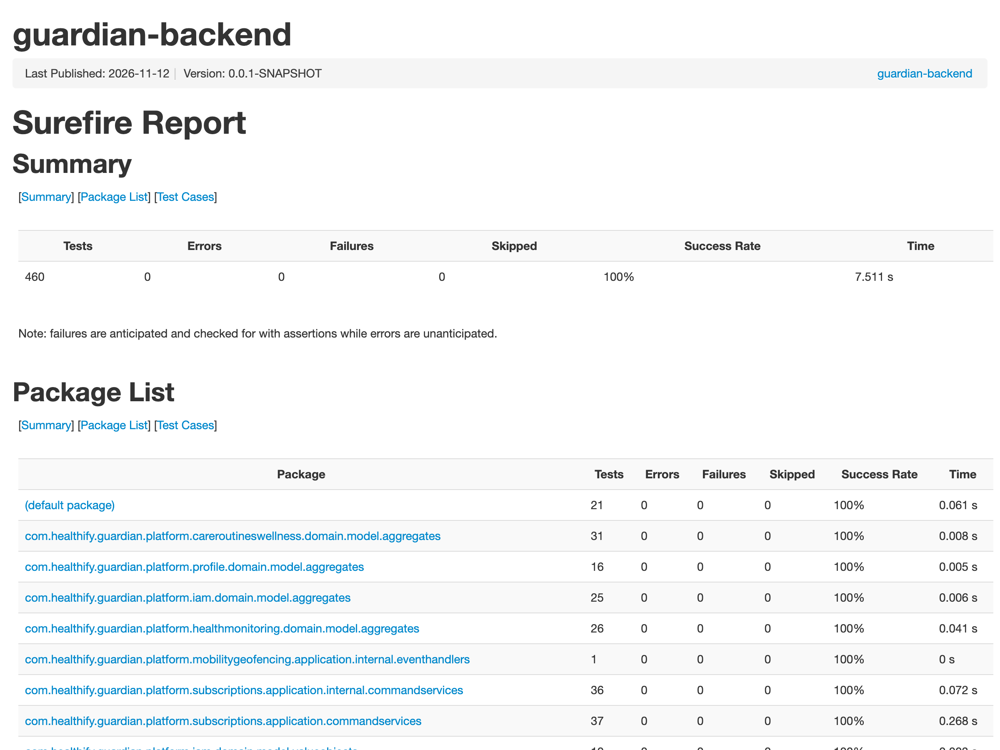

Las pruebas de la aplicación móvil en Kotlin se ejecutaron con Gradle:

~~~bash
./gradlew testDebugUnitTest
~~~

La ejecución comprende **77 pruebas** en 20 clases, sin fallos. La Figura 4.21 muestra el reporte HTML que Gradle genera en `app/build/reports/tests/testDebugUnitTest`.

<a id="figura-4-21"></a>**Figura 4.21.** Ejecución de las pruebas de la aplicación móvil en Kotlin

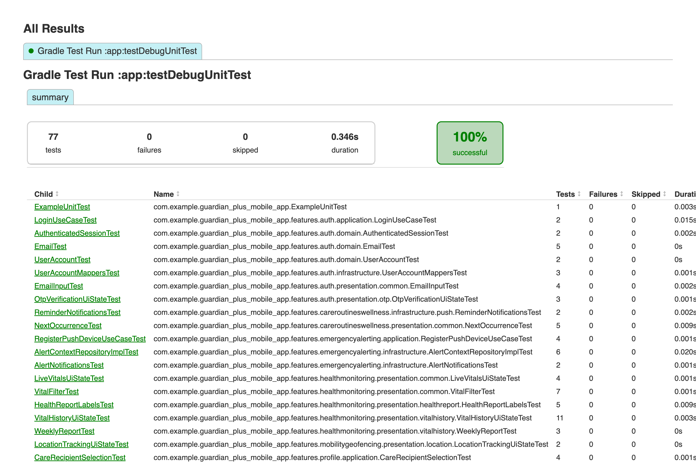

Las pruebas de la aplicación en Flutter se ejecutaron con:

~~~bash
flutter test
~~~

~~~text
00:02 +73: All tests passed!
~~~

La Figura 4.22 muestra la ejecución de las **73 pruebas** de la aplicación en Flutter.

<a id="figura-4-22"></a>**Figura 4.22.** Ejecución de las pruebas de la aplicación en Flutter

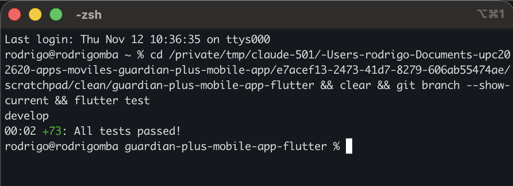

##### Integration Tests and Acceptance Tests

En los Web Services, las pruebas de los controladores de IAM y Subscriptions levantan la capa web con MockMvc y verifican los códigos HTTP y el cuerpo de las respuestas. Las pruebas de integración REST y los 21 escenarios de aceptación en Gherkin de Health Monitoring, incorporados en el Sprint 1, se mantienen en la suite y se ejecutan en cada Pull Request, por lo que verifican que los cambios del Sprint 2 no alteraron el comportamiento de US01 a US05, US09 y US21. En la aplicación en Flutter, las pruebas de `home_page_test.dart` y `health_page_test.dart` recorren las pantallas de principio a fin con la API simulada.

##### Testing Repository

Las pruebas se encuentran en los repositorios de cada producto, junto con su implementación. La Tabla 4.83 resume su ubicación.

<a id="tabla-4-83"></a>**Tabla 4.83.** Ubicación de las pruebas automatizadas

| Repository | Branch | Testing source path |
|---|---|---|
| `upc-pre-202620-1asi0238-13980-Healthify/guardian-plus-platform` | `develop` | `src/test/java/com/healthify/guardian/platform` y `src/test/resources/features` |
| `upc-pre-202620-1asi0238-13980-Healthify/guardian-plus-mobile-app` | `develop` | `app/src/test/java/com/example/guardian_plus_mobile_app/features` |
| `upc-pre-202620-1asi0238-13980-Healthify/guardian-plus-mobile-app-flutter` | `develop` | `test/core` y `test/features` |

##### Testing Commits

Los commits de la Tabla 4.84 contienen las pruebas automatizadas incorporadas durante el Sprint 2.

<a id="tabla-4-84"></a>**Tabla 4.84.** Commits de las pruebas del Sprint 2

| Repository | Branch | Commit Id | Commit Message | Commit Message Body | Committed on (Date) |
|---|---|---|---|---|---|
| `upc-pre-202620-1asi0238-13980-Healthify/guardian-plus-platform` | `feat/iam` | `0efbf64` | `test(iam): add user account and email domain tests` | — | `2026-10-22` |
| `upc-pre-202620-1asi0238-13980-Healthify/guardian-plus-platform` | `feat/iam` | `0e2b140` | `test(iam): add one-time password domain tests` | — | `2026-10-22` |
| `upc-pre-202620-1asi0238-13980-Healthify/guardian-plus-platform` | `feat/iam` | `70a093a` | `test(iam): add password reset token domain tests` | — | `2026-10-22` |
| `upc-pre-202620-1asi0238-13980-Healthify/guardian-plus-platform` | `feat/iam` | `617277a` | `test(iam): add command service tests` | — | `2026-10-22` |
| `upc-pre-202620-1asi0238-13980-Healthify/guardian-plus-platform` | `feat/iam` | `e1f0401` | `test(iam): add security adapter tests` | — | `2026-10-22` |
| `upc-pre-202620-1asi0238-13980-Healthify/guardian-plus-platform` | `feat/iam` | `cb243e6` | `test(iam): add auth controller tests` | — | `2026-10-22` |
| `upc-pre-202620-1asi0238-13980-Healthify/guardian-plus-platform` | `feat/iam` | `2db409c` | `test(iam): add e-mail template tests` | — | `2026-10-22` |
| `upc-pre-202620-1asi0238-13980-Healthify/guardian-plus-platform` | `feat/iam` | `ff2869e` | `test(iam): cover the unverified login, the code rate limit and the login code resend` | — | `2026-10-22` |
| `upc-pre-202620-1asi0238-13980-Healthify/guardian-plus-platform` | `feat/oauth` | `06d78de` | `test(iam): cover google sign-up and linking on the user account` | — | `2026-11-12` |
| `upc-pre-202620-1asi0238-13980-Healthify/guardian-plus-platform` | `feat/oauth` | `931e8a0` | `test(iam): cover the google id token verifier` | — | `2026-11-12` |
| `upc-pre-202620-1asi0238-13980-Healthify/guardian-plus-platform` | `feat/oauth` | `74a52ef` | `test(iam): cover google sign-in in the authentication service` | — | `2026-11-12` |
| `upc-pre-202620-1asi0238-13980-Healthify/guardian-plus-platform` | `feat/oauth` | `3c3ad7c` | `test(iam): cover the google sign-in endpoint` | — | `2026-11-12` |
| `upc-pre-202620-1asi0238-13980-Healthify/guardian-plus-platform` | `feat/subscriptions-backend-final` | `d0270aa` | `feat: implement subscriptions lifecycle and payment flow` | — | `2026-10-24` |
| `upc-pre-202620-1asi0238-13980-Healthify/guardian-plus-platform` | `feat/mobility-wearable-location-mqtt` | `0c6332b` | `test(mobility-geofencing): add wearable location message handler tests` | — | `2026-10-23` |
| `upc-pre-202620-1asi0238-13980-Healthify/guardian-plus-platform` | `feat/emergency-alerting-safe-zone-violation-alerts` | `38fdced` | `test(mobility-geofencing): add safe zone violation event handler tests` | — | `2026-10-23` |
| `upc-pre-202620-1asi0238-13980-Healthify/guardian-plus-platform` | `fix/mobility-geofencing-safe-zone-endpoints` | `2bbf844` | `test(mobility-geofencing): add safe zone command service tests` | — | `2026-10-28` |
| `upc-pre-202620-1asi0238-13980-Healthify/guardian-plus-platform` | `feat/appointment-reminder-push` | `823a513` | `test(emergency-alerting): cover appointment reminder push notifications` | — | `2026-11-12` |
| `upc-pre-202620-1asi0238-13980-Healthify/guardian-plus-platform` | `feat/care-routines-wellness-frontend-alignment` | `08258e6` | `test(care-routines): add unit tests for care routines and wellness bounded context` | — | `2026-10-08` |
| `upc-pre-202620-1asi0238-13980-Healthify/guardian-plus-platform` | `feat/appointment-reminder-push` | `f3f82c9` | `test(care-routines-wellness): cover the appointment reminder integration event` | — | `2026-11-12` |
| `upc-pre-202620-1asi0238-13980-Healthify/guardian-plus-platform` | `feat/appointment-reminder-push` | `38ac332` | `test(profile): cover the profile context facade` | — | `2026-11-12` |
| `upc-pre-202620-1asi0238-13980-Healthify/guardian-plus-platform` | `feat/unlink-wearable-device` | `533aefd` | `test(health-monitoring): cover unlinking wearable devices` | — | `2026-11-12` |
| `upc-pre-202620-1asi0238-13980-Healthify/guardian-plus-mobile-app` | `feat/iam-implementation` | `5a1dfd5` | `test(iam): update the auth tests to the platform contract` | — | `2026-10-22` |
| `upc-pre-202620-1asi0238-13980-Healthify/guardian-plus-mobile-app` | `feat/switch-care-recipient` | `f6147f1` | `test(profile): cover choosing the person under care` | — | `2026-11-12` |
| `upc-pre-202620-1asi0238-13980-Healthify/guardian-plus-mobile-app` | `feat/emergency-alerting-live-alert-context` | `c177886` | `test(emergency-alerting): add alert context repository tests` | — | `2026-10-22` |
| `upc-pre-202620-1asi0238-13980-Healthify/guardian-plus-mobile-app` | `feat/emergency-alerting-alert-location` | `6cb83d1` | `test(emergency-alerting): cover the alert location in the context repository tests` | — | `2026-10-23` |
| `upc-pre-202620-1asi0238-13980-Healthify/guardian-plus-mobile-app` | `feat/emergency-alerting-push-device-registration` | `aede612` | `test(emergency-alerting): add push device registration tests` | — | `2026-10-25` |
| `upc-pre-202620-1asi0238-13980-Healthify/guardian-plus-mobile-app` | `feat/emergency-alerting-push-notifications` | `f607ffb` | `test(emergency-alerting): add alert notification channel tests` | — | `2026-10-26` |
| `upc-pre-202620-1asi0238-13980-Healthify/guardian-plus-mobile-app` | `feat/care-routines-and-wellness` | `e377fe4` | `test(care-routines): add unit tests for care routines and wellness feature` | — | `2026-10-21` |
| `upc-pre-202620-1asi0238-13980-Healthify/guardian-plus-mobile-app` | `feat/appointment-reminder-push` | `9a75dca` | `test(care-routines-wellness): cover recognizing appointment reminder pushes` | — | `2026-11-12` |
| `upc-pre-202620-1asi0238-13980-Healthify/guardian-plus-mobile-app` | `fix/mobility-geofencing-safe-zone-endpoints` | `b8fe2f8` | `test(mobility-geofencing): add location tracking state tests` | — | `2026-10-28` |
| `upc-pre-202620-1asi0238-13980-Healthify/guardian-plus-mobile-app-flutter` | `feat/emergency-alerting-contacts-and-settings` | `51da8d8` | `test(emergency-alerting): add api client, repository, view model and screen tests` | — | `2026-11-08` |
| `upc-pre-202620-1asi0238-13980-Healthify/guardian-plus-mobile-app-flutter` | `feat/emergency-alerting-alerts-and-detail` | `7f1eacb` | `test(emergency-alerting): add alert, incident and alerts screen tests` | — | `2026-11-12` |
| `upc-pre-202620-1asi0238-13980-Healthify/guardian-plus-mobile-app-flutter` | `feat/monitoring-context` | `9dee3ce` | `test(health-monitoring): cover the home dashboard end to end` | — | `2026-11-12` |
| `upc-pre-202620-1asi0238-13980-Healthify/guardian-plus-mobile-app-flutter` | `feat/monitoring-context` | `3661122` | `test(health-monitoring): cover the health tab end to end` | — | `2026-11-12` |
| `upc-pre-202620-1asi0238-13980-Healthify/guardian-plus-mobile-app-flutter` | `feat/monitoring-context` | `2cc966d` | `test(health-monitoring): cover the wristband details` | — | `2026-11-12` |
| `upc-pre-202620-1asi0238-13980-Healthify/guardian-plus-mobile-app-flutter` | `feat/monitoring-context` | `cd1701d` | `test(health-monitoring): cover signing out from home` | — | `2026-11-12` |

#### 4.2.2.6. Execution Evidence for Sprint Review

Al cierre del Sprint 2, la aplicación móvil en Kotlin opera con cuentas reales: el usuario se registra, verifica su correo, inicia sesión con un código OTP o con Google y registra a la persona bajo cuidado. En la sección Salud se muestran en vivo los cinco signos vitales de la pulsera con su clasificación (US01 a US05), y las lecturas que el wearable envía en lote tras recuperar la conexión se integran al historial (US21). Las alertas críticas llegan como notificaciones push a todos los contactos del Care Circle y abren su detalle al tocarlas (US25). Como avance del Sprint 3, la aplicación incorpora la sección Rutinas conectada a los Web Services, la sección Ubicación con las zonas seguras, las llamadas con la pulsera y los recordatorios de citas por push.

De las 9 User Stories comprometidas se completaron 7, con 26 de los 31 Story Points. US10 quedó en progreso: la ventana para descartar una caída desde la pulsera y su escalamiento al vencer ya funcionan, pero el cuidador todavía no recibe el aviso de que el evento fue descartado. US20 no se inició, porque el backend aún no procesa el nivel de batería que publica el IoT Simulator; ambas pasan al Sprint 3.

##### Mobile Application

La Figura 4.23 muestra la aplicación móvil en Kotlin ejecutándose en el emulador de Android Studio.

<a id="figura-4-23"></a>**Figura 4.23.** Aplicación móvil en Kotlin en ejecución

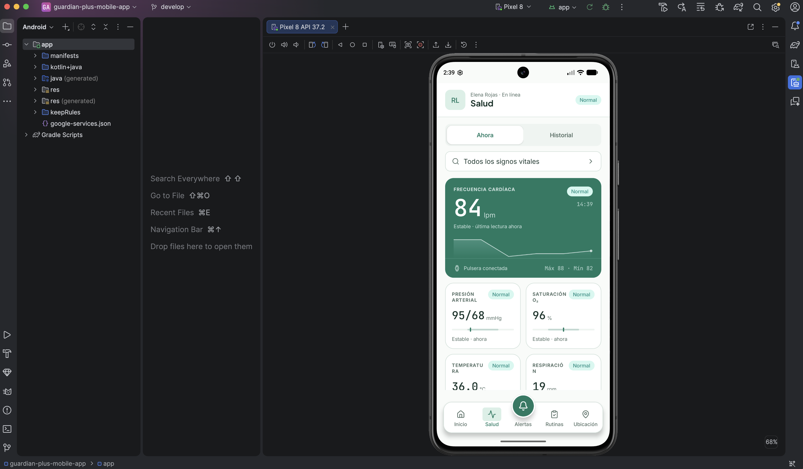

La Figura 4.24 muestra la aplicación en Flutter ejecutándose en el emulador.

<a id="figura-4-24"></a>**Figura 4.24.** Aplicación móvil en Flutter en ejecución

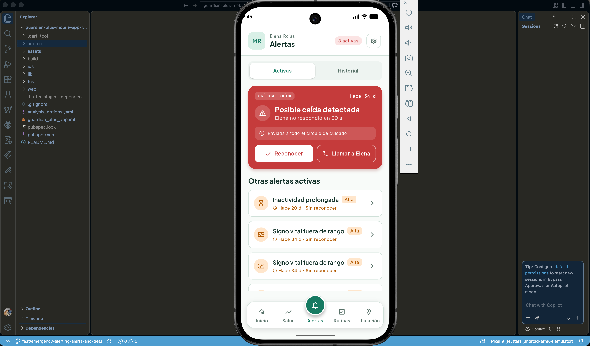

La Tabla 4.85 presenta los enlaces a los videos de ejecución de las aplicaciones móviles.

<a id="tabla-4-85"></a>**Tabla 4.85.** Videos de ejecución de las aplicaciones móviles

| Producto | Video de ejecución |
|---|---|
| Mobile Application (Kotlin) | [Guardian+ — Mobile Application (Sprint 2)](https://upcedupe-my.sharepoint.com/:v:/g/personal/u20241b843_upc_edu_pe/IQD5z0ZoKbxsRp3vO8N0FwlKAVTiEjxQ4u2z-deBxqdYYmc?e=eI1gze&nav=eyJyZWZlcnJhbEluZm8iOnsicmVmZXJyYWxBcHAiOiJTdHJlYW1XZWJBcHAiLCJyZWZlcnJhbFZpZXciOiJTaGFyZURpYWxvZy1MaW5rIiwicmVmZXJyYWxBcHBQbGF0Zm9ybSI6IldlYiIsInJlZmVycmFsTW9kZSI6InZpZXcifX0%3D) |
| Mobile Application (Flutter) | [Guardian+ — Mobile Application Flutter (Sprint 2)](https://upcedupe-my.sharepoint.com/:v:/g/personal/u20241b843_upc_edu_pe/IQAjHQW-AC8GS4Fz2ohMoe55AQiYpysniToSBVadKrHmJmk?e=BoJsfS&nav=eyJyZWZlcnJhbEluZm8iOnsicmVmZXJyYWxBcHAiOiJTdHJlYW1XZWJBcHAiLCJyZWZlcnJhbFZpZXciOiJTaGFyZURpYWxvZy1MaW5rIiwicmVmZXJyYWxBcHBQbGF0Zm9ybSI6IldlYiIsInJlZmVycmFsTW9kZSI6InZpZXcifX0%3D) |

##### Web Services

Los Web Services se encuentran publicados en Microsoft Azure y su documentación puede consultarse en [Swagger UI](https://guardian-plus-api.chilecentral.cloudapp.azure.com/swagger-ui/index.html). Al cierre del Sprint 2 exponen 105 operaciones en 97 rutas, frente a las 63 rutas del Sprint 1. La Figura 4.25 muestra los endpoints disponibles en el entorno desplegado.

<a id="figura-4-25"></a>**Figura 4.25.** Web Services en ejecución en Swagger UI

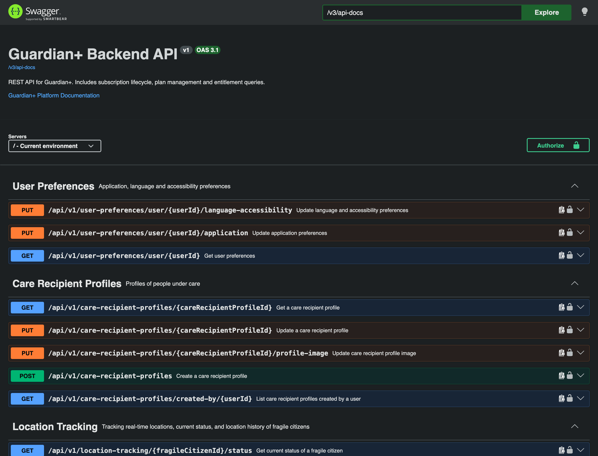

La Tabla 4.86 presenta el enlace al video de ejecución de los Web Services.

<a id="tabla-4-86"></a>**Tabla 4.86.** Video de ejecución de los Web Services

| Producto | Video de ejecución |
|---|---|
| Web Services | [Guardian+ — Web Services (Sprint 2)](https://www.youtube.com/watch?v=v9iYvc2zGpk) |

#### 4.2.2.7. Services Documentation Evidence for Sprint Review

Los Web Services se documentan con OpenAPI mediante springdoc-openapi, del mismo modo que en el Sprint 1 (sección 4.2.1.7). En esta sección se presentan los endpoints agregados o modificados en el Sprint 2. Los endpoints de signos vitales en vivo, historial y sincronización en lote que soportan US01 a US05 y US21 se documentaron en la Tabla 4.48 y no cambiaron.

##### IAM

La Tabla 4.87 presenta los endpoints de IAM. El inicio de sesión se realiza en dos pasos: `POST /api/v1/auth/login` valida la contraseña y envía un código OTP al correo, y `POST /api/v1/auth/otp/verify` valida el código y entrega el token de sesión.

<a id="tabla-4-87"></a>**Tabla 4.87.** Endpoints de IAM

| Verbo | Endpoint | Acción | Parámetros | Respuesta |
|---|---|---|---|---|
| POST | `/api/v1/auth/register` | Registra las credenciales y envía el código de verificación del correo | Body: `email`, `password` | 201 `UserAccountResource` / 400 / 409 |
| POST | `/api/v1/auth/verify-email` | Verifica el correo con el código recibido y activa la cuenta | Body: `userAccountId`, `code` | 200 `UserAccountResource` / 400 / 404 / 422 |
| POST | `/api/v1/auth/verify-email/resend` | Envía un nuevo código de verificación del correo | Body: `userAccountId` | 202 `MessageResource` / 404 / 422 |
| POST | `/api/v1/auth/login` | Valida la contraseña y envía el código de inicio de sesión (paso 1 de 2) | Body: `email`, `password` | 202 `OtpChallengeResource` / 401 / 403 |
| POST | `/api/v1/auth/otp/verify` | Valida el código y entrega el token de sesión (paso 2 de 2) | Body: `userAccountId`, `code` | 200 `AuthenticatedSessionResource` / 400 / 401 |
| POST | `/api/v1/auth/otp/resend` | Envía un nuevo código de inicio de sesión | Body: `userAccountId` | 202 `MessageResource` / 401 / 422 |
| POST | `/api/v1/auth/google` | Inicia sesión o registra la cuenta con un ID token de Google | Body: `idToken` | 200 `AuthenticatedSessionResource` / 400 / 401 |
| POST | `/api/v1/auth/password-reset/request` | Envía al correo el token de recuperación de contraseña | Body: `email` | 202 `MessageResource` / 400 / 404 |
| POST | `/api/v1/auth/password-reset/confirm` | Establece una nueva contraseña con el token de recuperación | Body: `token`, `newPassword` | 200 `MessageResource` / 400 |
| GET | `/api/v1/user-accounts/me` | Cuenta de la sesión iniciada | Header: `Authorization` | 200 `UserAccountResource` / 401 / 404 |
| GET | `/api/v1/user-accounts/{userAccountId}` | Detalle de una cuenta | Path: `userAccountId` | 200 `UserAccountResource` / 404 |
| GET | `/api/v1/user-accounts/availability` | Indica si un correo está disponible para el registro | Query: `email` | 200 `EmailAvailabilityResource` / 400 |

##### Subscriptions

La Tabla 4.88 presenta los endpoints de Subscriptions.

<a id="tabla-4-88"></a>**Tabla 4.88.** Endpoints de Subscriptions

| Verbo | Endpoint | Acción | Parámetros | Respuesta |
|---|---|---|---|---|
| POST | `/api/v1/subscriptions` | Solicita una suscripción a un plan e inicia su pago | Body: `subscriberId`, `planId` | 201 `SubscriptionResource` / 400 |
| PATCH | `/api/v1/subscriptions/{subscriptionId}/plan` | Cambia el plan de la suscripción | Path: `subscriptionId`. Body: `newPlanId` | 200 `SubscriptionResource` / 400 |
| POST | `/api/v1/subscriptions/{subscriptionId}/cancellation` | Programa la cancelación de la suscripción | Path: `subscriptionId` | 200 `SubscriptionResource` / 400 |
| GET | `/api/v1/subscriptions/subscriber/{subscriberId}/status` | Suscripción vigente del suscriptor | Path: `subscriberId` | 200 `SubscriptionResource` / 404 |
| GET | `/api/v1/subscriptions/subscriber/{subscriberId}/entitlements` | Beneficios habilitados por el plan | Path: `subscriberId` | 200 `EntitlementSetResource` / 404 |

##### Direct Communication

La Tabla 4.89 presenta los endpoints de Direct Communication.

<a id="tabla-4-89"></a>**Tabla 4.89.** Endpoints de Direct Communication

| Verbo | Endpoint | Acción | Parámetros | Respuesta |
|---|---|---|---|---|
| POST | `/api/v1/communication/calls/start` | Inicia una llamada de voz o video con la pulsera | Body: `fragileCitizenId`, `requestedType` | 200 `CallSessionResource` / 400 |
| POST | `/api/v1/communication/calls/{callId}/end` | Finaliza una llamada en curso | Path: `callId` | 200 `CallSessionResource` / 404 |
| POST | `/api/v1/communication/calls/log-unanswered` | Registra una llamada no atendida tras 30 segundos | Body: `fragileCitizenId`, `attemptedType`, `reason` | 200 `CallLogEntryResource` / 400 |
| GET | `/api/v1/communication/{fragileCitizenId}/call-logs` | Historial de llamadas | Path: `fragileCitizenId` | 200 lista de `CallLogEntryResource` |
| GET | `/api/v1/communication/{fragileCitizenId}/device-capabilities` | Capacidades de la pulsera: cámara, pantalla, micrófono, parlante y vibración | Path: `fragileCitizenId` | 200 `DeviceCapabilitiesResource` |
| POST | `/api/v1/communication/haptic-alert` | Envía una alerta háptica a la pulsera | Body: `fragileCitizenId`, `message` | 200 / 400 |

##### Mobility & Geofencing

La Tabla 4.90 presenta los endpoints de Mobility & Geofencing agregados en el Sprint 2. Los demás se mantienen como se documentaron en la Tabla 4.51; la activación de una zona segura desactiva ahora la que estaba activa, y la consulta del estado devuelve `UNKNOWN` mientras no exista una ubicación registrada.

<a id="tabla-4-90"></a>**Tabla 4.90.** Endpoints agregados en Mobility & Geofencing

| Verbo | Endpoint | Acción | Parámetros | Respuesta |
|---|---|---|---|---|
| GET | `/api/v1/safe-zones/fragile-citizen/{fragileCitizenId}` | Zonas seguras de la persona bajo cuidado | Path: `fragileCitizenId` | 200 lista de `SafeZoneResource` |
| DELETE | `/api/v1/safe-zones/{safeZoneId}` | Elimina una zona segura | Path: `safeZoneId` | 204 / 404 |

##### Care Routines & Wellness

La Tabla 4.91 presenta los endpoints de Care Routines & Wellness agregados para las pantallas de Rutinas de la aplicación.

<a id="tabla-4-91"></a>**Tabla 4.91.** Endpoints agregados en Care Routines & Wellness

| Verbo | Endpoint | Acción | Parámetros | Respuesta |
|---|---|---|---|---|
| POST | `/api/v1/reminders` | Programa un recordatorio con su recurrencia y sus datos de medicación o cita | Body: `personUnderCareId`, `type`, `scheduledTime`, `title`, `dosage`, `instructions`, `location`, `durationMinutes`, `leadTimeMinutes`, `medicationStockId`, `recurrence` | 201 `ReminderResource` / 400 / 404 |
| GET | `/api/v1/reminders/{reminderId}` | Detalle de un recordatorio | Path: `reminderId` | 200 `ReminderResource` / 404 |
| PUT | `/api/v1/reminders/{reminderId}/miss` | Marca un recordatorio como omitido | Path: `reminderId` | 200 `ReminderResource` / 404 / 422 |
| GET | `/api/v1/reminders/citizen/{personUnderCareId}/adherence` | Adherencia a los recordatorios en un periodo | Path: `personUnderCareId`. Query: `type`, `from`, `to` | 200 `AdherenceResource` / 400 |
| POST | `/api/v1/medication-stocks` | Registra el stock de un medicamento | Body: `personUnderCareId`, `medicationName`, `dosage`, `dailyConsumption`, `packageSize`, `initialDoses` | 201 `MedicationStockResource` / 400 / 409 |
| GET | `/api/v1/medication-stocks/{medicationStockId}` | Detalle de un stock de medicación | Path: `medicationStockId` | 200 `MedicationStockResource` / 404 |
| PUT | `/api/v1/medication-stocks/{medicationStockId}/acquisition` | Confirma la adquisición de un envase | Path: `medicationStockId`. Body: `dosesAdded` | 200 `MedicationStockResource` / 400 / 404 |
| GET / PUT | `/api/v1/hydration-plans/citizen/{personUnderCareId}` | Consulta o configura el plan de hidratación | Path: `personUnderCareId`. Body: `active`, `dailyGoalGlasses`, `intervalHours`, `respectSleepWindow` | 200 `HydrationPlanResource` / 400 / 404 |
| GET | `/api/v1/activity-monitors/citizen/{personUnderCareId}` | Estado de actividad de la persona bajo cuidado | Path: `personUnderCareId` | 200 `ActivityMonitorResource` / 404 |
| GET | `/api/v1/activity-monitors/citizen/{personUnderCareId}/log-entries` | Actividad reciente | Path: `personUnderCareId`. Query: `limit` | 200 lista / 400 |
| PUT | `/api/v1/activity-monitors/citizen/{personUnderCareId}/inactivity-detection` | Configura la detección de inactividad prolongada | Path: `personUnderCareId`. Body: `enabled`, `thresholdMinutes` | 200 `ActivityMonitorResource` / 400 |
| GET | `/api/v1/sleep-cycle-records/citizen/{personUnderCareId}` | Ciclos de sueño en un periodo | Path: `personUnderCareId`. Query: `from`, `to` | 200 lista de `SleepCycleRecordResource` |

##### Health Monitoring

La Tabla 4.92 presenta el endpoint agregado en Health Monitoring.

<a id="tabla-4-92"></a>**Tabla 4.92.** Endpoint agregado en Health Monitoring

| Verbo | Endpoint | Acción | Parámetros | Respuesta |
|---|---|---|---|---|
| DELETE | `/api/v1/wearable-devices/{wearableDeviceId}` | Desvincula un wearable de la persona bajo cuidado | Path: `wearableDeviceId` | 200 `WearableDeviceResource` / 404 |

##### Emergency & Alerting

Los endpoints de Emergency & Alerting se mantienen como se documentaron en la Tabla 4.47. Para recibir notificaciones push, la aplicación registra el token de Firebase del teléfono con `PUT /api/v1/alert-channel-settings/user/{userId}/channels/PUSH`, enviando `enabled` y `deviceToken`. Los procesos del Sprint 2 que el sistema dispara sin un endpoint propio se detallan en la Tabla 4.93.

<a id="tabla-4-93"></a>**Tabla 4.93.** Procesos de integración incorporados en el Sprint 2

| Proceso | Componente | Descripción |
|---|---|---|
| Entrega push de alertas | `PushNotificationProviderAdapter` | Envía cada entrega del canal `PUSH` mediante Firebase Cloud Messaging con la cuenta de servicio de `FIREBASE_SERVICE_ACCOUNT_BASE64`. En el nivel `BROADCAST` la alerta se entrega a la vez a todos los contactos activos (US25). |
| Ubicación del wearable | `WearableLocationMessageHandler` | Se suscribe al tópico MQTT `guardian/location/+` y registra la ubicación recibida en el seguimiento de la persona bajo cuidado. |
| Violación de la zona segura | `SafeZoneViolationDetectedEventHandler` | Publica `SafeZoneViolationDetectedIntegrationEvent` cuando la ubicación sale de la zona activa; Emergency & Alerting lo convierte en una alerta. |
| Recordatorio de cita médica | `AppointmentReminderIssuedEventHandler`, `ReminderNotificationSender` | Al emitirse un recordatorio de cita, Care Routines & Wellness publica un evento de integración y Emergency & Alerting notifica por push a cada cuidador de la persona, obtenido mediante `ProfileContextFacade`. |
| Limpieza de códigos OTP | Scheduler de IAM | Cada hora elimina los códigos OTP vencidos (`iam.otp.cleanup.cron`). |

#### 4.2.2.8. Software Deployment Evidence for Sprint Review

En el Sprint 2 se actualizaron los Web Services desplegados en Microsoft Azure con cada integración en `develop`, y se configuró Firebase Cloud Messaging para las notificaciones push de la aplicación móvil. El Landing Page y el IoT Simulator se mantienen con los despliegues del Sprint 1 (sección 4.2.1.8), porque no tuvieron cambios funcionales.

##### Web Services

La Tabla 4.94 resume el despliegue de los Web Services al cierre del Sprint 2.

<a id="tabla-4-94"></a>**Tabla 4.94.** Despliegue de los Web Services en el Sprint 2

| Aspecto | Detalle |
|---|---|
| **Plataforma** | Microsoft Azure (suscripción Azure for Students), región Chile Central |
| **URL pública** | [guardian-plus-api.chilecentral.cloudapp.azure.com](https://guardian-plus-api.chilecentral.cloudapp.azure.com/swagger-ui/index.html) |
| **Repositorio** | [guardian-plus-platform](https://github.com/upc-pre-202620-1asi0238-13980-Healthify/guardian-plus-platform) |
| **Rama desplegada** | `develop` (commit `6dd5f9f`) |
| **Infraestructura** | Máquina virtual `guardian-plus-vm` y Azure Database for PostgreSQL `guardian-plus-db-54c33b`, sin cambios respecto del Sprint 1 |
| **Variables agregadas al `.env`** | `BREVO_API_KEY`, `IAM_EMAIL_SENDER`, `IAM_SECRETS_HMAC_KEY`, `IAM_JWT_PRIVATE_KEY`, `IAM_JWT_PUBLIC_KEY`, `MOBILITY_GEOFENCING_MQTT_ENABLED`, `MOBILITY_GEOFENCING_MQTT_BROKER_URL` y `FIREBASE_SERVICE_ACCOUNT_BASE64` |
| **Bounded Contexts publicados** | Los cinco del Sprint 1 más IAM, Subscriptions y Direct Communication, con 97 rutas documentadas en Swagger UI |

El despliegue se realizó en los pasos de la Tabla 4.95:

<a id="tabla-4-95"></a>**Tabla 4.95.** Pasos del despliegue de los Web Services en el Sprint 2

| Step | Acción | Resultado |
|---|---|---|
| **1** | Registro en el `.env` de la máquina virtual de las variables de IAM: la clave de Brevo, el remitente de los correos, la clave HMAC y el par de claves RSA de los tokens de sesión. | Los correos de verificación y los códigos OTP se envían desde el entorno publicado. |
| **2** | Integración de IAM, de la ubicación por MQTT, de la alerta por zona segura y de Subscriptions (Pull Requests #17 a #21, del 22 al 24 de octubre). | Cinco despliegues consecutivos completados por el workflow `Deploy`. |
| **3** | Integración de Mobility & Geofencing (Pull Request #22). | El job `test` falló por un error de compilación en `SafeZone`, por lo que el workflow omitió `build` y `deploy`. La corrección se integró la misma noche y su despliegue se completó. |
| **4** | Creación del proyecto `guardian-plus-1f1dd` en Firebase, generación de la clave de su cuenta de servicio y registro de esta en `FIREBASE_SERVICE_ACCOUNT_BASE64`. Integración del envío push (Pull Request #23). | Despliegue completado el 25 de octubre y alertas entregadas por Firebase Cloud Messaging. |
| **5** | Integraciones del 21 de octubre (Pull Request #16) y del 28 de octubre al 12 de noviembre (Pull Requests #24 a #28), y sus reejecuciones. | El job `deploy` falló en `ssh-keyscan` porque la máquina virtual estaba detenida para ahorrar el crédito de Azure for Students; los jobs `test` y `build` se completaron y las imágenes quedaron publicadas en GHCR. |
| **6** | Encendido de la máquina virtual y de la base de datos, verificación del `.env` e integración del Pull Request #29. | Despliegue completado el 12 de noviembre de 2026 con el commit `6dd5f9f`, que incluye todas las integraciones del Sprint. |
| **7** | Validación de la API publicada. | `/v3/api-docs` responde por HTTPS con 97 rutas y 105 operaciones en 25 grupos. |

Las ejecuciones del workflow `Deploy` del Sprint 2 se muestran en la Figura 4.26.

<a id="figura-4-26"></a>**Figura 4.26.** Ejecuciones del workflow Deploy en el Sprint 2

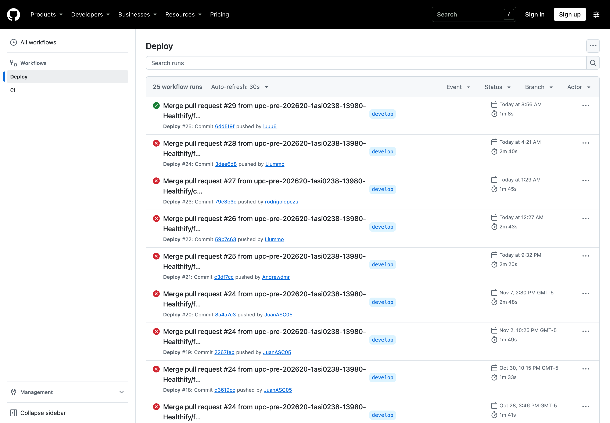

La máquina virtual `guardian-plus-vm` se encuentra en ejecución con la versión del cierre del Sprint, como se muestra en la Figura 4.27.

<a id="figura-4-27"></a>**Figura 4.27.** Máquina virtual guardian-plus-vm en Azure al cierre del Sprint 2

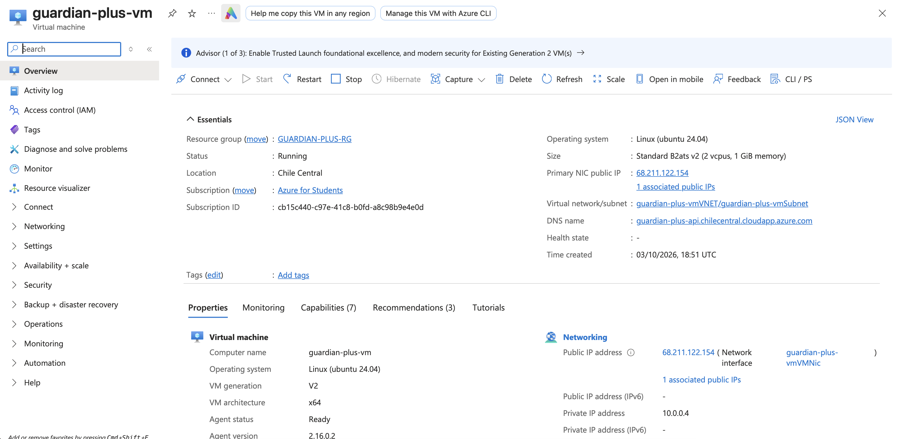

##### Mobile Application — Firebase Cloud Messaging

La Tabla 4.96 resume la configuración de Firebase para las notificaciones push de la aplicación móvil en Kotlin.

<a id="tabla-4-96"></a>**Tabla 4.96.** Configuración de Firebase Cloud Messaging

| Aspecto | Detalle |
|---|---|
| **Proyecto de Firebase** | `guardian-plus-1f1dd` |
| **Aplicación Android registrada** | `com.healthify.guardianplus`, identificador definitivo de la aplicación |
| **Configuración en la aplicación** | `app/google-services.json` y la dependencia `firebase-messaging` |
| **Configuración en el backend** | Cuenta de servicio de Firebase en la variable `FIREBASE_SERVICE_ACCOUNT_BASE64` del `.env` de la máquina virtual |
| **Canales de notificación** | Alertas, con prioridad alta, y recordatorios de citas médicas |

La Figura 4.28 muestra el proyecto de Firebase con la aplicación Android registrada.

<a id="figura-4-28"></a>**Figura 4.28.** Proyecto guardian-plus-1f1dd en Firebase

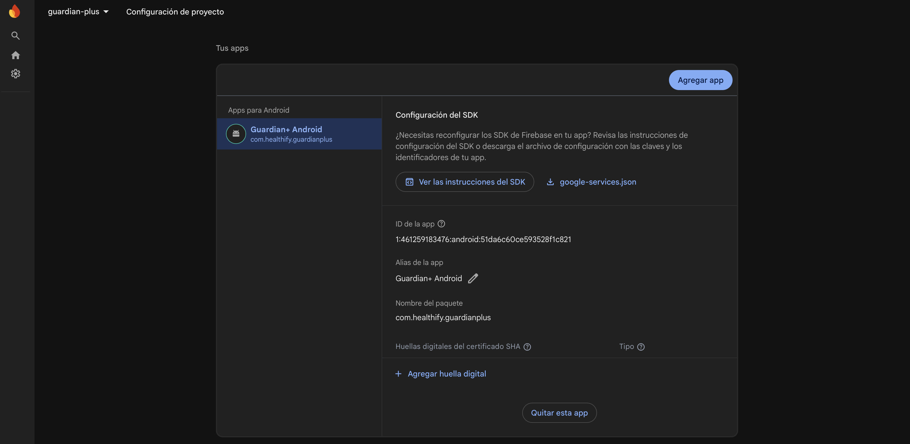

#### 4.2.2.9. Team Collaboration Insights during Sprint

Durante el Sprint 2 el equipo trabajó en los repositorios de los Web Services, de la aplicación móvil en Kotlin y de la aplicación en Flutter mediante ramas por funcionalidad integradas con Pull Requests. A continuación se muestran las analíticas de colaboración (Pulse) del último mes de cada repositorio, del 12 de octubre al 12 de noviembre de 2026. En los Web Services y en la aplicación en Kotlin, Pulse no muestra el resumen de commits porque se calcula sobre la rama `main`, que no recibió cambios en el periodo: todo el trabajo del Sprint se integró en `develop`. Por eso, el número de commits de esos dos repositorios se obtuvo del historial de todas sus ramas.

**Backend (Web Services):** 14 pull requests fusionados por los 5 integrantes, con 139 commits en todas las ramas. La Figura 4.29 muestra los insights del repositorio de los Web Services.

<a id="figura-4-29"></a>**Figura 4.29.** Insights del repositorio de los Web Services

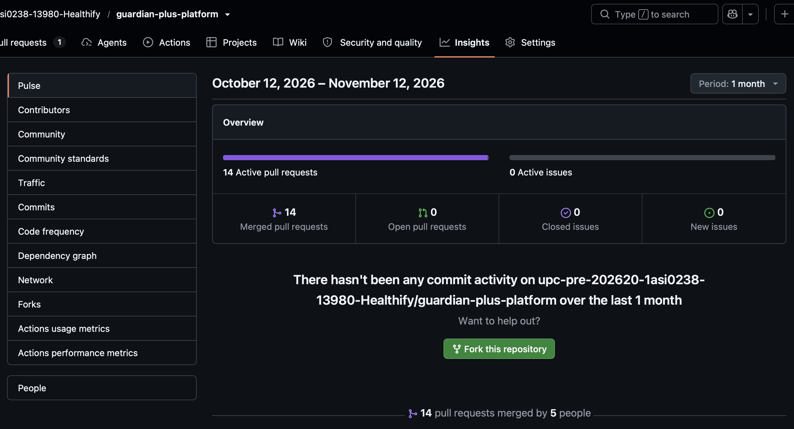

**Mobile App (Kotlin):** 24 pull requests fusionados por los 5 integrantes, con 162 commits en todas las ramas. La Figura 4.30 muestra los insights del repositorio de la aplicación móvil.

<a id="figura-4-30"></a>**Figura 4.30.** Insights del repositorio de la aplicación móvil

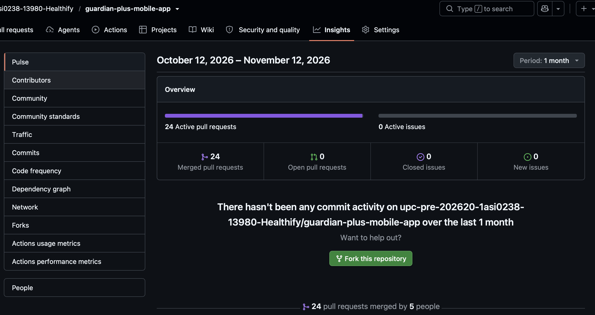

**Mobile App (Flutter):** 6 pull requests fusionados por 3 integrantes, con 88 commits de 3 autores en todas las ramas, 3 de ellos en `main`. La Figura 4.31 muestra los insights del repositorio de la aplicación en Flutter.

<a id="figura-4-31"></a>**Figura 4.31.** Insights del repositorio de la aplicación en Flutter

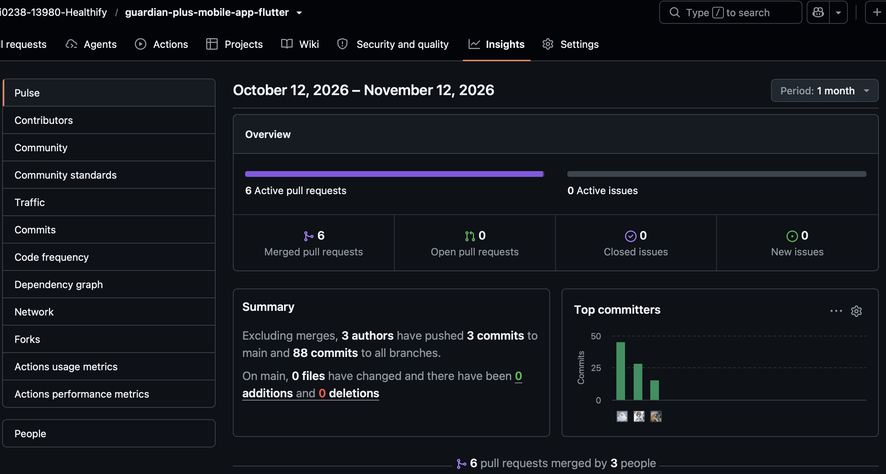

## 4.3. Validation Interviews

En esta sección se presentan las entrevistas de validación del Landing Page realizadas con familiares y cuidadores y la entrevista de validación de la aplicación móvil del Sprint 2, junto con su diseño y su registro, y la evaluación heurística del prototipo de la aplicación móvil.

### 4.3.1. Diseño de Entrevistas

La sesión de validación consiste en un recorrido guiado (think-aloud) por el Landing Page de Guardian+, en el mismo orden en que está estructurado el sitio: Hero → Pain Points → Cómo funciona → Pulsera → Beneficios → Tour de la app → Zonas Seguras → Por qué Guardian+ → Planes → Contacto. El objetivo de cada pregunta es verificar si, según su segmento, el entrevistado entiende y percibe el valor real que ofrece Guardian+ en esa sección, por lo que todas las preguntas buscan que el entrevistado se explaye y justifique su respuesta, evitando preguntas cerradas de sí/no.

#### Segmento 1 — Familiares

1. **Hero:** Después de leer esta primera pantalla, ¿qué entiendes que hace Guardian+ por ti y tu familia, en tus propias palabras? ¿Por qué lo entiendes así?
2. **Pain Points:** ¿Cuál de estas tres preguntas refleja mejor una preocupación que tú mismo has tenido con tu familiar, y por qué esa en particular?
3. **Cómo funciona:** ¿Qué entiendes que pasa, paso a paso, si tu familiar sufre una emergencia? ¿Qué parte del proceso te queda más clara y cuál más confusa?
4. **Pulsera:** ¿Cuáles de estas funciones de la pulsera usarías con tu familiar, y qué tranquilidad específica te daría cada una?
5. **Beneficios:** ¿Cuáles de estos seis beneficios te parecen más importantes para decidir si usarías Guardian+, y qué necesidad tuya resuelve cada uno?
6. **Tour de la app:** Al ver la pantalla de Inicio ¿qué tan bien reflejan la forma en que tú querrías enterarte del estado de tu familiar durante el día? ¿Por qué?
7. **Zonas Seguras:** ¿De qué manera esta función cambiaría tu tranquilidad o tu rutina actual con tu familiar? ¿Por qué?
8. **Por qué Guardian+:** ¿Qué tan identificado te sientes con el testimonio mostrado, y qué parte de esa historia se parece más a la tuya?
9. **Planes:** Viendo los tres planes, ¿cuál elegirías para tu familia y qué fue lo que más pesó en tu decisión?
10. **Contacto:** Si tuvieras dudas sobre qué plan elegir, ¿qué información esperarías recibir al usar este formulario de contacto?

#### Segmento 2 — Cuidadores

1. **Hero:** Si estuvieras buscando una herramienta que te apoye en tu trabajo de cuidado, ¿qué entiendes que te ofrece Guardian+ a partir de esta pantalla? ¿Por qué lo entiendes así?
2. **Pain Points:** ¿Cuál de estas preguntas representa mejor un riesgo que tú monitoreas en tu trabajo diario, y por qué ese en particular?
3. **Cómo funciona:** Viendo estos 3 pasos, ¿en qué se parece o se diferencia esto de cómo actúas tú actualmente ante una emergencia con tu paciente?
4. **Pulsera:** ¿Cuáles de estas funciones de la pulsera usarías en tu trabajo diario, y qué problema puntual de tu rutina de cuidado te resolvería cada una?
5. **Beneficios:** ¿Cuáles de estos beneficios te ahorrarían tiempo o esfuerzo en tu rutina diaria de cuidado, y de qué manera lo harían?
6. **Tour de la app:** Al ver la pantalla de Inicio con el estado del paciente, ¿qué tan útil te resulta esa información para hacer seguimiento durante tu jornada? ¿Qué le agregarías o quitarías?
7. **Zonas Seguras:** ¿De qué manera esta función reduciría la supervisión constante que haces actualmente? ¿Por qué?
8. **Por qué Guardian+:** Como cuidador profesional, ¿qué tanta confianza te generan estos diferenciadores frente a lo que usas hoy, y por qué?
9. **Planes:** Si tú recomendaras un plan a la familia de tu paciente, ¿cuál sugerirías según las necesidades que observas en tu trabajo, y por qué ese?
10. **Contacto:** Si necesitaras orientación sobre el plan adecuado para tu paciente, ¿qué información esperarías recibir al usar este formulario de contacto?

#### Aplicación móvil — Sprint 2

Para la entrega del Sprint 2 se valida la aplicación móvil en Kotlin con las funcionalidades implementadas al cierre del Sprint (sección 4.2.2.6), conectada a los Web Services desplegados en Microsoft Azure y con los signos vitales en vivo que envía el simulador IoT. La sesión empieza con el video de presentación del producto y continúa con un recorrido guiado (think-aloud) por la aplicación en el orden de su barra de navegación: Inicio → Salud → Alertas → Rutinas → Ubicación. Las preguntas son las mismas para familiares y cuidadores, ya que en la aplicación ambos cumplen el rol de miembro del Care Circle, y buscan verificar si el entrevistado entiende la información de cada pantalla y si le resulta útil para atender a la persona bajo su cuidado.

1. **Interfaz:** Al recorrer la pantalla de Inicio y la barra de navegación, ¿qué opinas del diseño de la aplicación? ¿Qué te resulta claro y qué no?
2. **Salud → Ahora:** Mientras los signos vitales se actualizan en vivo, ¿cuál revisarías primero y cómo identificarías si un valor es normal o preocupante?
3. **Alertas:** Ante una alerta de caída, ¿qué harías primero y qué te gustaría ver en el detalle de la alerta sobre lo que pasó?
4. **Rutinas:** Al ver esta sección, ¿qué entiendes que puedes registrar y configurar, y qué parte te resulta más útil?
5. **Ubicación:** Al ver la ubicación y las zonas seguras, ¿en qué situaciones de tu día a día usarías esta función y qué te daría confianza al usarla?
6. **Valoración general:** ¿Qué opinas de la aplicación en general y crees que te sería útil en tu día a día? ¿Por qué?
7. **Mejoras:** ¿Qué te gustaría que la aplicación incorpore o mejore más adelante?

### 4.3.2. Registro de Entrevistas

A continuación se presenta el registro de las entrevistas de validación del Landing Page, incluyendo la ficha de cada entrevistado, la captura de pantalla correspondiente y el análisis de sus respuestas.

El video de las entrevistas de validación del Landing Page se encuentra publicado en SharePoint. La Figura 4.32 muestra una captura del video.

<a id="figura-4-32"></a>**Figura 4.32.** Video de las entrevistas de validación del Landing Page

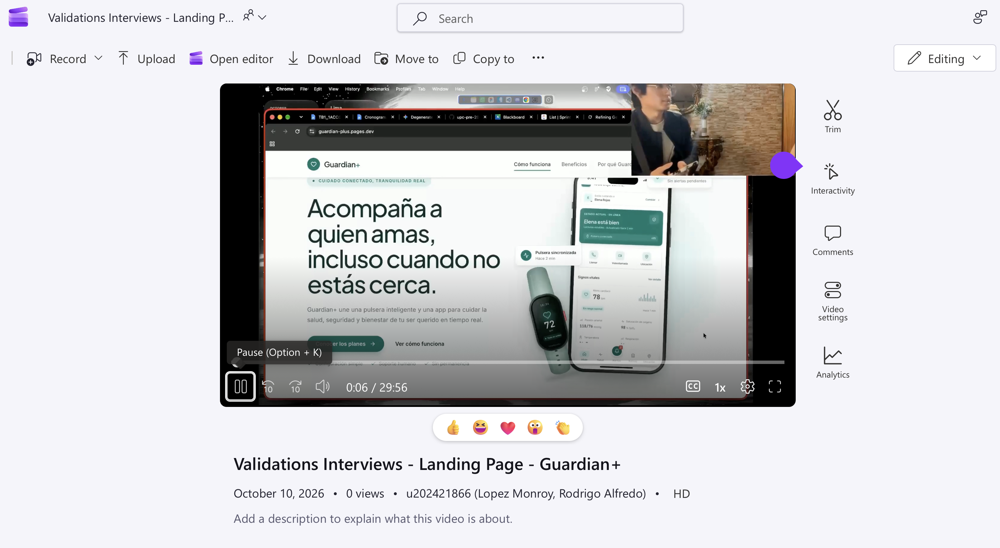

La Tabla 4.97 presenta el enlace al video de las entrevistas de validación.

<a id="tabla-4-97"></a>**Tabla 4.97.** Video de las entrevistas de validación

| Recurso | Enlace |
|---|---|
| Entrevistas de validación | [Validations Interviews - Landing Page - Guardian+](https://upcedupe-my.sharepoint.com/:v:/g/personal/u202421866_upc_edu_pe/IQAxBGuoHQvGRqgBC0T0HrglAUXwA6zv4qQLZ-jhAudV0No?nav=eyJyZWZlcnJhbEluZm8iOnsicmVmZXJyYWxBcHAiOiJPbmVEcml2ZUZvckJ1c2luZXNzIiwicmVmZXJyYWxBcHBQbGF0Zm9ybSI6IldlYiIsInJlZmVycmFsTW9kZSI6InZpZXciLCJyZWZlcnJhbFZpZXciOiJNeUZpbGVzTGlua0NvcHkifX0&e=eD9ATT) |

##### Segmento 1: Familiares

**Entrevistado 1**

**Enlace a la grabación de la entrevista:** [Ver grabación en SharePoint](https://upcedupe-my.sharepoint.com/:v:/g/personal/u20241b843_upc_edu_pe/IQBKYPpWt5CVTKNKT1KQHr26Aaz4_Jr5SuOov7l5OLCPyUE?e=EdUJcA&nav=eyJyZWZlcnJhbEluZm8iOnsicmVmZXJyYWxBcHAiOiJTdHJlYW1XZWJBcHAiLCJyZWZlcnJhbFZpZXciOiJTaGFyZURpYWxvZy1MaW5rIiwicmVmZXJyYWxBcHBQbGF0Zm9ybSI6IldlYiIsInJlZmVycmFsTW9kZSI6InZpZXcifX0%3D)

La Tabla 4.98 presenta los datos de la entrevistada.

<a id="tabla-4-98"></a>**Tabla 4.98.** Datos de la entrevista de validación a Rocio Alvarado

| Campo | Valor |
|---|---|
| Nombre y apellido | Rocío Miranda Alvarado Silva |
| Edad | 22 |
| Distrito | Jesus María |

La Figura 4.33 muestra una captura de la entrevista de validación a Rocio Alvarado.

<a id="figura-4-33"></a>**Figura 4.33.** Captura de la entrevista de validación a Rocio Alvarado

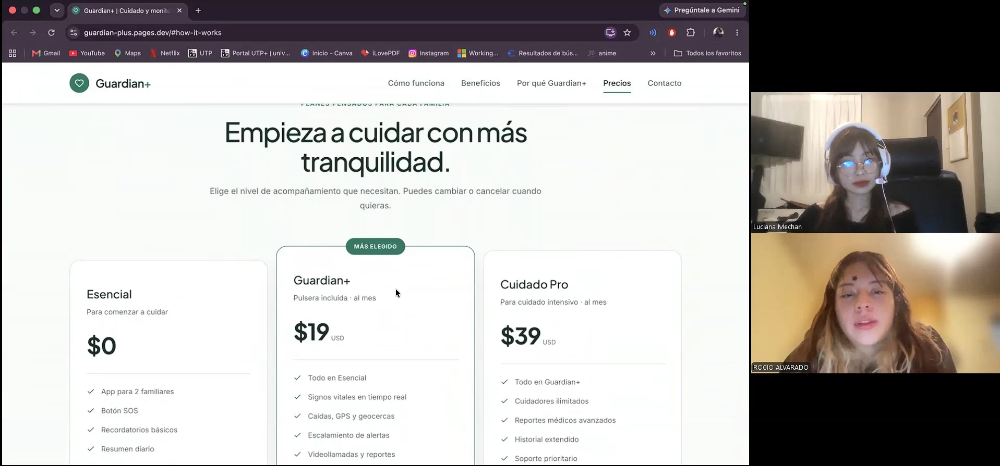

**Análisis de la entrevista:** Rocío Alvarado, familiar de una persona con esquizofrenia, recorrió el Landing Page completo y mostró una comprensión clara de la propuesta de valor de Guardian+. Al leer la pantalla inicial lo describió como una app con pulsera inteligente que acompaña a quienes necesitan cuidados, y calificó la sección "Cómo funciona" como sencilla y fácil de entender, sin dudas en ninguno de sus tres pasos. De las preocupaciones de la sección Pain Points se identificó con la pregunta sobre la medicación, porque su familiar requiere medicación constante y una rutina estable. Coherentemente con ello, valoró del apartado de la pulsera el recordatorio con vibración y la confirmación de la toma con un solo toque, y eligió "Rutinas sin olvidos" como el beneficio más importante, ya que le permite asegurar que se cumplan la medicación y las citas.

Sobre el resto de secciones, indicó que la pantalla de Inicio de la app refleja muy bien la forma en que quiere enterarse del estado de su familiar durante el día, porque muestra lo primordial y le daría más confianza. Respecto a las Zonas Seguras, destacó que le alertarían si su familiar sale de casa, algo relevante por el riesgo de que se pierda o le ocurra algún incidente. También se sintió identificada con el testimonio, pues trabaja y estar informada le da tranquilidad mientras está fuera. Entre los planes, eligió Guardian+ porque incluye la pulsera, cubre lo esencial y se adecúa a su presupuesto. Finalmente, del formulario de contacto esperaría recibir atención de un operador que resuelva sus dudas por teléfono, correo o WhatsApp.

**Entrevistado 2**

**Enlace a la grabación de la entrevista:** [Ver grabación en SharePoint](https://upcedupe-my.sharepoint.com/:v:/g/personal/u20241d185_upc_edu_pe/IQABOx69dgUqQJVteesEI7SjAdyRmsIZdNLA461ekIXLgtg?e=7FNzjH)

La Tabla 4.99 presenta los datos del entrevistado.

<a id="tabla-4-99"></a>**Tabla 4.99.** Datos de la entrevista de validación a Junior Antenor

| Campo | Valor |
|---|---|
| Nombre y apellido | Junior Antenor Ayala |
| Edad | 33 |
| Distrito | San Juan Bautista |

La Figura 4.34 muestra una captura de la entrevista de validación a Junior Antenor.

<a id="figura-4-34"></a>**Figura 4.34.** Captura de la entrevista de validación a Junior Antenor

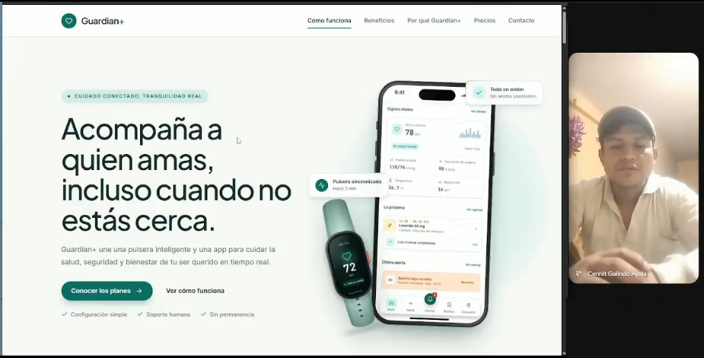

**Análisis de la entrevista:** El entrevistado entiende Guardián+ como una plataforma que utiliza una pulsera inteligente para monitorear la salud, ubicación y seguridad de un familiar, destacando su utilidad para recibir alertas ante situaciones como caídas, problemas de salud o falta de respuesta. Considera especialmente valiosas la geolocalización, las alertas y las opciones de comunicación, ya que le permitirían reaccionar con mayor rapidez ante una emergencia y reducir la preocupación durante el día, incluso mientras trabaja o se encuentra lejos de su familiar. También percibe como útiles funciones como el monitoreo de signos vitales, rutinas y recordatorios de medicamentos, calificando la propuesta como completa. En cuanto a los planes, muestra interés por el plan más avanzado, aunque señala que inicialmente podría comenzar con el de $19 para conocer mejor el funcionamiento de la plataforma. Finalmente, espera que el formulario de contacto presente información breve, directa, clara y sin términos técnicos.


##### Segmento 2: Cuidadores

**Entrevistado 1**

**Enlace a la grabación de la entrevista:** [Ver grabación en SharePoint](https://upcedupe-my.sharepoint.com/:v:/g/personal/u202411310_upc_edu_pe/IQD8oJT2Z8TpSoJBUXSMSMGhAfeo7eDVGKMqM2Pu5ygx8Ys?e=Uh9lJl&nav=eyJyZWZlcnJhbEluZm8iOnsicmVmZXJyYWxBcHAiOiJTdHJlYW1XZWJBcHAiLCJyZWZlcnJhbFZpZXciOiJTaGFyZURpYWxvZy1MaW5rIiwicmVmZXJyYWxBcHBQbGF0Zm9ybSI6IldlYiIsInJlZmVycmFsTW9kZSI6InZpZXcifX0%3D)

La Tabla 4.100 presenta los datos de la entrevistada.

<a id="tabla-4-100"></a>**Tabla 4.100.** Datos de la entrevista de validación a Roxana Paola Diana

| Campo | Valor |
|---|---|
| Nombre y apellido | Roxana Paola Diana |
| Edad | 39 |
| Distrito | Surco |

La Figura 4.35 muestra una captura de la entrevista de validación a Roxana Paola Diana.

<a id="figura-4-35"></a>**Figura 4.35.** Captura de la entrevista de validación a Roxana Paola Diana

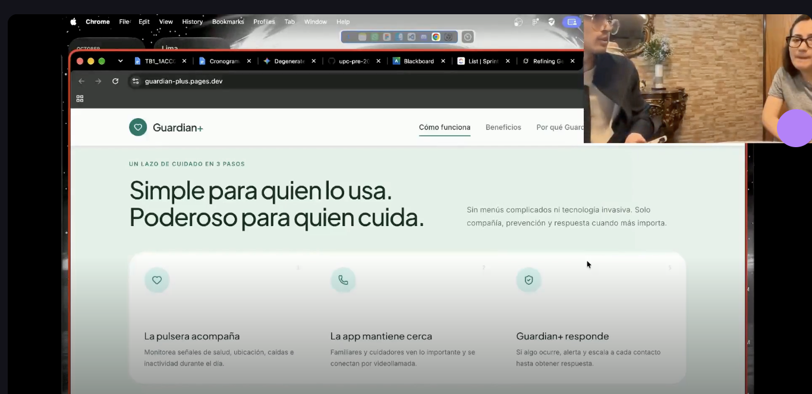

**Análisis de la entrevista:** Roxana Paola Diana recorrió el Landing Page de Guardian+ y validó la mayoría de sus secciones, comprendiendo la propuesta de valor y el funcionamiento del servicio a partir de la pulsera, la aplicación y la respuesta ante emergencias. Desde su experiencia como cuidadora, consideró que la información más relevante del sitio es la detección de caídas, el recordatorio de medicaciones, la detección de signos vitales y el envío de alertas, ya que son los aspectos que más se relacionan con su rutina diaria de cuidado. Como oportunidad de mejora, sugirió hacer el Landing Page más dinámico para captar mejor la atención del visitante durante el recorrido.

**Entrevistado 2**

**Enlace a la grabación de la entrevista:** [Ver grabación en SharePoint](https://upcedupe-my.sharepoint.com/:v:/g/personal/u202319404_upc_edu_pe/IQDoaeLwjz7pRrzg8-g7O6AzAdLOTQcjJpGE6qaMDAqHBEg?nav=eyJyZWZlcnJhbEluZm8iOnsicmVmZXJyYWxBcHAiOiJPbmVEcml2ZUZvckJ1c2luZXNzIiwicmVmZXJyYWxBcHBQbGF0Zm9ybSI6IldlYiIsInJlZmVycmFsTW9kZSI6InZpZXciLCJyZWZlcnJhbFZpZXciOiJNeUZpbGVzTGlua0NvcHkifX0&e=5m6P3a)

La Tabla 4.101 presenta los datos del entrevistado.

<a id="tabla-4-101"></a>**Tabla 4.101.** Datos de la entrevista de validación a Piero Segurda Cardenas

| Campo | Valor |
|---|---|
| Nombre y apellido | Piero Segurda Cardenas |
| Edad | 20 |
| Distrito | Callao |

La Figura 4.36 muestra una captura de la entrevista de validación a Piero Segurda Cardenas.

<a id="figura-4-36"></a>**Figura 4.36.** Captura de la entrevista de validación a Piero Segurda Cardenas

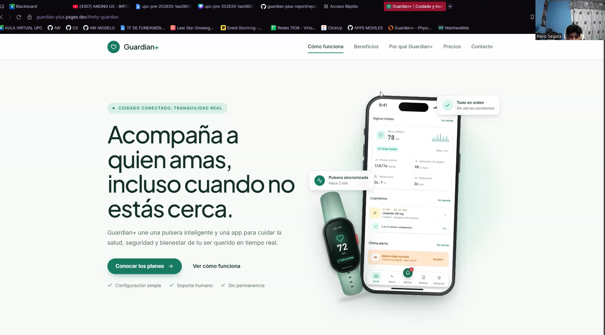

**Análisis de la entrevista:** Piero comprendió que Guardian+ integra una pulsera y una aplicación para centralizar el seguimiento de la salud, la seguridad, las rutinas y las alertas de la persona bajo cuidado. Desde su experiencia como cuidador, destacó principalmente la detección automática de caídas, el botón SOS, la ubicación mediante GPS y el escalamiento de alertas, ya que estas funciones podrían ayudarle a reaccionar con mayor rapidez cuando no se encuentra junto al paciente. También valoró que la aplicación reúna signos vitales, medicación, pendientes y alertas en un solo lugar, lo que facilitaría el seguimiento diario, la entrega de turnos y la coordinación con familiares u otros cuidadores. Como oportunidades de mejora, señaló la necesidad de aclarar quién confirma la atención de una emergencia, diferenciar la confirmación de un recordatorio de la toma real de un medicamento, incorporar pendientes y observaciones del cuidador, y evitar inconsistencias visuales como mostrar notificaciones cuando el estado general indica que el paciente se encuentra bien. Asimismo, consideró útiles las zonas seguras para pacientes con riesgo de desorientación, aunque indicó que permanecer dentro de una zona no garantiza por sí solo su bienestar. Finalmente, manifestó interés por los planes Guardian+ y Cuidado Pro, pero señaló que antes de contratar necesitaría conocer con claridad el costo total, la autonomía y conectividad de la pulsera, la precisión de las mediciones y el procedimiento de respuesta ante emergencias, considerando una demostración del servicio como un elemento importante para generar confianza.

**Entrevistado 3**

**Enlace a la grabación de la entrevista:** [Ver grabación en SharePoint](https://upcedupe-my.sharepoint.com/:v:/g/personal/u20241d185_upc_edu_pe/IQB7Nk6PrMXqS5-kBKUcezySARYOt3pUCZya8d1mWq2jZBE?e=0Sqbtb)

La Tabla 4.102 presenta los datos de la entrevistada.

<a id="tabla-4-102"></a>**Tabla 4.102.** Datos de la entrevista de validación a Gabriela Cuadros

| Campo | Valor |
|---|---|
| Nombre y apellido | Gabriela Cuadros Curihuaman |
| Edad | 21 |
| Distrito | Santa Anita |

La Figura 4.37 muestra una captura de la entrevista de validación a Gabriela Cuadros.

<a id="figura-4-37"></a>**Figura 4.37.** Captura de la entrevista de validación a Gabriela Cuadros

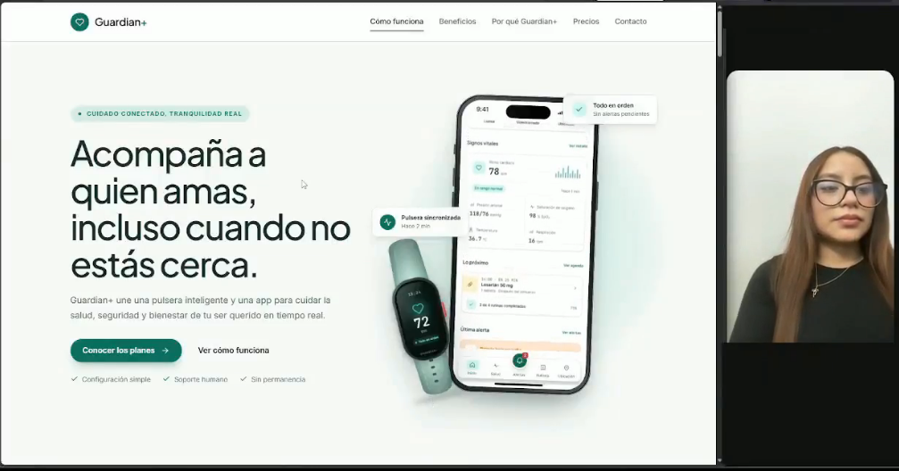

**Análisis de la entrevista:**  Gabriela entiende Guardián+ como una herramienta integral que combina una pulsera inteligente para monitorear la salud y seguridad del paciente, recibir alertas y mantener conectado al círculo de cuidado. Considera que el principal riesgo que monitorea diariamente son las caídas, especialmente cuando no tiene al paciente a la vista, y valora funciones como el botón SOS, la detección de caídas y las alertas automáticas, ya que reducirían su esfuerzo y la necesidad de supervisión constante. También encuentra útil un dashboard que concentre signos vitales, recordatorios, alertas y cambios importantes, siempre que la información sea clara y no esté saturada. Las zonas seguras y la geolocalización le permitirían reducir el monitoreo continuo, mientras que destaca como diferencial la integración de seguridad, salud, rutinas y comunicación, junto con un sistema de escalamiento de alertas. Para un paciente con necesidades intensivas recomendaría el plan Cuidado Pro, por sus cuidados ilimitados, reportes avanzados, historial extendido y soporte prioritario. Finalmente, espera que el formulario de contacto proporcione una comparación clara de planes, precios y funciones, además de información sobre la pulsera, configuración de alertas y privacidad de datos.

#### Aplicación móvil — Sprint 2

A continuación se presenta el registro de la entrevista de validación de la aplicación móvil.

**Entrevistado 1**

**Enlace a la grabación de la entrevista:** [Ver grabación en YouTube](https://youtu.be/X1aPOoKQ9yE)

La Tabla 4.103 presenta los datos de la entrevistada.

<a id="tabla-4-103"></a>**Tabla 4.103.** Datos de la entrevista de validación de la aplicación móvil a Lucía Infante

| Campo | Valor |
|---|---|
| Nombre y apellido | Lucía Infante |
| Edad | 27 |
| Distrito | Santiago de Surco |
| Segmento | Familiares |

La Figura 4.38 muestra una captura de la entrevista de validación de la aplicación móvil a Lucía Infante.

<a id="figura-4-38"></a>**Figura 4.38.** Captura de la entrevista de validación de la aplicación móvil a Lucía Infante

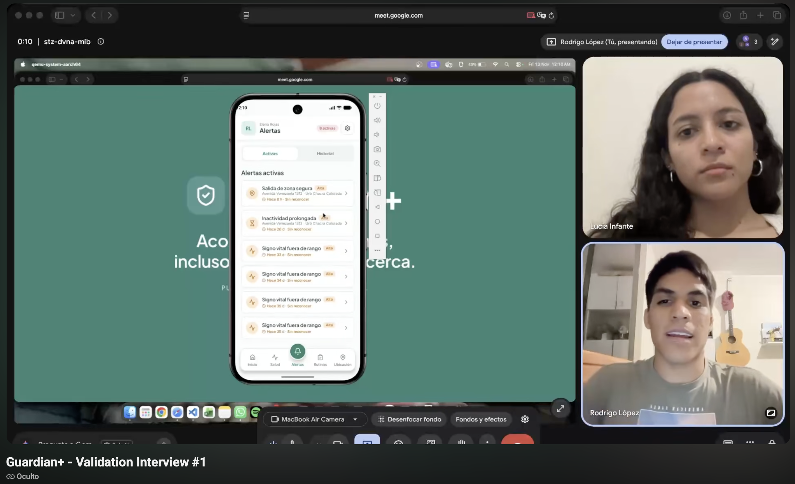

**Análisis de la entrevista:** Lucía Infante, que cuida a su padre adulto mayor, vio el video de presentación del producto y recorrió la aplicación móvil. Describió el diseño como intuitivo y atractivo: destacó que los signos vitales se ven con claridad, que los colores van con la temática de la aplicación, que la barra de navegación inferior es fácil de ubicar y que las alertas aparezcan resaltadas, por la importancia que tienen para el usuario. En la pestaña Salud indicó que revisaría primero la frecuencia cardíaca, seguida de la saturación de oxígeno y la presión arterial, y propuso que un valor alterado se distinga en rojo o naranja y genere una alerta para el cuidador, que es como la aplicación ya señala los valores fuera de rango con su etiqueta y su color.

Ante una alerta de caída, esperaría que el detalle muestre los signos vitales registrados en ese momento para saber cómo se encuentra la persona, y que la alerta le llegue a su celular. De la sección Rutinas valoró principalmente el registro de la medicación, para confirmar si su familiar tomó cada pastilla y a qué hora, y el de las citas médicas, para que ninguna se pase; también consideró útiles la actividad, la hidratación y el sueño para conocer el bienestar general de la persona. Usaría la ubicación y las zonas seguras cuando su familiar se queda solo en casa mientras ella trabaja. En su valoración general consideró la aplicación interesante y bastante completa, porque reúne en un solo lugar lo necesario para estar pendiente de su familiar, de sus indicadores y de su actividad del día. No identificó puntos de mejora durante la sesión y comentó que podrían surgir con el uso diario de la aplicación.

### 4.3.3. Evaluaciones según heurísticas

La evaluación heurística se realizó sobre el prototipo de alta fidelidad de la aplicación móvil, considerando principios de usabilidad, diseño inclusivo y arquitectura de información. A continuación se presentan su alcance, las tareas evaluadas y los problemas encontrados con su severidad y recomendación.

#### UX Heuristics & Principles Evaluation
**Usability - Inclusive Design - Information Architecture**

La Tabla 4.104 presenta los datos generales de la evaluación.

<a id="tabla-4-104"></a>**Tabla 4.104.** Datos generales de la evaluación heurística

| | |
|---|---|
| **CARRERA** | Ingeniería de Software |
| **CURSO** | 1ACC0238 Aplicaciones para dispositivos móviles |
| **NRC** | 13980 |
| **PROFESORES** | Todos |
| **AUDITOR** | Healthify |
| **CLIENTE(S)** | Azama Fukuda, Juan Pablo, Mechan Montenegro, Luciana Carolina,Luis Miranda, Diego Andres, López Monroy, Rodrigo Alfredo, Sanchez Cuadrado, Juan Antonio |

**SITE o APP A EVALUAR:** Guardian+ (prototipo de alta fidelidad — módulos de Salud, Alertas, Rutinas y Ubicación)

**TAREAS A EVALUAR:**

El alcance de esta evaluación incluye la revisión de la usabilidad de las siguientes tareas:

1. Programar un nuevo recordatorio de medicación, cita médica o actividad (Care Routines & Wellness)
2. Consultar el historial de signos vitales y aplicar filtros de búsqueda (Health Monitoring)
3. Exportar el expediente de signos vitales seleccionando un periodo de tiempo (Health Monitoring)
4. Agregar, editar y reordenar contactos de emergencia (Emergency & Alerting)

No están incluidas en esta versión de la evaluación las siguientes tareas:

1. Gestión de planes de suscripción y pagos
2. Configuración de cuenta e IAM (inicio de sesión, recuperación de contraseña)
3. Ubicación en tiempo real, zonas seguras y videollamada
4. Flujo de onboarding inicial del wearable

**ESCALA DE SEVERIDAD:**

La Tabla 4.105 define la escala de severidad utilizada.

<a id="tabla-4-105"></a>**Tabla 4.105.** Escala de severidad de la evaluación heurística

| Nivel | Descripción |
|---|---|
| 1 | Problema superficial: Puede ser fácilmente superado por el usuario y ocurre con muy poca frecuencia. No necesita ser arreglado a no ser que exista disponibilidad de tiempo. |
| 2 | Problema menor: Puede ocurrir un poco más frecuentemente o es un poco más difícil de superar para el usuario. Se le debería asignar una prioridad baja para resolverlo de cara al siguiente release. |
| 3 | Problema mayor: Ocurre frecuentemente o los usuarios no son capaces de resolverlos. Es importante que sean corregidos y se les debe asignar una prioridad alta. |
| 4 | Problema muy grave: Un error de gran impacto que impide al usuario continuar con el uso de la herramienta. Es imperativo que sea corregido antes del lanzamiento. |


**TABLA RESUMEN:**

La Tabla 4.106 resume los problemas encontrados.

<a id="tabla-4-106"></a>**Tabla 4.106.** Resumen de problemas de la evaluación heurística

| # | Problema | Escala de severidad | Heurística/Principio violada(o) |
|---|---|---|---|
| 1 | Los campos de fecha/hora en "Nueva toma", "Nueva cita" y "Nueva actividad" se muestran vacíos, sin placeholder ni formato de referencia (ej. HH:MM) | 2 | Usability: Prevención de errores |
| 2 | El reordenamiento de contactos de emergencia solo puede hacerse mediante gesto de "mantener presionado y arrastrar", sin alternativa accesible (botones subir/bajar) | 3 | Inclusive Design: Proporciona experiencias comparables |
| 3 | Las opciones del panel "Buscar y filtrar" se muestran como filas de texto plano, sin checkbox ni indicador visual de selección, pese a ser una selección múltiple con contador ("Aplicar · 0") | 2 | Usability: Reconocimiento antes que recuerdo |
| 4 | En "Exportar expediente", las opciones de periodo se listan en orden "Últimos 30 días" → "Últimos 7 días", invirtiendo la progresión lógica de menor a mayor duración | 1 | Information Architecture: Organization Systems |
| 5 | El gráfico de "Sueño" usa tonos de verde muy similares entre sí (Profundo/Ligero) junto con un tono naranja (Despierta) para diferenciar tres estados, sin patrón o textura adicional | 2 | Inclusive Design: Proporciona experiencias comparables |


**PROBLEMA #1: Campos de fecha/hora sin placeholder ni formato de referencia**

**Severidad:** 2
**Heurística violada:** Usability - Prevención de errores

**Problema:**
En las pantallas "Nueva toma", "Nueva cita" y "Nueva actividad" del módulo de Rutinas, los campos "Hora de la toma", "Fecha"/"Hora" y "Hora del aviso" se muestran como recuadros completamente vacíos, sin placeholder (ej. "14:00" o "HH:MM") ni un ícono de reloj/calendario que indique que son selectores. Esto contrasta con el formulario "Nuevo contacto de emergencia" del módulo de Alertas, que sí incluye placeholders claros (ej. "Ej. Carlos Rojas", "999 999 999"), evidenciando además una inconsistencia de patrones entre bounded contexts.

Las Figuras 4.39 a 4.41 muestran las pantallas Nueva toma, Nueva cita y Nueva actividad.

<a id="figura-4-39"></a>**Figura 4.39.** Pantalla Nueva toma del módulo de Rutinas

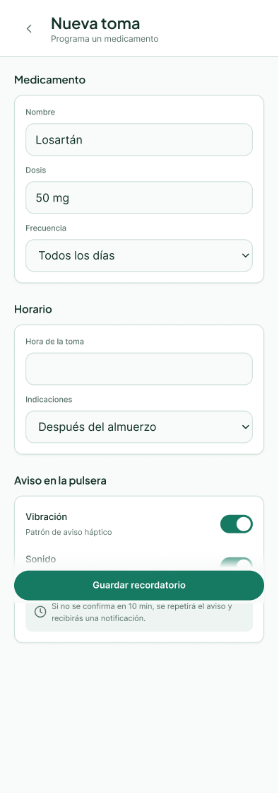

<a id="figura-4-40"></a>**Figura 4.40.** Pantalla Nueva cita del módulo de Rutinas

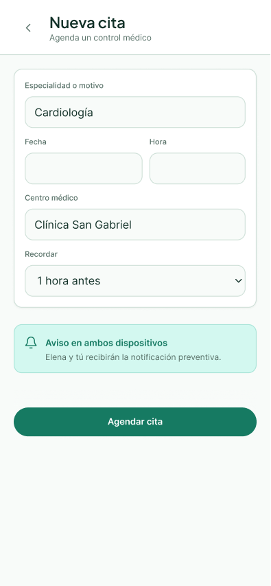

<a id="figura-4-41"></a>**Figura 4.41.** Pantalla Nueva actividad del módulo de Rutinas

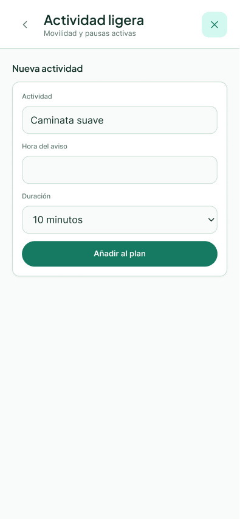

**Recomendación:**
Agregar placeholders con el formato esperado y un ícono reconocible de reloj/calendario en todos los campos de fecha/hora, replicando el estándar de placeholders ya usado en el módulo de contactos de emergencia.

---
**PROBLEMA #2: Reordenamiento de contactos de emergencia sin alternativa accesible al gesto de arrastre**

**Severidad:** 3
**Heurística violada:** Inclusive Design - Proporciona experiencias comparables

**Problema:**
En "Contactos de emergencia", el único mecanismo para cambiar la prioridad de un contacto es "Mantén presionado y arrastra", un gesto que puede ser difícil de ejecutar con precisión para usuarios con limitaciones motrices o destreza reducida —un perfil de usuario especialmente relevante considerando que muchos cuidadores y familiares de Guardian+ son personas de edad avanzada. No se ofrece una alternativa como botones de subir/bajar o un menú de "mover a posición". La Figura 4.42 muestra la pantalla Contactos de emergencia.

<a id="figura-4-42"></a>**Figura 4.42.** Pantalla Contactos de emergencia

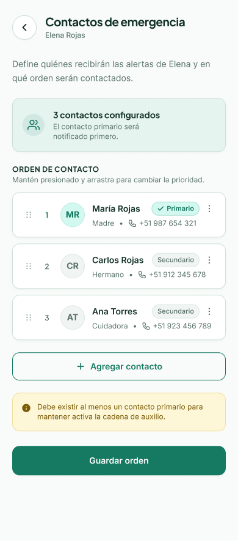

**Recomendación:**
Agregar una alternativa accesible al drag-and-drop, como botones de flecha arriba/abajo en el menú de tres puntos de cada contacto, o una opción "Cambiar prioridad" dentro de "Editar contacto".

---

**PROBLEMA #3: Opciones de filtro sin indicador visual de selección**

**Severidad:** 2
**Heurística violada:** Usability - Reconocimiento antes que recuerdo

**Problema:**
En el panel "Buscar y filtrar" del módulo Salud, las opciones (Ritmo cardíaco, Presión arterial, Día, Semana, etc.) se muestran como filas de texto plano, sin checkbox, radio button ni ningún indicador visual de selección. Sin embargo, el botón inferior "Aplicar · 0" confirma que se trata de una selección múltiple con conteo. El usuario no puede reconocer a simple vista qué opciones están disponibles para seleccionar ni cuáles ya eligió. La Figura 4.43 muestra el panel Buscar y filtrar del módulo de Salud.

<a id="figura-4-43"></a>**Figura 4.43.** Panel Buscar y filtrar del módulo de Salud

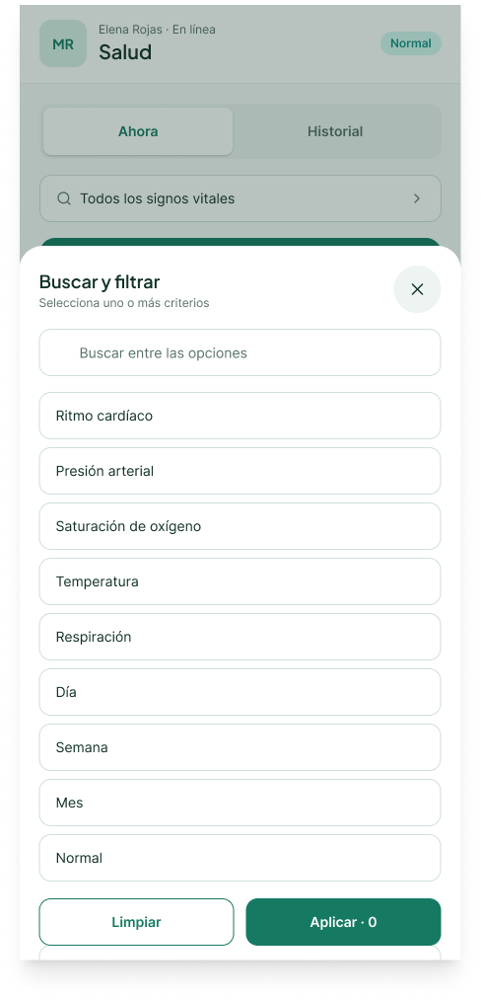

**Recomendación:**
Agregar checkboxes o un estado visual claro (cambio de fondo/borde) a cada fila seleccionada, de forma que el usuario pueda reconocer su selección sin necesidad de recordarla.

---

**PROBLEMA #4: Orden no intuitivo de las opciones de periodo**

**Severidad:** 1
**Heurística violada:** Information Architecture - Organization Systems

**Problema:**
En "Exportar expediente", las opciones de periodo se presentan en el orden "Últimos 30 días" → "Últimos 7 días" → "Personalizado", invirtiendo la progresión lógica esperada de menor a mayor duración (7 días antes que 30 días), lo que puede dificultar que el usuario escanee rápidamente la opción que busca. La Figura 4.44 muestra la pantalla Exportar expediente.

<a id="figura-4-44"></a>**Figura 4.44.** Pantalla Exportar expediente

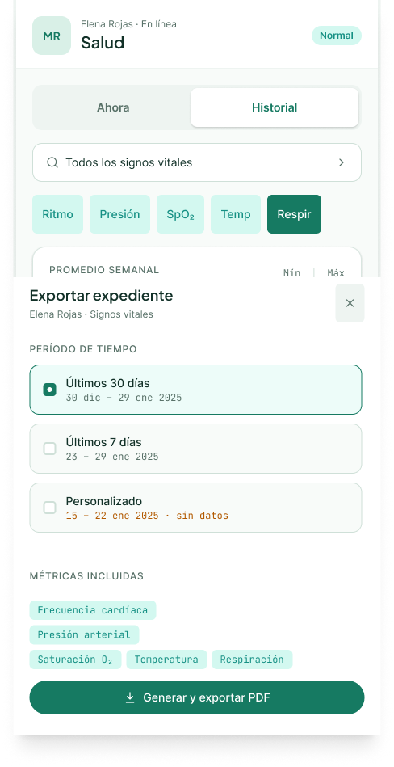

**Recomendación:**
Reordenar las opciones de forma ascendente: "Últimos 7 días", "Últimos 30 días", "Personalizado".

---

**PROBLEMA #5: Diferenciación de estados de sueño basada en tonos de color muy similares**

**Severidad:** 2
**Heurística violada:** Inclusive Design - Proporciona experiencias comparables

**Problema:**
En la pantalla "Sueño", el gráfico de barras distingue tres estados (Profundo, Ligero, Despierta) usando dos tonos de verde muy cercanos entre sí y un tono naranja, sin ningún patrón, textura o forma adicional que refuerce la diferencia. Para personas con daltonismo (especialmente deuteranopia, la forma más común), distinguir entre los dos tonos de verde puede ser difícil, dejándolos sin una forma confiable de leer el gráfico. La Figura 4.45 muestra la pantalla Sueño del módulo de Rutinas.

<a id="figura-4-45"></a>**Figura 4.45.** Pantalla Sueño del módulo de Rutinas

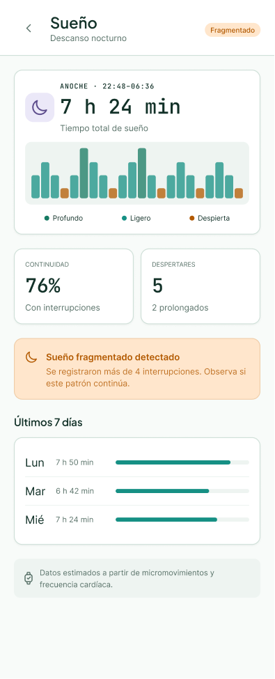

**Recomendación:**
Usar colores con mayor contraste entre sí (ej. verde oscuro, celeste y naranja) o agregar un patrón/textura distinto a cada barra además del color, siguiendo WCAG 1.4.1 (no depender únicamente del color para transmitir información).

## 4.4. Video About-the-Product

El video About-the-Product presenta Guardian+ en poco más de un minuto. Parte del problema que motiva el producto, las caídas de los adultos mayores, y muestra la pulsera y la aplicación móvil con cuatro de sus funcionalidades principales: los signos vitales en tiempo real, el aviso al siguiente contacto cuando nadie responde a una caída, los avisos de salida y regreso a la zona segura y la confirmación de cada toma de medicación. Cierra con el testimonio de una familiar entrevistada durante la validación de la aplicación móvil (sección 4.3.2). La Figura 4.46 muestra una captura del video.

<a id="figura-4-46"></a>**Figura 4.46.** Video About-the-Product de Guardian+

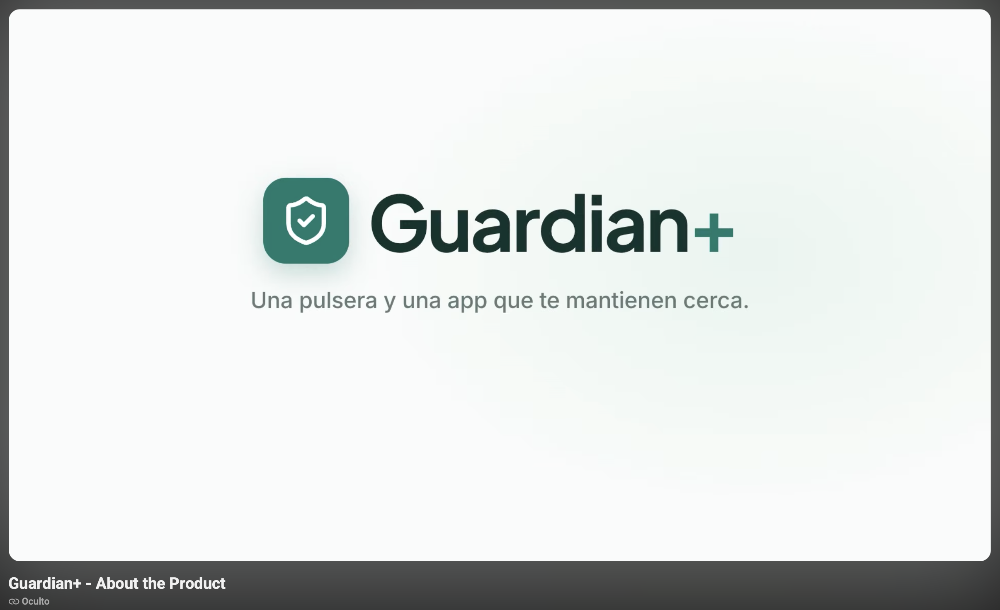

La Tabla 4.107 presenta el enlace al video.

<a id="tabla-4-107"></a>**Tabla 4.107.** Video About-the-Product

| Recurso | Enlace |
|---|---|
| Video About-the-Product | [Guardian+ — About the Product](https://youtu.be/zI62F7bp0og) |
